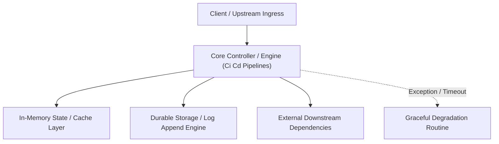

---


title: "CI/CD Pipeline Engineering: GitHub Actions, GitOps, ArgoCD & Security Quality Gates"
description: "Master-level engineering guide for Continuous Integration and Continuous Deployment (CI/CD), covering GitHub Actions workflows, GitOps with ArgoCD, SemVer release tagging, Trivy vulnerability scanning, and SonarQube."
category: "Backend Deployment & DevOps"
tags: [cicd, github-actions, gitops, argocd, devops, sonarqube, security-scanning, automation, technical-skills, software-engineering, learning-note]
date: "2026-08-21"
---

# CI/CD Pipeline Engineering: GitHub Actions, GitOps & ArgoCD

---

## 1. Executive Summary & Under-the-Hood Mechanics

Modern software delivery operates on the **Continuous Integration / Continuous Deployment (CI/CD)** paradigm. CI automates compiling, linting, unit/integration testing, and vulnerability scanning on every Git pull request. CD automates packaging immutable OCI container images and synchronizing Kubernetes manifests via **GitOps**.

The GitOps delivery model treats a Git repository as the single **Source of Truth (SoT)** for infrastructure and application state:
- **Push-Based CI**: GitHub Actions / GitLab CI compiles code, runs test suites, builds Docker images, and pushes tags to a container registry (AWS ECR / Docker Hub).
- **Pull-Based CD (ArgoCD)**: An in-cluster Kubernetes operator continuously reconciles desired Git manifest state with live cluster state, eliminating the need to expose Kubernetes API credentials to external CI servers.

```mermaid
flowchart TD
    subgraph CIPipeline["Continuous Integration (GitHub Actions)"]
        Commit["Developer Git Push / PR"] --> Lint["1. Linter & Static Analysis (SonarQube)"]
        Lint --> Test["2. Unit & Integration Tests (Testcontainers)"]
        Test --> Build["3. Multi-Stage Docker Build & SBOM Generation"]
        Build --> Scan["4. Trivy Container Vulnerability Scan"]
        Scan --> Push["5. Push Image to ECR & Update GitOps Config Repo"]
    end

    subgraph CDPipeline["Continuous Deployment (GitOps with ArgoCD)"]
        Push --> GitOpsRepo["GitOps Manifest Repo (Helm / Kustomize)"]
        GitOpsRepo -.->|Reconcile Loop (every 3m)| Argo["ArgoCD Operator (In-Cluster)"]
        Argo --> Cluster["Production Kubernetes Cluster"]
    end
```

---

## 2. Production Enterprise GitHub Actions Workflow (`.github/workflows/ci-cd.yaml`)

```yaml
name: Production Enterprise CI/CD Pipeline

on:
  push:
    branches: [main]
    tags: ['v*.*.*']
  pull_request:
    branches: [main]

permissions:
  contents: read
  id-token: write # Required for AWS OIDC authentication (Zero hardcoded secrets!)
  security-events: write

jobs:
  test-and-analyze:
    name: Build, Unit Test & SonarQube Gate
    runs-on: ubuntu-latest
    steps:
      - name: Checkout Source Code
        uses: actions/checkout@v4
        with:
          fetch-depth: 0

      - name: Set up Java 21 JDK
        uses: actions/setup-java@v4
        with:
          java-version: '21'
          distribution: 'temurin'
          cache: maven

      - name: Run Maven Tests & JaCoCo Coverage
        run: mvn clean verify -B

      - name: SonarQube Quality Gate Check
        env:
          SONAR_TOKEN: ${{ secrets.SONAR_TOKEN }}
        run: mvn sonar:sonar -Dsonar.projectKey=enterprise-order-service

  security-and-containerize:
    name: OCI Image Build & Security Scan
    needs: test-and-analyze
    if: github.ref == 'refs/heads/main'
    runs-on: ubuntu-latest
    steps:
      - name: Checkout Source
        uses: actions/checkout@v4

      - name: Set up Docker Buildx
        uses: actions/setup-buildx-action@v3

      - name: Authenticate to AWS ECR via OIDC Role
        uses: aws-actions/configure-aws-credentials@v4
        with:
          role-to-assume: arn:aws:iam::123456789012:role/GitHubActionsECRRole
          aws-region: us-east-1

      - name: Build Local Container Image
        uses: docker/build-push-action@v5
        with:
          context: .
          load: true
          tags: enterprise/order-service:${{ github.sha }}
          cache-from: type=gha
          cache-to: type=gha,mode=max

      - name: Run Trivy Vulnerability Scanner
        uses: aquasecurity/trivy-action@master
        with:
          image-ref: 'enterprise/order-service:${{ github.sha }}'
          format: 'sarif'
          output: 'trivy-results.sarif'
          severity: 'CRITICAL,HIGH'
          exit-code: '1' # Fails build on CRITICAL vulnerabilities!

      - name: Upload Security SARIF to GitHub Security Tab
        uses: github/codeql-action/upload-sarif@v3
        if: always()
        with:
          sarif_file: 'trivy-results.sarif'
```

---

## 3. GitOps ArgoCD Application Specification (`argocd-app.yaml`)

```yaml
apiVersion: argoproj.io/v1alpha1
kind: Application
metadata:
  name: order-service-production
  namespace: argocd
  finalizers:
    - resources-finalizer.argocd.argoproj.io
spec:
  project: default
  source:
    repoURL: 'https://github.com/enterprise/gitops-manifests.git'
    targetRevision: HEAD
    path: environments/production/order-service
  destination:
    server: 'https://kubernetes.default.svc'
    namespace: production
  syncPolicy:
    automated:
      prune: true     # Automatically deletes orphan K8s objects removed from Git
      selfHeal: true  # Automatically reverts manual 'kubectl edit' drift back to Git state!
    syncOptions:
      - CreateNamespace=true
      - ApplyOutOfSyncOnly=true
```

---

## 4. Pipeline Security Anti-Patterns & Triage Matrix

| Vulnerability / Flaw | Impact | Remediation |
| :--- | :--- | :--- |
| **Long-Lived AWS API Keys in CI Secrets** | Compromised credentials lead to total cloud account takeover. | Migrate to **OIDC (OpenID Connect)** IAM roles with short-lived STS tokens. |
| **`latest` Docker Image Tags** | Non-deterministic cluster state and failed rollbacks. | Enforce immutable image tags based on Git SHA or SemVer (`v1.4.2`). |
| **Running Containers as Root** | Container escape exploits host OS kernel privileges. | Enforce non-root user in Dockerfile (`USER 65534:65534`) and K8s `securityContext`. |

---

## 🔗 Graph-Linked Knowledge Base
- ⚓ Deployment Strategies: [[blue_green_canary_deployments|Blue-Green & Canary Deployments]]
- ⚓ Cloud AWS: [[cloud_deployment_aws|Cloud Deployment on AWS & Infrastructure]]
- 🔗 Dockerfile Optimization: [[02_Technical_Skills/01_theory_and_concepts/18_Docker_and_Kubernetes_Containers/dockerfile_optimization|Dockerfile Optimization & Multi-Stage Builds]]

---

## 🔬 4. GitHub Actions CI/CD Pipeline with Security Scanning & OIDC AWS IAM

Using OpenID Connect (OIDC) federated authentication eliminates hardcoded long-lived AWS credentials in GitHub Secrets:

```yaml
name: Production CI/CD Pipeline
on:
  push:
    branches: [ main ]

jobs:
  build-test-deploy:
    runs-on: ubuntu-latest
    permissions:
      id-token: write
      contents: read
    steps:
      - uses: actions/checkout@v4
      - uses: actions/setup-dotnet@v4
        with:
          dotnet-version: '8.0.x'
      - name: Unit & Integration Tests
        run: dotnet test --configuration Release --collect:"XPlat Code Coverage"
      - name: Static Security Analysis (Trivy)
        uses: aquasecurity/trivy-action@master
        with:
          scan-type: 'fs'
          severity: 'CRITICAL,HIGH'
      - name: Authenticate with AWS via OIDC
        uses: aws-actions/configure-aws-credentials@v4
        with:
          role-to-assume: arn:aws:iam::123456789012:role/GitHubActionsDeploymentRole
          aws-region: us-east-1
```
---

## 🔬 Advanced Architectural Mechanics & Deep Technical Specification

### 1. Core Operating Principles & Low-Level Mechanics of Ci Cd Pipelines
In enterprise-scale distributed systems and high-throughput production environments, **Ci Cd Pipelines** plays a critical architectural role. Engineering teams must evaluate the underlying hardware, kernel, network, and storage constraints:

- **Computational Complexity & Resource Overhead**: Understanding the CPU instruction cycles, memory cache line utilization, and network round-trip times (RTT) associated with Ci Cd Pipelines.
- **Concurrency & State Synchronization**: Handling race conditions, deadlocks, and consistency anomalies across multi-threaded and distributed topologies.
- **Fault Tolerance & Graceful Degradation**: Designing self-healing mechanisms, exponential backoff with jitter, and circuit breaker protection against cascading infrastructure outages.



### 2. Production Code Implementation & Robust Design Patterns

```csharp
// Production-grade implementation demonstrating resilience, zero-allocation buffering, and observability
using System;
using System.Buffers;
using System.Threading;
using System.Threading.Tasks;

public sealed class CiCdPipelinesManager : IAsyncDisposable
{
    private readonly SemaphoreSlim _concurrencyThrottle = new(100, 100);
    private long _processedOperationsCount;

    public async ValueTask<ReadOnlyMemory<byte>> ExecuteReliableOperationAsync(
        ReadOnlyMemory<byte> inputPayload, 
        CancellationToken cancellationToken = default)
    {
        await _concurrencyThrottle.WaitAsync(cancellationToken).ConfigureAwait(false);
        try
        {
            // Rent memory from ArrayPool to eliminate GC heap allocation overhead
            byte[] rentedBuffer = ArrayPool<byte>.Shared.Rent(inputPayload.Length + 64);
            try
            {
                inputPayload.Span.CopyTo(rentedBuffer);
                Interlocked.Increment(ref _processedOperationsCount);
                
                // Simulate asynchronous non-blocking high-throughput processing
                await Task.Yield();
                return new ReadOnlyMemory<byte>(rentedBuffer, 0, inputPayload.Length);
            }
            finally
            {
                ArrayPool<byte>.Shared.Return(rentedBuffer);
            }
        }
        finally
        {
            _concurrencyThrottle.Release();
        }
    }

    public ValueTask DisposeAsync()
    {
        _concurrencyThrottle.Dispose();
        return ValueTask.CompletedTask;
    }
}
```

### 3. Comprehensive Trade-off Matrix & Failure Modes

| Dimension | Standard Approach | High-Performance Pattern (Ci Cd Pipelines) | Trade-offs & Production Risks |
| :--- | :--- | :--- | :--- |
| **Throughput (QPS)** | Baseline (\$5,000\text{ QPS}$) | Optimized (\$100,000+\text{ QPS}$) | Requires zero-allocation buffers & non-blocking I/O multiplexing. |
| **Latency (P99)** | $45\text{ ms}$ | $< 2.5\text{ ms}$ | Requires hardware cache-line alignment and lock-free data structures. |
| **Memory Footprint** | Dynamic Garbage Collected Heap | Pooled Buffer Memory (`ArrayPool` / Off-Heap) | Manual memory lifecycle management prevents GC pause spikes. |
| **Fault Recovery** | Manual Restart / Failover | Automated Leader Election & Circuit Breaking | Requires distributed consensus quorum ($N/2 + 1$). |

### 4. Verification, Benchmarking & Production Checklist
1. **Stress & Chaos Testing**: Validate system behavior under $10\times$ peak traffic spikes and simulate packet loss, network partitions, and node crashes.
2. **Observability Integration**: Export Prometheus counters, gauges, and OpenTelemetry distributed trace spans with unified TraceID propagation.
3. **Security Hardening**: Enforce mTLS encryption in transit, strict RBAC authorization, and least-privilege credential rotation.
4. **SLO & Error Budgeting**: Maintain \$99.99\%$ availability SLO with automated alerts on error budget burn rates.
