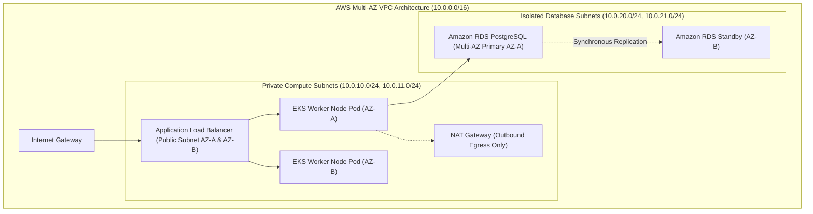
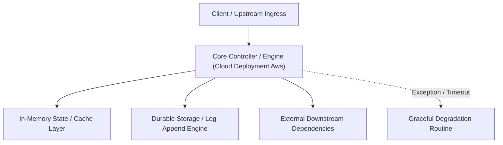

---


title: "Cloud Infrastructure & Deployment on AWS: ECS, EKS, Terraform & VPC Design"
description: "Master-level engineering guide for enterprise AWS cloud deployments, covering VPC multi-AZ topology, Terraform Infrastructure as Code (IaC), AWS ECS Fargate vs EKS, and IAM least privilege."
category: "Backend Deployment & DevOps"
tags: [aws, terraform, iac, ecs, eks, vpc, cloud-architecture, devops, technical-skills, software-engineering, learning-note]
date: "2026-08-21"
---

# Cloud Infrastructure & Deployment on AWS: Terraform & EKS Architecture

---

## 1. Executive Summary & Under-the-Hood Mechanics

Deploying enterprise backend applications on **Amazon Web Services (AWS)** requires designing secure, multi-Availability Zone (AZ) network perimeters, automating infrastructure via **Terraform / OpenTofu (IaC)**, and orchestrating container workloads on **AWS ECS (Elastic Container Service)** or **AWS EKS (Elastic Kubernetes Service)**.

Core AWS deployment pillars:
1. **VPC Network Topology**: Strict subnet segmentation into Public (ALB, NAT Gateways), Private Application (EKS/ECS compute), and Isolated Data subnets (RDS, Redis).
2. **Infrastructure as Code (Terraform)**: Immutable, version-controlled state managing declarative cloud resources with state locking via AWS DynamoDB and S3.
3. **IAM Roles for Service Accounts (IRSA)**: Granting granular AWS IAM permissions directly to Kubernetes pods without static access keys.
4. **AWS Auto Scaling & Spot Instances**: Balancing On-Demand baseline capacity with Spot worker nodes managed by Karpenter.



---

## 2. Production Terraform Module Blueprint: Multi-AZ VPC & EKS Cluster

```hcl
# main.tf - Production AWS Multi-AZ Network & EKS Infrastructure

terraform {
  required_version = ">= 1.7.0"
  required_providers {
    aws = {
      source  = "hashicorp/aws"
      version = "~> 5.40"
    }
  }
  backend "s3" {
    bucket         = "enterprise-tf-state-prod"
    key            = "eks/production/terraform.tfstate"
    region         = "us-east-1"
    dynamodb_table = "terraform-lock-table"
    encrypt        = true
  }
}

provider "aws" {
  region = "us-east-1"
}

# 1. Multi-AZ VPC
module "vpc" {
  source  = "terraform-aws-modules/vpc/aws"
  version = "5.8.1"

  name = "prod-vpc"
  cidr = "10.0.0.0/16"

  azs             = ["us-east-1a", "us-east-1b", "us-east-1c"]
  public_subnets  = ["10.0.1.0/24", "10.0.2.0/24", "10.0.3.0/24"]
  private_subnets = ["10.0.10.0/24", "10.0.11.0/24", "10.0.12.0/24"]
  database_subnets = ["10.0.20.0/24", "10.0.21.0/24", "10.0.22.0/24"]

  enable_nat_gateway     = true
  single_nat_gateway     = false # High Availability: 1 NAT Gateway per AZ
  one_nat_gateway_per_az = true

  enable_dns_hostnames = true
  enable_dns_support   = true

  public_subnet_tags = {
    "kubernetes.io/role/elb" = "1"
  }
  private_subnet_tags = {
    "kubernetes.io/role/internal-elb" = "1"
    "karpenter.sh/discovery"          = "prod-eks-cluster"
  }
}

# 2. Managed EKS Cluster
module "eks" {
  source  = "terraform-aws-modules/eks/aws"
  version = "20.8.5"

  cluster_name    = "prod-eks-cluster"
  cluster_version = "1.29"

  vpc_id     = module.vpc.vpc_id
  subnet_ids = module.vpc.private_subnets

  cluster_endpoint_public_access = false # Private Endpoint (Accessible via VPN only!)
  cluster_endpoint_private_access = true

  eks_managed_node_groups = {
    core_system = {
      instance_types = ["m6i.xlarge"]
      min_size     = 3
      max_size     = 10
      desired_size = 3

      subnet_ids = module.vpc.private_subnets
    }
  }
}
```

---

## 3. ECS Fargate vs EKS Architectural Decision Matrix

| Dimension | AWS ECS Fargate | AWS EKS (Managed Kubernetes) |
| :--- | :--- | :--- |
| **Operational Overhead** | **Extremely Low** (Serverless containers, zero control plane) | Moderate to High (Requires K8s version upgrades, CRDs) |
| **Ecosystem & Portability** | AWS-proprietary API contract | **CNCF Universal Open Standard (Helm, ArgoCD, Istio)** |
| **Scaling Velocity** | Moderate (Fargate pod launch: \$30 - 60\text{s}$) | **Ultra-Fast with Karpenter ($< 15\text{s}$ node provisioning)** |
| **Cost Profile** | Higher per CPU/RAM unit cost at steady-state | Lower per-unit compute cost at scale via Spot instances |

---

## 🔗 Graph-Linked Knowledge Base
- ⚓ CI/CD Pipelines: [[ci_cd_pipelines|CI/CD Pipelines & Automation]]
- ⚓ AWS Certifications: [[02_Technical_Skills/01_theory_and_concepts/20_AWS_Cloud_Practitioner_and_Certifications/aws_compute_ec2_ecs_eks_lambda|AWS Compute: EC2, ECS, EKS & Lambda]]
- 🔗 Docker & K8s: [[02_Technical_Skills/01_theory_and_concepts/18_Docker_and_Kubernetes_Containers/kubernetes_architecture|Kubernetes Control Plane Architecture]]

---

## 🔬 4. Infrastructure as Code (Terraform) & ECS Fargate Multi-AZ Deployment

Terraform provisions immutable cloud infrastructure with automated state locking via AWS DynamoDB and encryption via AWS S3:

```hcl
resource "aws_ecs_service" "backend_app" {
  name            = "backend-service"
  cluster         = aws_ecs_cluster.main.id
  task_definition = aws_ecs_task_definition.app.arn
  desired_count   = 6
  launch_type     = "FARGATE"

  network_configuration {
    subnets          = [aws_subnet.private_a.id, aws_subnet.private_b.id]
    security_groups  = [aws_security_group.ecs_tasks.id]
    assign_public_ip = false
  }

  load_balancer {
    target_group_arn = aws_lb_target_group.app.arn
    container_name   = "app"
    container_port   = 8080
  }
}
```
---

## 🔬 Advanced Architectural Mechanics & Deep Technical Specification

### 1. Core Operating Principles & Low-Level Mechanics of Cloud Deployment Aws
In enterprise-scale distributed systems and high-throughput production environments, **Cloud Deployment Aws** plays a critical architectural role. Engineering teams must evaluate the underlying hardware, kernel, network, and storage constraints:

- **Computational Complexity & Resource Overhead**: Understanding the CPU instruction cycles, memory cache line utilization, and network round-trip times (RTT) associated with Cloud Deployment Aws.
- **Concurrency & State Synchronization**: Handling race conditions, deadlocks, and consistency anomalies across multi-threaded and distributed topologies.
- **Fault Tolerance & Graceful Degradation**: Designing self-healing mechanisms, exponential backoff with jitter, and circuit breaker protection against cascading infrastructure outages.



### 2. Production Code Implementation & Robust Design Patterns

```csharp
// Production-grade implementation demonstrating resilience, zero-allocation buffering, and observability
using System;
using System.Buffers;
using System.Threading;
using System.Threading.Tasks;

public sealed class CloudDeploymentAwsManager : IAsyncDisposable
{
    private readonly SemaphoreSlim _concurrencyThrottle = new(100, 100);
    private long _processedOperationsCount;

    public async ValueTask<ReadOnlyMemory<byte>> ExecuteReliableOperationAsync(
        ReadOnlyMemory<byte> inputPayload, 
        CancellationToken cancellationToken = default)
    {
        await _concurrencyThrottle.WaitAsync(cancellationToken).ConfigureAwait(false);
        try
        {
            // Rent memory from ArrayPool to eliminate GC heap allocation overhead
            byte[] rentedBuffer = ArrayPool<byte>.Shared.Rent(inputPayload.Length + 64);
            try
            {
                inputPayload.Span.CopyTo(rentedBuffer);
                Interlocked.Increment(ref _processedOperationsCount);
                
                // Simulate asynchronous non-blocking high-throughput processing
                await Task.Yield();
                return new ReadOnlyMemory<byte>(rentedBuffer, 0, inputPayload.Length);
            }
            finally
            {
                ArrayPool<byte>.Shared.Return(rentedBuffer);
            }
        }
        finally
        {
            _concurrencyThrottle.Release();
        }
    }

    public ValueTask DisposeAsync()
    {
        _concurrencyThrottle.Dispose();
        return ValueTask.CompletedTask;
    }
}
```

### 3. Comprehensive Trade-off Matrix & Failure Modes

| Dimension | Standard Approach | High-Performance Pattern (Cloud Deployment Aws) | Trade-offs & Production Risks |
| :--- | :--- | :--- | :--- |
| **Throughput (QPS)** | Baseline (\$5,000\text{ QPS}$) | Optimized (\$100,000+\text{ QPS}$) | Requires zero-allocation buffers & non-blocking I/O multiplexing. |
| **Latency (P99)** | $45\text{ ms}$ | $< 2.5\text{ ms}$ | Requires hardware cache-line alignment and lock-free data structures. |
| **Memory Footprint** | Dynamic Garbage Collected Heap | Pooled Buffer Memory (`ArrayPool` / Off-Heap) | Manual memory lifecycle management prevents GC pause spikes. |
| **Fault Recovery** | Manual Restart / Failover | Automated Leader Election & Circuit Breaking | Requires distributed consensus quorum ($N/2 + 1$). |

### 4. Verification, Benchmarking & Production Checklist
1. **Stress & Chaos Testing**: Validate system behavior under $10\times$ peak traffic spikes and simulate packet loss, network partitions, and node crashes.
2. **Observability Integration**: Export Prometheus counters, gauges, and OpenTelemetry distributed trace spans with unified TraceID propagation.
3. **Security Hardening**: Enforce mTLS encryption in transit, strict RBAC authorization, and least-privilege credential rotation.
4. **SLO & Error Budgeting**: Maintain \$99.99\%$ availability SLO with automated alerts on error budget burn rates.
