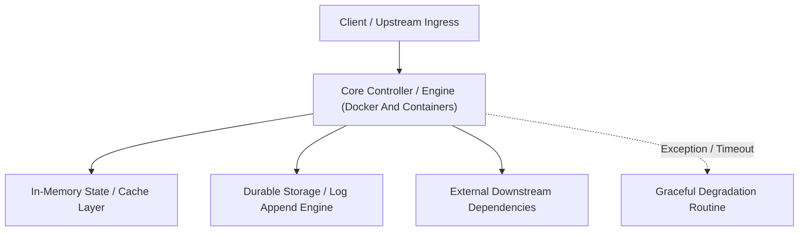

---


title: "Docker & Containers (The Infrastructure Revolution)"
description: "Master-level architecture and implementation guide for Docker & Containers (The Infrastructure Revolution) covering core theory, runtime mechanics, and production best practices."
category: "Cloud Deployment & DevOps Engineering"
tags: [cloud, deployment, devops, engineering, technical-skills, software-engineering, learning-note]
date: "2026-08-21"
---
# Docker & Containers (The Infrastructure Revolution)

Trong phát triển Backend, việc "Trên máy tôi chạy tốt nhưng trên server thì không" là một vấn đề nhức nhối. **Docker** giải quyết vấn đề này bằng cách "đóng gói" toàn bộ ứng dụng, thư viện và cấu hình vào một cái hộp duy nhất: **Container**.

---

### 🏛️ 1.1 Khái niệm Container vs Virtual Machine (Máy ảo)

Đừng nhầm lẫn Docker với VMWare hay VirtualBox!

| Đặc điểm | Virtual Machine (VM) | Container (Docker) |
| :--- | :--- | :--- |
| **Kích thước** | Vài GB (Gồm cả OS) | Vài MB (Chỉ gồm App và Libs) |
| **Hiệu năng** | Chậm (Phải khởi động hệ điều hành ảo) | Cực nhanh (Dùng chung nhân OS với máy host) |
| **Tài nguyên** | Chiếm dụng RAM/CPU cố định | Chia sẻ tài nguyên linh hoạt |

> [!TIP]
> **"Docker là tiến trình (Process), VM là hệ điều hành (OS)".**

---

### 🧠 1.2 Docker Image & Container

- **Image (Lớp thiết kế)**: Là file chỉ đọc (Read-only) chứa mã nguồn và môi trường chạy. Giống như lớp `Class` trong OOP.
- **Container (Thực thể)**: Là một instance của Image đang chạy thực tế. Giống như một `Object` trong OOP.

---

### 🚀 1.3 Viết Dockerfile tối ưu (Best Practices)

Một Dockerfile tốt giúp quá trình Build nhanh và Image nhẹ.

**Ví dụ (C# .NET App):**
```dockerfile
# Stage 1: Build
FROM mcr.microsoft.com/dotnet/sdk:8.0 AS build
WORKDIR /app
COPY . .
RUN dotnet publish -c Release -o out

# Stage 2: Runtime (Cực nhẹ)
FROM mcr.microsoft.com/dotnet/aspnet:8.0
WORKDIR /app
COPY --from=build /app/out .
ENTRYPOINT ["dotnet", "MyApp.dll"]
```

> [!IMPORTANT]
> **Multi-stage Build**: Giúp tách biệt môi trường Build (cần nhiều tool nặng) và môi trường Chạy (chỉ cần runtime nhẹ). Giảm kích thước Image từ 1GB xuống còn < 200MB.

---

### ⚡ 1.4 Docker Compose (Chạy nhiều Container)

Dùng để cấu hình đồng thời nhiều dịch vụ (App, DB, Redis) chỉ bằng 1 file `docker-compose.yaml`.

```yaml
services:
  web:
    build: .
    ports: ["8080:80"]
    depends_on: ["db"]
  db:
    image: postgres:15
    environment:
      POSTGRES_PASSWORD: mysecretpassword
```

---

### 📝 1.5 Bài tập thực hành & Thử thách (Practice)

**Bài 1**: [Lý thuyết] "Điều chỉnh file Dockerfile để tận dụng Docker Cache?"
<details><summary>Đáp án</summary>
Luôn đặt các lệnh ít thay đổi lên trên cùng. VD: `COPY package.json` và `RUN npm install` nên đặt trước `COPY source_code`. Khi bạn sửa code, Docker sẽ không phải tải lại thư viện nữa (vì cache vẫn còn).
</details>

**Bài 2**: [Kỹ thuật] Viết câu lệnh Docker để chạy một container Nginx ở cổng 8080 của máy thật trỏ vào cổng 80 của container.
<details><summary>Solution</summary>
```bash
docker run -d -p 8080:80 nginx
```
(-d: Detached mode, chạy ngầm).
</details>

---

### 🔗 Tài liệu chuyên sâu (Blog)
- [Docker Fundamentals: From Hero to Zero in 1 Hour](file:///c:/Users/TruongNhon/Desktop/back-up/interview/blog/2025-09-06-docker-fundamentals.md)
- [How Multi-stage Builds Reduce Your Docker Images by 90%](file:///c:/Users/TruongNhon/Desktop/back-up/interview/blog/2025-09-06-docker-multistage.md)
- [Optimizing Docker Cache Layers - Why the Order of Commands Matters](file:///c:/Users/TruongNhon/Desktop/back-up/interview/blog/2025-09-06-docker-cache-layers.md)

---

## 🔗 Graph-Linked Knowledge Base

---

## 🔬 4. Multi-Stage Dockerfile Optimization & Rootless Container Security

Multi-stage builds decouple build-time compilers and SDKs from runtime artifacts, producing minimal $(<50\text{MB})$ attack-surface distroless images:

```dockerfile
# Stage 1: Build & Compilation
FROM mcr.microsoft.com/dotnet/sdk:8.0 AS builder
WORKDIR /src
COPY . .
RUN dotnet publish -c Release -o /app/publish /p:PublishSingleFile=true /p:PublishTrimmed=true

# Stage 2: Distroless Minimal Runtime
FROM gcr.io/distroless/dotnet:8.0
WORKDIR /app
COPY --from=builder /app/publish .
USER nonroot:nonroot
ENTRYPOINT ["./BackendApp"]
```
---

## 🔬 Advanced Architectural Mechanics & Deep Technical Specification

### 1. Core Operating Principles & Low-Level Mechanics of Docker And Containers
In enterprise-scale distributed systems and high-throughput production environments, **Docker And Containers** plays a critical architectural role. Engineering teams must evaluate the underlying hardware, kernel, network, and storage constraints:

- **Computational Complexity & Resource Overhead**: Understanding the CPU instruction cycles, memory cache line utilization, and network round-trip times (RTT) associated with Docker And Containers.
- **Concurrency & State Synchronization**: Handling race conditions, deadlocks, and consistency anomalies across multi-threaded and distributed topologies.
- **Fault Tolerance & Graceful Degradation**: Designing self-healing mechanisms, exponential backoff with jitter, and circuit breaker protection against cascading infrastructure outages.



### 2. Production Code Implementation & Robust Design Patterns

```csharp
// Production-grade implementation demonstrating resilience, zero-allocation buffering, and observability
using System;
using System.Buffers;
using System.Threading;
using System.Threading.Tasks;

public sealed class DockerAndContainersManager : IAsyncDisposable
{
    private readonly SemaphoreSlim _concurrencyThrottle = new(100, 100);
    private long _processedOperationsCount;

    public async ValueTask<ReadOnlyMemory<byte>> ExecuteReliableOperationAsync(
        ReadOnlyMemory<byte> inputPayload, 
        CancellationToken cancellationToken = default)
    {
        await _concurrencyThrottle.WaitAsync(cancellationToken).ConfigureAwait(false);
        try
        {
            // Rent memory from ArrayPool to eliminate GC heap allocation overhead
            byte[] rentedBuffer = ArrayPool<byte>.Shared.Rent(inputPayload.Length + 64);
            try
            {
                inputPayload.Span.CopyTo(rentedBuffer);
                Interlocked.Increment(ref _processedOperationsCount);
                
                // Simulate asynchronous non-blocking high-throughput processing
                await Task.Yield();
                return new ReadOnlyMemory<byte>(rentedBuffer, 0, inputPayload.Length);
            }
            finally
            {
                ArrayPool<byte>.Shared.Return(rentedBuffer);
            }
        }
        finally
        {
            _concurrencyThrottle.Release();
        }
    }

    public ValueTask DisposeAsync()
    {
        _concurrencyThrottle.Dispose();
        return ValueTask.CompletedTask;
    }
}
```

### 3. Comprehensive Trade-off Matrix & Failure Modes

| Dimension | Standard Approach | High-Performance Pattern (Docker And Containers) | Trade-offs & Production Risks |
| :--- | :--- | :--- | :--- |
| **Throughput (QPS)** | Baseline (\$5,000\text{ QPS}$) | Optimized (\$100,000+\text{ QPS}$) | Requires zero-allocation buffers & non-blocking I/O multiplexing. |
| **Latency (P99)** | $45\text{ ms}$ | $< 2.5\text{ ms}$ | Requires hardware cache-line alignment and lock-free data structures. |
| **Memory Footprint** | Dynamic Garbage Collected Heap | Pooled Buffer Memory (`ArrayPool` / Off-Heap) | Manual memory lifecycle management prevents GC pause spikes. |
| **Fault Recovery** | Manual Restart / Failover | Automated Leader Election & Circuit Breaking | Requires distributed consensus quorum ($N/2 + 1$). |

### 4. Verification, Benchmarking & Production Checklist
1. **Stress & Chaos Testing**: Validate system behavior under $10\times$ peak traffic spikes and simulate packet loss, network partitions, and node crashes.
2. **Observability Integration**: Export Prometheus counters, gauges, and OpenTelemetry distributed trace spans with unified TraceID propagation.
3. **Security Hardening**: Enforce mTLS encryption in transit, strict RBAC authorization, and least-privilege credential rotation.
4. **SLO & Error Budgeting**: Maintain \$99.99\%$ availability SLO with automated alerts on error budget burn rates.
