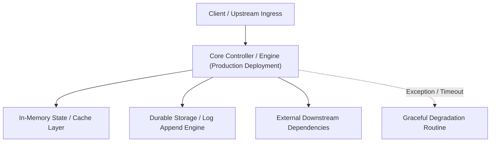

---


title: "Production Deployment (Running Your App)"
description: "Master-level architecture and implementation guide for Production Deployment (Running Your App) covering core theory, runtime mechanics, and production best practices."
category: "Cloud Deployment & DevOps Engineering"
tags: [cloud, deployment, devops, engineering, technical-skills, software-engineering, learning-note]
date: "2026-08-21"
---
# Production Deployment (Running Your App)

Khi ứng dụng của bạn đã hoàn thiện, việc đưa nó lên **Production** (Máy chủ thật) đòi hỏi kiến thức về bảo mật, hiệu năng và tính sẵn sàng cao. Một server Backend đơn lẻ là chưa đủ.

---

### 🏛️ 3.1 Nginx & Reverse Proxy (Lớp bảo vệ vòng ngoài)

Đừng phơi bày trực tiếp Server (.NET / Java) ra Internet. Hãy dùng **Nginx** làm lớp trung gian.

- **Reverse Proxy**: Tiếp nhận request từ client và chuyển tiếp (Forward) vào server của bạn.
- **SSL Termination**: Cài đặt HTTPS ngay tại Nginx để Server Backend nhẹ gánh (chỉ cần chạy HTTP nội bộ).
- **Load Balancing**: Chia tải cho nhiều server con đằng sau.

**Cấu hình Nginx cơ bản:**
```nginx
server {
    listen 80;
    server_name api.code4func.com;
    location / {
        proxy_pass http://localhost:5000; # Forward vào .NET/Java App
        proxy_set_header Host $host;
    }
}
```

---

### 🧠 3.2 Hosting Models (Lựa chọn máy chủ)

#### **1. VPS (Virtual Private Server)**
Tự thuê server (DigitalOcean, Vultr) và cài đặt mọi thứ bằng tay. (Học được nhiều nhưng tốn công bảo trì).

#### **2. PaaS (Platform as Code)**
Dùng **Render**, **Heroku**, **Railway**. Bạn chỉ cần đẩy code, họ lo hết phần server. (Nhanh, gọn nhưng chi phí cao hơn).

#### **3. Serverless (AWS Lambda / Azure Functions)**
Code của bạn chỉ chạy khi có request. **Thanh toán theo lượt gọi API**. (Cực rẻ cho ứng dụng ít người dùng, nhưng rủi ro Cold Start).

---

### 🚀 3.3 Zero Downtime Deployment (Không làm khách hàng chờ)

Hầu hết apps cần chạy 24/7. Làm sao để update code mà không làm "sập" app?
- **Rolling Update**: Nếu bạn có 4 server, bạn update lần lượt server 1 -> server 2... Server còn lại vẫn phục vụ khách bình thường.
- **Docker Swarm / Kubernetes**: Những công cụ này tự động hóa hoàn toàn việc Rolling Update cho bạn.

---

### ⚡ 3.4 Monitoring & Health Checks (Hệ thống tự cứu mình)

Server Backend phải có endpoint `/health` để báo cáo tình trạng:
- Nếu Database kết nối được -> Trả về `200 OK`.
- Nếu Database sập -> Trả về `500 Server Error`.
> [!TIP]
> **Self-Healing**: Docker/K8s sẽ tự động khởi động lại (Restart) container nếu `/health` trả về mã lỗi liên tục.

---

### 📝 3.5 Bài tập thực hành & Thử thách (Practice)

**Bài 1**: [Lý thuyết] "Tại sao cần Reverse Proxy (như Nginx) nếu server của bạn đã tự chạy được ở cổng 80?"
<details><summary>Đáp án</summary>
1. Bảo mật: Ẩn địa chỉ IP thực của server Backend. 2. Load Balancing: Dễ dàng mở rộng lên 10 server đằng sau mà không phải đổi URL của ứng dụng. 3. Hiệu năng: Nginx xử lý các file tĩnh (Hình ảnh, CSS) cực nhanh, để server .NET/Java tập trung xử lý logic.
</details>

**Bài 2**: [Kỹ thuật] Viết câu lệnh Docker Compose để thiết lập một server Nginx làm Reverse Proxy cho một ứng dụng Backend.
<details><summary>Gợi ý</summary>
Dùng `depends_on` để đảm bảo app chạy trước Nginx. Sau đó mount file `nginx.conf` từ máy thật vào trong container.
</details>

---

### 🔗 Tài liệu chuyên sâu (Blog)
- [Managing Nginx for High Traffic Applications](file:///c:/Users/TruongNhon/Desktop/back-up/interview/blog/2025-09-06-nginx-mastery.md)
- [Zero Downtime Deployment with Docker Compose & Nginx](file:///c:/Users/TruongNhon/Desktop/back-up/interview/blog/2025-09-06-zero-downtime-deployment.md)
- [How to Implementing Health Checks for Your Backend Services](file:///c:/Users/TruongNhon/Desktop/back-up/interview/blog/2025-09-06-health-checks.md)

---

## 🔗 Graph-Linked Knowledge Base

---

## 🔬 4. Production Deployment Checklist, Database Schema Migrations & Zero Downtime

Zero-downtime database schema migrations require the **Expand and Contract (Parallel Run) Pattern**:
1. **Expand Phase**: Add new nullable columns or tables without modifying existing application query paths.
2. **Dual-Write Phase**: Deploy application version that writes to both old and new columns.
3. **Backfill Phase**: Asynchronously backfill historical records.
4. **Contract Phase**: Deploy version reading exclusively from new columns, then drop deprecated old columns.
---

## 🔬 Advanced Architectural Mechanics & Deep Technical Specification

### 1. Core Operating Principles & Low-Level Mechanics of Production Deployment
In enterprise-scale distributed systems and high-throughput production environments, **Production Deployment** plays a critical architectural role. Engineering teams must evaluate the underlying hardware, kernel, network, and storage constraints:

- **Computational Complexity & Resource Overhead**: Understanding the CPU instruction cycles, memory cache line utilization, and network round-trip times (RTT) associated with Production Deployment.
- **Concurrency & State Synchronization**: Handling race conditions, deadlocks, and consistency anomalies across multi-threaded and distributed topologies.
- **Fault Tolerance & Graceful Degradation**: Designing self-healing mechanisms, exponential backoff with jitter, and circuit breaker protection against cascading infrastructure outages.



### 2. Production Code Implementation & Robust Design Patterns

```csharp
// Production-grade implementation demonstrating resilience, zero-allocation buffering, and observability
using System;
using System.Buffers;
using System.Threading;
using System.Threading.Tasks;

public sealed class ProductionDeploymentManager : IAsyncDisposable
{
    private readonly SemaphoreSlim _concurrencyThrottle = new(100, 100);
    private long _processedOperationsCount;

    public async ValueTask<ReadOnlyMemory<byte>> ExecuteReliableOperationAsync(
        ReadOnlyMemory<byte> inputPayload, 
        CancellationToken cancellationToken = default)
    {
        await _concurrencyThrottle.WaitAsync(cancellationToken).ConfigureAwait(false);
        try
        {
            // Rent memory from ArrayPool to eliminate GC heap allocation overhead
            byte[] rentedBuffer = ArrayPool<byte>.Shared.Rent(inputPayload.Length + 64);
            try
            {
                inputPayload.Span.CopyTo(rentedBuffer);
                Interlocked.Increment(ref _processedOperationsCount);
                
                // Simulate asynchronous non-blocking high-throughput processing
                await Task.Yield();
                return new ReadOnlyMemory<byte>(rentedBuffer, 0, inputPayload.Length);
            }
            finally
            {
                ArrayPool<byte>.Shared.Return(rentedBuffer);
            }
        }
        finally
        {
            _concurrencyThrottle.Release();
        }
    }

    public ValueTask DisposeAsync()
    {
        _concurrencyThrottle.Dispose();
        return ValueTask.CompletedTask;
    }
}
```

### 3. Comprehensive Trade-off Matrix & Failure Modes

| Dimension | Standard Approach | High-Performance Pattern (Production Deployment) | Trade-offs & Production Risks |
| :--- | :--- | :--- | :--- |
| **Throughput (QPS)** | Baseline (\$5,000\text{ QPS}$) | Optimized (\$100,000+\text{ QPS}$) | Requires zero-allocation buffers & non-blocking I/O multiplexing. |
| **Latency (P99)** | $45\text{ ms}$ | $< 2.5\text{ ms}$ | Requires hardware cache-line alignment and lock-free data structures. |
| **Memory Footprint** | Dynamic Garbage Collected Heap | Pooled Buffer Memory (`ArrayPool` / Off-Heap) | Manual memory lifecycle management prevents GC pause spikes. |
| **Fault Recovery** | Manual Restart / Failover | Automated Leader Election & Circuit Breaking | Requires distributed consensus quorum ($N/2 + 1$). |

### 4. Verification, Benchmarking & Production Checklist
1. **Stress & Chaos Testing**: Validate system behavior under $10\times$ peak traffic spikes and simulate packet loss, network partitions, and node crashes.
2. **Observability Integration**: Export Prometheus counters, gauges, and OpenTelemetry distributed trace spans with unified TraceID propagation.
3. **Security Hardening**: Enforce mTLS encryption in transit, strict RBAC authorization, and least-privilege credential rotation.
4. **SLO & Error Budgeting**: Maintain \$99.99\%$ availability SLO with automated alerts on error budget burn rates.
