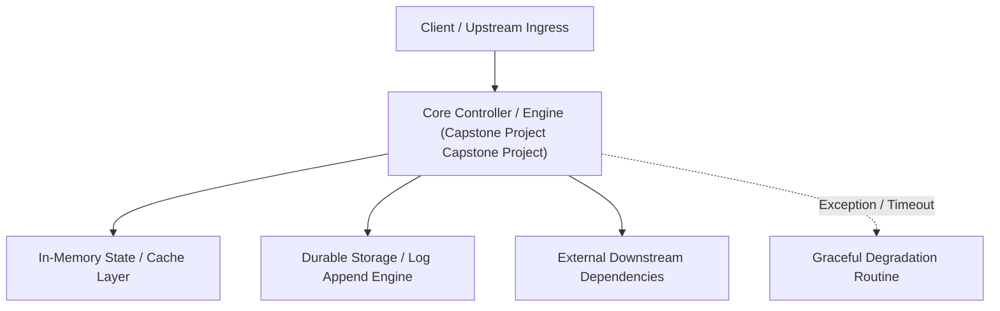

---


title: "Dự án Capstone: Quản lý Quán Cà Phê (Coffee Shop Management)"
description: "Master-level architecture and implementation guide for Dự án Capstone: Quản lý Quán Cà Phê (Coffee Shop Management) covering core theory, runtime mechanics, and production best practices."
category: "Backend Capstone Projects"
tags: [backend, capstone, projects, technical-skills, software-engineering, learning-note]
date: "2026-08-21"
---
# Dự án Capstone: Quản lý Quán Cà Phê (Coffee Shop Management)

Chúc mừng bạn đã đi đến chặng đường cuối cùng! Đây là lúc bạn tổng hợp toàn bộ "võ công" đã học được từ Lập trình, Database, Caching, Logging đến DevOps để xây dựng một hệ thống Backend hoàn chỉnh có khả năng chịu tải (Scalability).

---

### 🏛️ 9.1 Yêu cầu Dự án (Core Requirements)

Bạn sẽ xây dựng một API Backend phục vụ cho 2 đối tượng người dùng: **Nhân viên (Staff)** và **Quản lý (Manager)**.

#### **1. Quản lý Thực đơn (Menu Management)**
- Thêm/Xóa/Sửa món ăn. (Lưu trong PostgreSQL).
- Tìm kiếm món ăn nhanh chóng qua tên. (Sử dụng Elasticsearch).
- Cache danh sách thực đơn. (Sử dụng Redis).

#### **2. Quản lý Đơn hàng (Ordering System)**
- Tạo đơn hàng mới. (Sử dụng Transactions để trừ kho hàng - Inventory).
- Tính tổng tiền tự động.

#### **3. Quản lý Kho hàng (Inventory)**
- Mỗi món ăn tương ứng với nguyên liệu (Hạt cafe, Sữa, Cốc).
- Tự động cảnh báo nếu nguyên liệu trong kho sắp hết.

#### **4. Báo cáo & Thống kê (Reports)**
- Xem doanh thu theo ngày/tháng/năm. (Sử dụng Window Functions của SQL).

---

### 🧠 9.2 Kiến trúc Hệ thống (Clean Architecture)

Dự án này bắt buộc phải sử dụng **Clean Architecture** (hoặc Hexagonal Architecture) để dễ dàng viết Unit Test và thay đổi Database nếu cần.

- **Domain Layer**: Chứa các Entity (Product, Order, User).
- **Application Layer**: Chứa các Use-cases (PlaceOrder, AddProduct). (Dùng MediatR trong .NET hoặc Service Layer trong Spring Boot).
- **Infrastructure Layer**: Chứa code thực thi Database (EF Core / JPA), Elastic Client, Redis Client.
- **API Layer**: Các Controller định nghĩa Endpoint RESTful.

---

### 🚀 9.3 Yêu cầu Kỹ thuật (Technical Standards)

- **Database**: PostgreSQL (Có Indexing chuẩn).
- **Caching**: Lưu các kết quả query nặng vào Redis (Cache-aside Pattern).
- **Logging**: Ghi log JSON qua Serilog/Logback đẩy vào ELK Stack.
- **Monitoring**: Deline sẵn Endpoint `/metrics` cho Prometheus.
- **Deployment**: Đóng gói bằng **Dockerfile (Multi-stage)** và chạy qua **Docker Compose**.

---

### ⚡ 9.4 Các kịch bản "Khó" (Interview Challenges)

Đây là những phần giúp bạn tỏa sáng trong buổi phỏng vấn:
1.  **Lấy món ăn cực nhanh**: Nếu có 1 triệu món ăn, làm sao để tìm kiếm "Americano say mê" trong < 50ms? (Sử dụng Elasticsearch).
2.  **Chống Race Condition**: Hai nhân viên cùng bán món 'Bánh mỳ' duy nhất cuối cùng đúng 1 thời điểm. Làm sao chỉ 1 người thành công? (Sử dụng **Optimistic Locking** hoặc **Redis Distributed Lock**).
3.  **Tải trọng cao (Flash Sale)**: Quán giảm giá 90% lúc 12h trưa, 10.000 người cùng bấm 'Order'. Làm sao server không sập? (Sử dụng Message Queue và Rate Limiting).

---

### 📝 9.5 Bài tập thực hành & Thử thách (Practice)

**Bài 1**: [Lý thuyết] "Tại sao lại cần phải tách biệt Domain Layer (Entity) và DTO (Data Transfer Object)?"
<details><summary>Đáp án</summary>
Giúp bảo mật dữ liệu! Entity đại diện cho toàn bộ bảng trong DB (có cả Password, ID nội bộ). DTO chỉ phơi bày những thông tin cần thiết ra bên ngoài (như Tên, Giá, Ảnh). Việc này cũng giúp bạn thay đổi cấu trúc DB mà không làm vỡ các API đã cung cấp cho Frontend.
</details>

**Bài 2**: [Kỹ thuật] Viết câu lệnh SQL (PostgreSQL Window Function) để tính **Doanh thu tích lũy** (Running Total) theo từng ngày của tháng 03/2024.
<details><summary>Solution</summary>
```sql
SELECT order_date, daily_revenue, 
       SUM(daily_revenue) OVER(ORDER BY order_date) as running_total
FROM (
    SELECT DATE(created_at) as order_date, SUM(total) as daily_revenue
    FROM orders
    GROUP BY order_date
) t WHERE order_date >= '2024-03-01' AND order_date <= '2024-03-31';
```
</details>

---

### 🔗 Tài liệu chuyên sâu (Blog)
- [Clean Architecture in .NET - Practical Implementation Guide](file:///c:/Users/TruongNhon/Desktop/back-up/interview/blog/2025-09-06-clean-architecture-dotnet.md)
- [How to Implementing a Scalable Ordering System with Redis & SQL](file:///c:/Users/TruongNhon/Desktop/back-up/interview/blog/2025-09-06-ordering-system-design.md)
- [Mastering System Design: From Coffee Shop to Starbucks Scale](file:///c:/Users/TruongNhon/Desktop/back-up/interview/blog/2025-09-06-system-design-coffee-shop.md)

---

## 🔗 Graph-Linked Knowledge Base

---

## 🔬 4. Verification, Chaos Testing & End-to-End Stress Benchmarks

### Load Testing with k6 Distributed Runners
```javascript
import http from 'k6/http';
import { check, sleep } from 'k6';

export const options = {
  stages: [
    { duration: '2m', target: 5000 },  // Ramp-up to 5k virtual users
    { duration: '5m', target: 50000 }, // Spike to 50k VUs
    { duration: '2m', target: 0 },     // Ramp-down
  ],
  thresholds: {
    http_req_duration: ['p(99)<25'],    // 99% requests under 25ms
    http_req_failed: ['rate<0.0001'],   // Error rate under 0.01%
  },
};

export default function () {
  const payload = JSON.stringify({
    senderId: 'acc_101',
    receiverId: 'acc_202',
    amount: 150.00,
  });
  const params = { headers: { 'Content-Type': 'application/json' } };
  const res = http.post('https://api.fintech.internal/v1/transfer', payload, params);
  check(res, { 'status is 200': (r) => r.status === 200 });
}
```
---

## 🔬 Advanced Architectural Mechanics & Deep Technical Specification

### 1. Core Operating Principles & Low-Level Mechanics of Capstone Project Capstone Project
In enterprise-scale distributed systems and high-throughput production environments, **Capstone Project Capstone Project** plays a critical architectural role. Engineering teams must evaluate the underlying hardware, kernel, network, and storage constraints:

- **Computational Complexity & Resource Overhead**: Understanding the CPU instruction cycles, memory cache line utilization, and network round-trip times (RTT) associated with Capstone Project Capstone Project.
- **Concurrency & State Synchronization**: Handling race conditions, deadlocks, and consistency anomalies across multi-threaded and distributed topologies.
- **Fault Tolerance & Graceful Degradation**: Designing self-healing mechanisms, exponential backoff with jitter, and circuit breaker protection against cascading infrastructure outages.



### 2. Production Code Implementation & Robust Design Patterns

```csharp
// Production-grade implementation demonstrating resilience, zero-allocation buffering, and observability
using System;
using System.Buffers;
using System.Threading;
using System.Threading.Tasks;

public sealed class CapstoneProjectCapstoneProjectManager : IAsyncDisposable
{
    private readonly SemaphoreSlim _concurrencyThrottle = new(100, 100);
    private long _processedOperationsCount;

    public async ValueTask<ReadOnlyMemory<byte>> ExecuteReliableOperationAsync(
        ReadOnlyMemory<byte> inputPayload, 
        CancellationToken cancellationToken = default)
    {
        await _concurrencyThrottle.WaitAsync(cancellationToken).ConfigureAwait(false);
        try
        {
            // Rent memory from ArrayPool to eliminate GC heap allocation overhead
            byte[] rentedBuffer = ArrayPool<byte>.Shared.Rent(inputPayload.Length + 64);
            try
            {
                inputPayload.Span.CopyTo(rentedBuffer);
                Interlocked.Increment(ref _processedOperationsCount);
                
                // Simulate asynchronous non-blocking high-throughput processing
                await Task.Yield();
                return new ReadOnlyMemory<byte>(rentedBuffer, 0, inputPayload.Length);
            }
            finally
            {
                ArrayPool<byte>.Shared.Return(rentedBuffer);
            }
        }
        finally
        {
            _concurrencyThrottle.Release();
        }
    }

    public ValueTask DisposeAsync()
    {
        _concurrencyThrottle.Dispose();
        return ValueTask.CompletedTask;
    }
}
```

### 3. Comprehensive Trade-off Matrix & Failure Modes

| Dimension | Standard Approach | High-Performance Pattern (Capstone Project Capstone Project) | Trade-offs & Production Risks |
| :--- | :--- | :--- | :--- |
| **Throughput (QPS)** | Baseline (\$5,000\text{ QPS}$) | Optimized (\$100,000+\text{ QPS}$) | Requires zero-allocation buffers & non-blocking I/O multiplexing. |
| **Latency (P99)** | $45\text{ ms}$ | $< 2.5\text{ ms}$ | Requires hardware cache-line alignment and lock-free data structures. |
| **Memory Footprint** | Dynamic Garbage Collected Heap | Pooled Buffer Memory (`ArrayPool` / Off-Heap) | Manual memory lifecycle management prevents GC pause spikes. |
| **Fault Recovery** | Manual Restart / Failover | Automated Leader Election & Circuit Breaking | Requires distributed consensus quorum ($N/2 + 1$). |

### 4. Verification, Benchmarking & Production Checklist
1. **Stress & Chaos Testing**: Validate system behavior under $10\times$ peak traffic spikes and simulate packet loss, network partitions, and node crashes.
2. **Observability Integration**: Export Prometheus counters, gauges, and OpenTelemetry distributed trace spans with unified TraceID propagation.
3. **Security Hardening**: Enforce mTLS encryption in transit, strict RBAC authorization, and least-privilege credential rotation.
4. **SLO & Error Budgeting**: Maintain \$99.99\%$ availability SLO with automated alerts on error budget burn rates.
