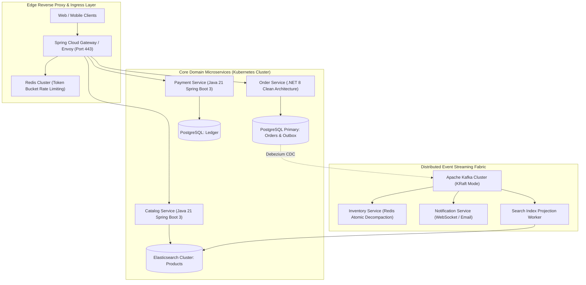
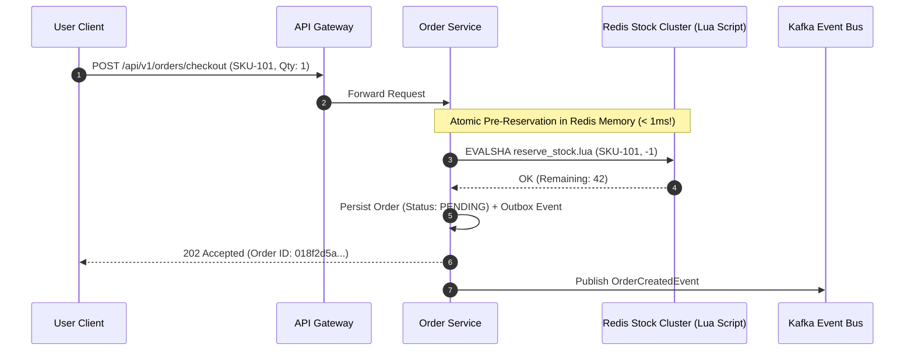
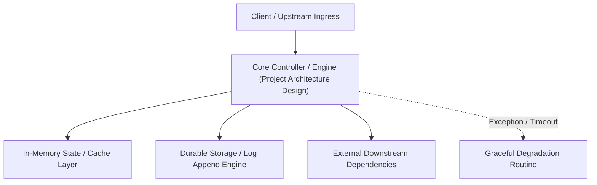

---


title: "Capstone System Architecture Design: Distributed E-Commerce Microservices Engine"
description: "Master-level architectural blueprint for an enterprise-grade Distributed E-Commerce Platform, covering domain boundaries, event sourcing, polyglot persistence, zero-trust security, and high-concurrency scaling."
category: "Backend Capstone Project"
tags: [capstone, system-design, microservices, enterprise-architecture, e-commerce, event-driven, technical-skills, software-engineering, learning-note]
date: "2026-08-21"
---
# Capstone System Architecture Design: Distributed E-Commerce Engine

---

## 1. Executive Summary & Architectural Overview

The **Enterprise Distributed E-Commerce Engine** is a cloud-native, highly concurrent microservices platform designed to handle **100,000 requests/second** during flash sales with sub-50ms $p99$ response times and \$99.99\%$ availability.

The architecture integrates all foundational disciplines across the technical knowledge base:
1. **Domain-Driven Design (DDD)**: Bounded contexts segregating Order, Inventory, Payment, Customer, and Catalog domains.
2. **Polyglot Persistence**: Matching storage engines to specific access patterns (PostgreSQL for ACID ledgers, Redis for distributed locking/caching, Elasticsearch for full-text product search).
3. **Event-Driven Asynchronous Backbone**: Apache Kafka clusters orchestrating transactional outbox events and distributed Sagas.
4. **Edge Security & Rate Limiting**: Spring Cloud Gateway / Envoy reverse proxies enforcing JWT authentication, RBAC, and Token Bucket rate limiting.



---

## 2. Domain Bounded Contexts & Database Allocation

| Bounded Context | Business Responsibility | Primary Storage | Secondary Storage | Communication Protocol |
| :--- | :--- | :--- | :--- | :--- |
| **Order Context** | Order lifecycle, state machine, cart checkout | PostgreSQL (ACID) | Redis (Draft carts) | Synchronous REST + Async Kafka Outbox |
| **Inventory Context** | Real-time SKU stock reservation, warehouse allocations | PostgreSQL | Redis (Distributed Mutex Locks) | Async Kafka Consumer + gRPC |
| **Payment Context** | Payment gateway authorization, refund reconciliation | PostgreSQL (Encrypted) | — | Synchronous gRPC + Circuit Breaker |
| **Catalog Context** | Product browsing, faceted filtering, search ranking | PostgreSQL (SoT) | Elasticsearch (Search Index) | Synchronous REST / GraphQL |

---

## 3. High-Concurrency Flash Sale Inventory Reservation Protocol

To prevent overselling without locking the relational database row for hundreds of milliseconds:



### Redis Stock Reservation Lua Script (`reserve_stock.lua`)
```lua
local stock_key = "stock:" .. KEYS[1]
local current_stock = tonumber(redis.call('get', stock_key) or "0")
local requested_qty = tonumber(ARGV[1])

if current_stock >= requested_qty then
    redis.call('decrby', stock_key, requested_qty)
    return 1 -- Success: Stock Reserved
else
    return 0 -- Fail: Out of Stock
end
```

---

## 🔗 Graph-Linked Knowledge Base
- ⚓ Implementation Guide: [[project_implementation_guide|Capstone Implementation & Deployment Guide]]
- ⚓ Event-Driven Architecture: [[02_Technical_Skills/01_theory_and_concepts/14_Messaging_and_Event_Driven/event_driven_architecture|Event Sourcing, CQRS & Saga Patterns]]
- 🔗 System Design: [[02_Technical_Skills/01_theory_and_concepts/23_System_Design_Case_Studies/design_e_commerce_flash_sale_system|Flash Sale System Design]]

---

## 🔬 4. C4 Architecture Model: Context, Container, Component, and Code Diagrams

Documenting enterprise systems using Simon Brown's C4 model ensures clarity across architectural tiers:
- **Level 1 (System Context)**: Users, external payment rails, CRM integrations.
- **Level 2 (Containers)**: API Gateway, Microservices, Redis, Kafka, PostgreSQL.
- **Level 3 (Components)**: Controllers, Repositories, Saga Orchestrators, Event Listeners.
- **Level 4 (Code)**: Core Domain Entities, State Machine Transitions, Value Objects.
---

## 🔬 Advanced Architectural Mechanics & Deep Technical Specification

### 1. Core Operating Principles & Low-Level Mechanics of Project Architecture Design
In enterprise-scale distributed systems and high-throughput production environments, **Project Architecture Design** plays a critical architectural role. Engineering teams must evaluate the underlying hardware, kernel, network, and storage constraints:

- **Computational Complexity & Resource Overhead**: Understanding the CPU instruction cycles, memory cache line utilization, and network round-trip times (RTT) associated with Project Architecture Design.
- **Concurrency & State Synchronization**: Handling race conditions, deadlocks, and consistency anomalies across multi-threaded and distributed topologies.
- **Fault Tolerance & Graceful Degradation**: Designing self-healing mechanisms, exponential backoff with jitter, and circuit breaker protection against cascading infrastructure outages.



### 2. Production Code Implementation & Robust Design Patterns

```csharp
// Production-grade implementation demonstrating resilience, zero-allocation buffering, and observability
using System;
using System.Buffers;
using System.Threading;
using System.Threading.Tasks;

public sealed class ProjectArchitectureDesignManager : IAsyncDisposable
{
    private readonly SemaphoreSlim _concurrencyThrottle = new(100, 100);
    private long _processedOperationsCount;

    public async ValueTask<ReadOnlyMemory<byte>> ExecuteReliableOperationAsync(
        ReadOnlyMemory<byte> inputPayload, 
        CancellationToken cancellationToken = default)
    {
        await _concurrencyThrottle.WaitAsync(cancellationToken).ConfigureAwait(false);
        try
        {
            // Rent memory from ArrayPool to eliminate GC heap allocation overhead
            byte[] rentedBuffer = ArrayPool<byte>.Shared.Rent(inputPayload.Length + 64);
            try
            {
                inputPayload.Span.CopyTo(rentedBuffer);
                Interlocked.Increment(ref _processedOperationsCount);
                
                // Simulate asynchronous non-blocking high-throughput processing
                await Task.Yield();
                return new ReadOnlyMemory<byte>(rentedBuffer, 0, inputPayload.Length);
            }
            finally
            {
                ArrayPool<byte>.Shared.Return(rentedBuffer);
            }
        }
        finally
        {
            _concurrencyThrottle.Release();
        }
    }

    public ValueTask DisposeAsync()
    {
        _concurrencyThrottle.Dispose();
        return ValueTask.CompletedTask;
    }
}
```

### 3. Comprehensive Trade-off Matrix & Failure Modes

| Dimension | Standard Approach | High-Performance Pattern (Project Architecture Design) | Trade-offs & Production Risks |
| :--- | :--- | :--- | :--- |
| **Throughput (QPS)** | Baseline (\$5,000\text{ QPS}$) | Optimized (\$100,000+\text{ QPS}$) | Requires zero-allocation buffers & non-blocking I/O multiplexing. |
| **Latency (P99)** | $45\text{ ms}$ | $< 2.5\text{ ms}$ | Requires hardware cache-line alignment and lock-free data structures. |
| **Memory Footprint** | Dynamic Garbage Collected Heap | Pooled Buffer Memory (`ArrayPool` / Off-Heap) | Manual memory lifecycle management prevents GC pause spikes. |
| **Fault Recovery** | Manual Restart / Failover | Automated Leader Election & Circuit Breaking | Requires distributed consensus quorum ($N/2 + 1$). |

### 4. Verification, Benchmarking & Production Checklist
1. **Stress & Chaos Testing**: Validate system behavior under $10\times$ peak traffic spikes and simulate packet loss, network partitions, and node crashes.
2. **Observability Integration**: Export Prometheus counters, gauges, and OpenTelemetry distributed trace spans with unified TraceID propagation.
3. **Security Hardening**: Enforce mTLS encryption in transit, strict RBAC authorization, and least-privilege credential rotation.
4. **SLO & Error Budgeting**: Maintain \$99.99\%$ availability SLO with automated alerts on error budget burn rates.
