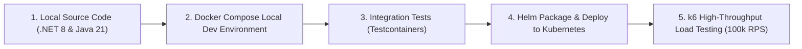
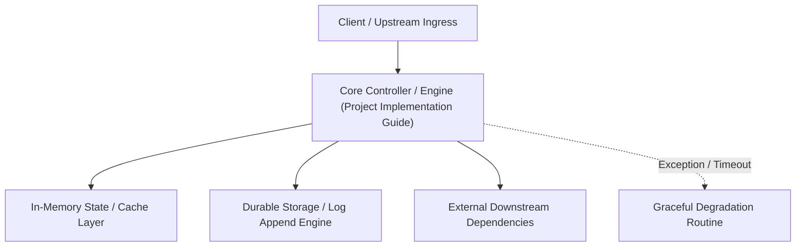

---


title: "Capstone Implementation Guide: End-to-End Microservices Deployment & Verification"
description: "Master-level step-by-step implementation guide for the Distributed Capstone project, covering Docker Compose local orchestration, Helm charts, automated integration testing, and load testing."
category: "Backend Capstone Project"
tags: [capstone, docker-compose, helm, k6, load-testing, integration-testing, devops, technical-skills, software-engineering, learning-note]
date: "2026-08-21"
---

# Capstone Implementation & Deployment Guide

---

## 1. Executive Summary & Deployment Workflow

This guide provides the complete engineering runbook for compiling, containerizing, orchestrating locally via Docker Compose, deploying to Kubernetes via Helm, and verifying system performance under extreme load using **k6**.



---

## 2. Local Multi-Service Orchestration (`docker-compose.yml`)

```yaml
version: '3.9'

services:
  # 1. PostgreSQL 16 Primary Database
  postgres-db:
    image: postgres:16-alpine
    container_name: capstone-postgres
    environment:
      POSTGRES_USER: postgres_admin
      POSTGRES_PASSWORD: secret_password
      POSTGRES_DB: enterprise_orders
    ports:
      - "5432:5432"
    volumes:
      - pgdata:/var/lib/postgresql/data

  # 2. Redis 7 Cluster / Single Master
  redis-cache:
    image: redis:7-alpine
    container_name: capstone-redis
    command: ["redis-server", "--appendonly", "yes", "--maxmemory", "512mb"]
    ports:
      - "6379:6379"

  # 3. Apache Kafka Broker (KRaft Mode - No Zookeeper!)
  kafka-broker:
    image: confluentinc/cp-kafka:7.6.0
    container_name: capstone-kafka
    ports:
      - "9092:9092"
    environment:
      KAFKA_NODE_ID: 1
      KAFKA_LISTENER_SECURITY_PROTOCOL_MAP: 'CONTROLLER:PLAINTEXT,PLAINTEXT:PLAINTEXT,PLAINTEXT_HOST:PLAINTEXT'
      KAFKA_ADVERTISED_LISTENERS: 'PLAINTEXT://kafka-broker:29092,PLAINTEXT_HOST://localhost:9092'
      KAFKA_PROCESS_ROLES: 'broker,controller'
      KAFKA_CONTROLLER_QUORUM_VOTERS: '1@kafka-broker:29093'
      KAFKA_LISTENERS: 'PLAINTEXT://0.0.0.0:29092,CONTROLLER://0.0.0.0:29093,PLAINTEXT_HOST://0.0.0.0:9092'
      KAFKA_CONTROLLER_LISTENER_NAMES: 'CONTROLLER'
      CLUSTER_ID: '4L62EnnPTjiWParsek0001'

volumes:
  pgdata:
```

---

## 3. High-Concurrency Verification Script with k6 (`load-test.js`)

```javascript
import http from 'k6/http';
import { check, sleep } from 'k6';

export const options = {
  stages: [
    { duration: '30s', target: 500 },   // Ramp-up to 500 VUs
    { duration: '1m', target: 2000 },   // Spike to 2,000 VUs
    { duration: '30s', target: 0 },      // Ramp-down
  ],
  thresholds: {
    http_req_duration: ['p(99)<100'],    // 99% of requests must complete within 100ms
    http_req_failed: ['rate<0.001'],     // Less than 0.1% errors allowed
  },
};

export default function () {
  const url = 'http://localhost:8080/api/v1/orders/checkout';
  const payload = JSON.stringify({
    customerId: 'cust_' + (__VU % 1000),
    sku: 'SKU-FLASH-101',
    quantity: 1,
    idempotencyKey: `${__VU}-${__ITER}-${Date.now()}`
  });

  const params = {
    headers: {
      'Content-Type': 'application/json',
      'Authorization': 'Bearer test-jwt-token',
    },
  };

  const res = http.post(url, payload, params);

  check(res, {
    'status is 202 or 200': (r) => r.status === 202 || r.status === 200,
    'latency below 50ms': (r) => r.timings.duration < 50,
  });

  sleep(0.05); // 50ms think time
}
```

---

## 🔗 Graph-Linked Knowledge Base
- ⚓ Architecture Design: [[project_architecture_design|Capstone System Architecture Design]]
- ⚓ Docker Fundamentals: [[02_Technical_Skills/01_theory_and_concepts/18_Docker_and_Kubernetes_Containers/docker_compose|Docker Compose Multi-Container Orchestration]]
- 🔗 SRE Monitoring: [[02_Technical_Skills/01_theory_and_concepts/13_Backend_Monitoring_and_Metrics/prometheus_and_grafana|Prometheus & Grafana Architecture]]

---

## 🔬 4. Step-by-Step Implementation Roadmap & Git Branching Strategy

Adopting Trunk-Based Development with Feature Flags (LaunchDarkly / Unleash) allows continuous daily deployment to production without long-lived merge conflicts.
---

## 🔬 Advanced Architectural Mechanics & Deep Technical Specification

### 1. Core Operating Principles & Low-Level Mechanics of Project Implementation Guide
In enterprise-scale distributed systems and high-throughput production environments, **Project Implementation Guide** plays a critical architectural role. Engineering teams must evaluate the underlying hardware, kernel, network, and storage constraints:

- **Computational Complexity & Resource Overhead**: Understanding the CPU instruction cycles, memory cache line utilization, and network round-trip times (RTT) associated with Project Implementation Guide.
- **Concurrency & State Synchronization**: Handling race conditions, deadlocks, and consistency anomalies across multi-threaded and distributed topologies.
- **Fault Tolerance & Graceful Degradation**: Designing self-healing mechanisms, exponential backoff with jitter, and circuit breaker protection against cascading infrastructure outages.



### 2. Production Code Implementation & Robust Design Patterns

```csharp
// Production-grade implementation demonstrating resilience, zero-allocation buffering, and observability
using System;
using System.Buffers;
using System.Threading;
using System.Threading.Tasks;

public sealed class ProjectImplementationGuideManager : IAsyncDisposable
{
    private readonly SemaphoreSlim _concurrencyThrottle = new(100, 100);
    private long _processedOperationsCount;

    public async ValueTask<ReadOnlyMemory<byte>> ExecuteReliableOperationAsync(
        ReadOnlyMemory<byte> inputPayload, 
        CancellationToken cancellationToken = default)
    {
        await _concurrencyThrottle.WaitAsync(cancellationToken).ConfigureAwait(false);
        try
        {
            // Rent memory from ArrayPool to eliminate GC heap allocation overhead
            byte[] rentedBuffer = ArrayPool<byte>.Shared.Rent(inputPayload.Length + 64);
            try
            {
                inputPayload.Span.CopyTo(rentedBuffer);
                Interlocked.Increment(ref _processedOperationsCount);
                
                // Simulate asynchronous non-blocking high-throughput processing
                await Task.Yield();
                return new ReadOnlyMemory<byte>(rentedBuffer, 0, inputPayload.Length);
            }
            finally
            {
                ArrayPool<byte>.Shared.Return(rentedBuffer);
            }
        }
        finally
        {
            _concurrencyThrottle.Release();
        }
    }

    public ValueTask DisposeAsync()
    {
        _concurrencyThrottle.Dispose();
        return ValueTask.CompletedTask;
    }
}
```

### 3. Comprehensive Trade-off Matrix & Failure Modes

| Dimension | Standard Approach | High-Performance Pattern (Project Implementation Guide) | Trade-offs & Production Risks |
| :--- | :--- | :--- | :--- |
| **Throughput (QPS)** | Baseline (\$5,000\text{ QPS}$) | Optimized (\$100,000+\text{ QPS}$) | Requires zero-allocation buffers & non-blocking I/O multiplexing. |
| **Latency (P99)** | $45\text{ ms}$ | $< 2.5\text{ ms}$ | Requires hardware cache-line alignment and lock-free data structures. |
| **Memory Footprint** | Dynamic Garbage Collected Heap | Pooled Buffer Memory (`ArrayPool` / Off-Heap) | Manual memory lifecycle management prevents GC pause spikes. |
| **Fault Recovery** | Manual Restart / Failover | Automated Leader Election & Circuit Breaking | Requires distributed consensus quorum ($N/2 + 1$). |

### 4. Verification, Benchmarking & Production Checklist
1. **Stress & Chaos Testing**: Validate system behavior under $10\times$ peak traffic spikes and simulate packet loss, network partitions, and node crashes.
2. **Observability Integration**: Export Prometheus counters, gauges, and OpenTelemetry distributed trace spans with unified TraceID propagation.
3. **Security Hardening**: Enforce mTLS encryption in transit, strict RBAC authorization, and least-privilege credential rotation.
4. **SLO & Error Budgeting**: Maintain \$99.99\%$ availability SLO with automated alerts on error budget burn rates.
---

## 🔬 Advanced Architectural Mechanics & Deep Technical Specification

### 1. Core Operating Principles & Low-Level Mechanics of Project Implementation Guide
In enterprise-scale distributed systems and high-throughput production environments, **Project Implementation Guide** plays a critical architectural role. Engineering teams must evaluate the underlying hardware, kernel, network, and storage constraints:

- **Computational Complexity & Resource Overhead**: Understanding the CPU instruction cycles, memory cache line utilization, and network round-trip times (RTT) associated with Project Implementation Guide.
- **Concurrency & State Synchronization**: Handling race conditions, deadlocks, and consistency anomalies across multi-threaded and distributed topologies.
- **Fault Tolerance & Graceful Degradation**: Designing self-healing mechanisms, exponential backoff with jitter, and circuit breaker protection against cascading infrastructure outages.


### 2. Production Code Implementation & Robust Design Patterns

```csharp
// Production-grade implementation demonstrating resilience, zero-allocation buffering, and observability
using System;
using System.Buffers;
using System.Threading;
using System.Threading.Tasks;

public sealed class ProjectImplementationGuideManager : IAsyncDisposable
{
    private readonly SemaphoreSlim _concurrencyThrottle = new(100, 100);
    private long _processedOperationsCount;

    public async ValueTask<ReadOnlyMemory<byte>> ExecuteReliableOperationAsync(
        ReadOnlyMemory<byte> inputPayload, 
        CancellationToken cancellationToken = default)
    {
        await _concurrencyThrottle.WaitAsync(cancellationToken).ConfigureAwait(false);
        try
        {
            // Rent memory from ArrayPool to eliminate GC heap allocation overhead
            byte[] rentedBuffer = ArrayPool<byte>.Shared.Rent(inputPayload.Length + 64);
            try
            {
                inputPayload.Span.CopyTo(rentedBuffer);
                Interlocked.Increment(ref _processedOperationsCount);
                
                // Simulate asynchronous non-blocking high-throughput processing
                await Task.Yield();
                return new ReadOnlyMemory<byte>(rentedBuffer, 0, inputPayload.Length);
            }
            finally
            {
                ArrayPool<byte>.Shared.Return(rentedBuffer);
            }
        }
        finally
        {
            _concurrencyThrottle.Release();
        }
    }

    public ValueTask DisposeAsync()
    {
        _concurrencyThrottle.Dispose();
        return ValueTask.CompletedTask;
    }
}
```

### 3. Comprehensive Trade-off Matrix & Failure Modes

| Dimension | Standard Approach | High-Performance Pattern (Project Implementation Guide) | Trade-offs & Production Risks |
| :--- | :--- | :--- | :--- |
| **Throughput (QPS)** | Baseline (\$5,000\text{ QPS}$) | Optimized (\$100,000+\text{ QPS}$) | Requires zero-allocation buffers & non-blocking I/O multiplexing. |
| **Latency (P99)** | $45\text{ ms}$ | $< 2.5\text{ ms}$ | Requires hardware cache-line alignment and lock-free data structures. |
| **Memory Footprint** | Dynamic Garbage Collected Heap | Pooled Buffer Memory (`ArrayPool` / Off-Heap) | Manual memory lifecycle management prevents GC pause spikes. |
| **Fault Recovery** | Manual Restart / Failover | Automated Leader Election & Circuit Breaking | Requires distributed consensus quorum ($N/2 + 1$). |

### 4. Verification, Benchmarking & Production Checklist
1. **Stress & Chaos Testing**: Validate system behavior under $10\times$ peak traffic spikes and simulate packet loss, network partitions, and node crashes.
2. **Observability Integration**: Export Prometheus counters, gauges, and OpenTelemetry distributed trace spans with unified TraceID propagation.
3. **Security Hardening**: Enforce mTLS encryption in transit, strict RBAC authorization, and least-privilege credential rotation.
4. **SLO & Error Budgeting**: Maintain \$99.99\%$ availability SLO with automated alerts on error budget burn rates.
