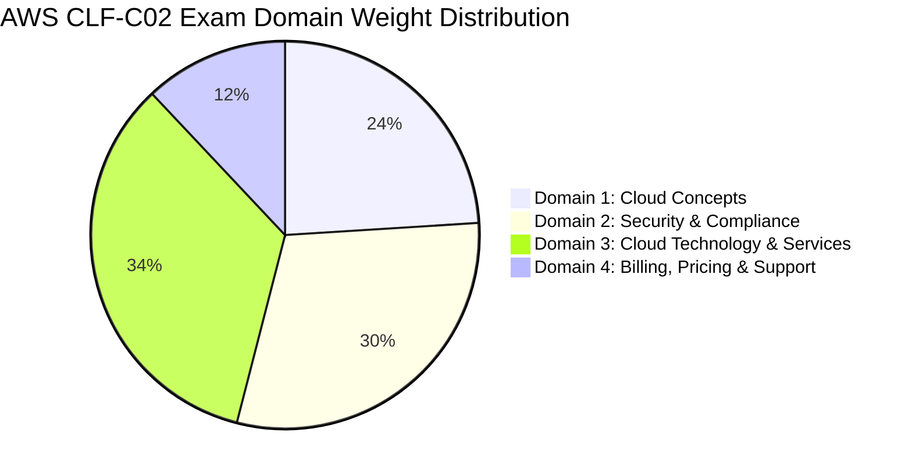
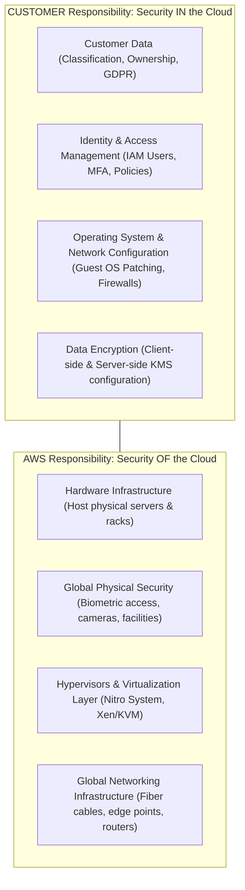
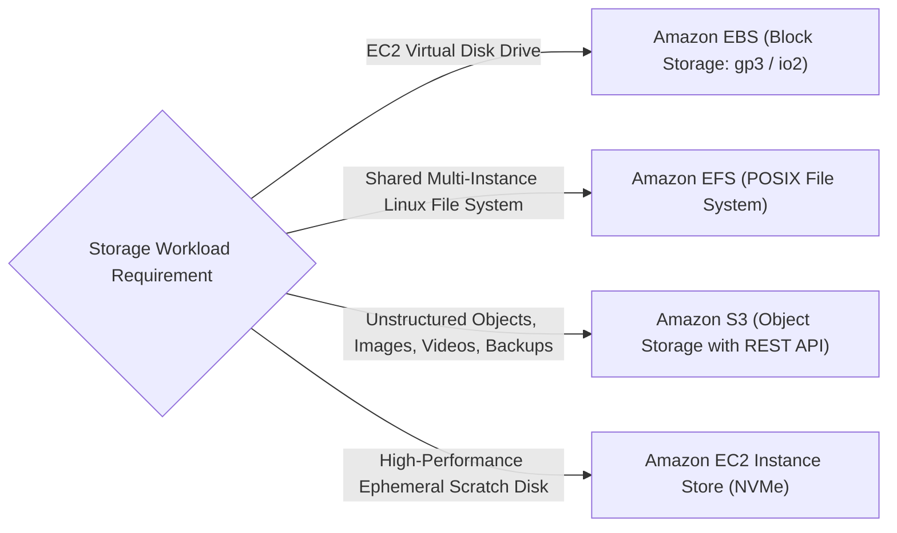

---


title: "AWS CLF-C02: Cloud Practitioner Master Architecture Mindmap"
description: "Master-level engineering study guide and architectural mindmap for the AWS Certified Cloud Practitioner (CLF-C02) exam, covering Cloud Concepts, Security & Compliance, Cloud Technology & Services, and Billing & Support."
category: "AWS Cloud Practitioner & Certifications"
tags: [aws, clf-c02, mindmap, certification, cloud-practitioner, architecture, well-architected, security, billing, technical-skills, software-engineering, learning-note]
date: "2026-08-21"
---

# AWS Certified Cloud Practitioner (CLF-C02) Master Architecture Mindmap

---

## 1. Executive Summary & Examination Blueprint Weighting

The **AWS Certified Cloud Practitioner (CLF-C02)** validates foundational, high-level understanding of the AWS Cloud ecosystem, global infrastructure, security models, core compute/storage/database/networking services, and financial governance.



---

## 2. Comprehensive CLF-C02 Master Architecture Mindmap

```mermaid
mindmap
  root((AWS CLF-C02 Architecture))
    Domain 1: Cloud Concepts
      Six Core Advantages
        CapEx to OpEx Variable Cost
        Massive Economies of Scale
        Stop Guessing Capacity (Elasticity)
        Increase Speed & Agility
        Stop Running Data Centers
        Go Global in Minutes
      Cloud Adoption Framework (CAF)
        Business Perspectives (Business, People, Governance)
        Technical Perspectives (Platform, Security, Operations)
      Well-Architected Framework
        Operational Excellence
        Security
        Reliability
        Performance Efficiency
        Cost Optimization
        Sustainability
      Migration Strategies (6 Rs)
        Rehost (Lift and Shift)
        Replatform (Lift, Tinker, Shift)
        Repurchase (Move to SaaS)
        Refactor (Re-architect Cloud-Native)
        Retain (Keep On-Prem)
        Retire (Decommission)
    Domain 2: Security & Compliance
      Shared Responsibility Model
        Security OF the Cloud (AWS: Physical, Hardware, Hypervisors)
        Security IN the Cloud (Customer: OS, IAM, Data, Encryption, Firewalls)
      Identity & Access Management
        IAM Users, Groups, Roles & Policies
        Multi-Factor Authentication (MFA)
        AWS Organizations & Service Control Policies (SCPs)
        AWS IAM Identity Center (SSO)
      Security & Threat Services
        Amazon GuardDuty (Intelligent Threat ML)
        Amazon Inspector (Vulnerability Scanning)
        Amazon Macie (S3 Sensitive Data & PII Discovery)
        AWS Security Hub (Centralized Security Posture)
      Network & Edge Protection
        Security Groups (Stateful) vs NACLs (Stateless)
        AWS WAF (Layer 7 Web App Firewall)
        AWS Shield (DDoS: Standard vs Advanced)
      Encryption & Secrets
        AWS KMS (Envelope Cryptography CMKs)
        AWS CloudHSM (Dedicated FIPS 140-2 Level 3)
        AWS Secrets Manager (Automatic Credential Rotation)
        AWS Systems Manager Parameter Store
      Compliance & Governance
        AWS Artifact (SOC, PCI-DSS, BAA Compliance Reports)
        AWS Audit Manager
    Domain 3: Cloud Technology & Services
      Global Infrastructure
        Regions (Min 3 AZs per Region)
        Availability Zones (Discrete Data Centers)
        Edge Locations & Points of Presence (PoP)
        Local Zones & Wavelength (5G Edge)
        AWS Outposts (Hybrid On-Premise)
      Compute Services
        Amazon EC2 (Instances, AMIs, User Data, Spot/Reserved)
        AWS Auto Scaling & Elastic Load Balancing (ALB, NLB, GWLB)
        Container Services (ECS, EKS, ECR, AWS Fargate)
        Serverless Compute (AWS Lambda, AWS App Runner)
        PaaS & Batch (AWS Elastic Beanstalk, AWS Batch)
      Storage Services
        Amazon S3 (Standard, Intelligent-Tiering, IA, Glacier Deep Archive)
        Amazon EBS (Block Storage: gp3, io2 Block Express)
        Amazon EFS (Elastic Shared Linux File System)
        AWS Storage Gateway (File, Volume, Tape Gateway)
        AWS Snow Family (Snowcone, Snowball Edge, Snowmobile)
      Database Services
        Amazon RDS (Aurora, PostgreSQL, MySQL, MariaDB, Oracle, SQL Server)
        Amazon DynamoDB (Serverless NoSQL Key-Value / Global Tables)
        Amazon ElastiCache (Redis & Memcached)
        Amazon Redshift (Petabyte Columnar Data Warehouse)
        Amazon DocumentDB & Neptune (Document & Graph)
      Networking & Content Delivery
        Amazon VPC (Subnets, Route Tables, CIDR Blocks)
        Gateways (Internet Gateway, NAT Gateway, Transit Gateway)
        VPC Endpoints (Interface Endpoints via PrivateLink, Gateway Endpoints)
        Amazon Route 53 (DNS & Global Routing Policies)
        Amazon CloudFront (CDN Edge Acceleration)
        AWS Direct Connect & Site-to-Site VPN
      Management & Observability
        Amazon CloudWatch (Metrics, Logs, Alarms, Dashboards)
        AWS CloudTrail (API Audit Trails & User Activity)
        AWS Config (Continuous Resource Compliance Tracking)
        AWS CloudFormation (Infrastructure as Code)
        AWS Systems Manager (Patching, Automation, Session Manager)
    Domain 4: Billing, Pricing & Support
      Pricing Models
        On-Demand (Pay-as-you-go)
        Savings Plans (Compute & EC2 1-3 Year Commitment)
        Reserved Instances (Standard vs Convertible)
        Spot Instances (Up to 90% Discount)
      Cost Management Tools
        AWS Cost Explorer (12-Month Forecasting)
        AWS Budgets (Threshold Email/SNS Alerts)
        AWS Pricing Calculator (Pre-deployment Architecture Estimates)
        Cost Allocation Tags
      Support Plans Comparison
        Basic (Free, Customer Service, 7 Trusted Advisor Checks)
        Developer (Business Hours Email, 12h SLA)
        Business (24/7 Phone/Chat, 1h SLA, Full Trusted Advisor)
        Enterprise (24/7 Dedicated TAM, 15m SLA for Critical Down)
```

---

## 3. Domain 1: Cloud Concepts Deep Dive (24%)

### 3.1 The 6 Fundamental Advantages of Cloud Computing
1. **Trade Capital Expense (CapEx) for Variable Expense (OpEx)**: Pay only for compute and storage when consumed rather than investing heavily in data centers.
2. **Benefit from Massive Economies of Scale**: Aggregated usage across millions of customers translates to higher economies of scale and continuous price reductions from AWS.
3. **Stop Guessing Capacity**: Elastic auto-scaling automatically expands capacity to handle load spikes and scales in during lulls.
4. **Increase Speed and Agility**: Provision thousands of servers in seconds via API, accelerating software innovation cycles.
5. **Stop Spending Money Running Data Centers**: Offload racking, stacking, cabling, cooling, and power to AWS.
6. **Go Global in Minutes**: Deploy applications across multiple global AWS Regions with minimal latency.

### 3.2 The AWS Well-Architected Framework (6 Pillars)

| Pillar | Core Architectural Principle | Representative AWS Services |
| :--- | :--- | :--- |
| **1. Operational Excellence** | Perform operations as code, make small reversible changes, anticipate failure. | AWS CloudFormation, CloudWatch, Systems Manager |
| **2. Security** | Implement strong identity foundation, maintain traceability, protect data in transit & at rest. | AWS IAM, KMS, Shield, WAF, CloudTrail |
| **3. Reliability** | Automatically recover from failure, test recovery procedures, scale horizontally. | Multi-AZ RDS, Auto Scaling Groups, Route 53 Failover |
| **4. Performance Efficiency** | Democratize advanced technologies, use serverless architectures, experiment globally. | AWS Lambda, Fargate, ElastiCache, CloudFront |
| **5. Cost Optimization** | Implement cloud financial management, adopt consumption model, measure ROI. | Cost Explorer, Compute Optimizer, Budgets |
| **6. Sustainability** | Maximize utilization, minimize environmental impact of cloud infrastructure. | AWS Graviton (ARM-based chips), S3 Lifecycle Rules |

---

## 4. Domain 2: Security & Compliance Deep Dive (30%)

### 4.1 The Shared Responsibility Model



### 4.2 Security Groups vs. Network Access Control Lists (NACLs)

| Dimension | Security Groups | Network Access Control Lists (NACLs) |
| :--- | :--- | :--- |
| **Operating Level** | **Instance Level** (Attached to EC2 ENI) | **Subnet Level** (Applies to all instances in subnet) |
| **State Nature** | **Stateful** (Return traffic automatically allowed) | **Stateless** (Inbound & Outbound rules evaluated independently) |
| **Rule Types** | **ALLOW rules only** (Implicit deny all else) | **ALLOW and DENY rules** |
| **Evaluation Order** | Evaluates **ALL rules** before deciding | Evaluates rules in strict **numbered order** (\$100, 200, \dots$) |

---

## 5. Domain 3: Core Technology & Services Matrix (34%)

### 5.1 Storage Services Decision Matrix



### 5.2 Amazon S3 Storage Classes Hierarchy

| S3 Storage Class | Durability | Availability | Minimum Storage Duration | Retrieval Fee | Optimal Use Case |
| :--- | :--- | :--- | :--- | :--- | :--- |
| **S3 Standard** | \$99.999999999\%$ ($11\text{ 9s}$) | \$99.99\%$ | None | None | Active, frequently accessed hot data. |
| **S3 Intelligent-Tiering** | $11\text{ 9s}$ | \$99.9\%$ | None | None | Data with unknown or unpredictable access patterns. |
| **S3 Standard-IA** | $11\text{ 9s}$ | \$99.9\%$ | 30 Days | Yes (per GB) | Long-term data accessed $< 1\text{ time/month}$. |
| **S3 One Zone-IA** | $11\text{ 9s}$ (1 AZ only) | \$99.5\%$ | 30 Days | Yes (per GB) | Reproducible infrequent data (low cost). |
| **S3 Glacier Flexible** | $11\text{ 9s}$ | \$99.9\%$ | 90 Days | Yes | Compliance archives (retrieval: minutes to hours). |
| **S3 Glacier Deep Archive**| $11\text{ 9s}$ | \$99.9\%$ | 180 Days | Yes | Lowest cost storage (retrieval: 12-48 hours). |

---

## 6. Domain 4: Billing, Pricing & Support Plans (12%)

### 6.1 AWS Support Plans Comparison Matrix

| Feature | Basic Support | Developer Support | Business Support | Enterprise Support |
| :--- | :--- | :--- | :--- | :--- |
| **Cost** | Free (Included) | Greater of $\$29/\text{mo}$ or $3\%$ usage | Greater of $\$100/\text{mo}$ or graduated $\%$ | Greater of $\$15,000/\text{mo}$ or graduated $\%$ |
| **Who can open cases?** | Customer Service only | 1 Primary Contact (Email) | Unlimited Contacts (24/7 Phone/Chat) | Unlimited Contacts (24/7 Phone/Chat) |
| **SLA: General Guidance** | None | $< 24$ Business Hours | $< 24$ Business Hours | $< 24$ Business Hours |
| **SLA: Production System Impaired** | None | $< 12$ Business Hours | $< 4$ Hours | $< 4$ Hours |
| **SLA: Production System Down** | None | None | **$< 1$ Hour** | **$< 1$ Hour** |
| **SLA: Business-Critical System Down**| None | None | None | **$< 15$ Minutes** |
| **Architecture Guidance** | None | General guidance | Contextual to your use-case | **Consultative with Solutions Architect** |
| **Dedicated Technical Account Manager**| No | No | No | **YES (Assigned TAM)** |
| **AWS Trusted Advisor Access** | 7 Core checks | 7 Core checks | **Full 115+ checks** | **Full 115+ checks** |

---

## 🔗 Graph-Linked Knowledge Base
- ⚓ Flashcard Deck: [[aws_clf_c02_flashcards|AWS CLF-C02 Flashcards]]
- ⚓ Practice Questions: [[aws_clf_c02_practice_questions___final_test|AWS CLF-C02 Final Practice Test]]
- 🔗 Cloud Concepts: [[aws_cloud_concepts_waf|AWS Cloud Concepts & WAF]]
