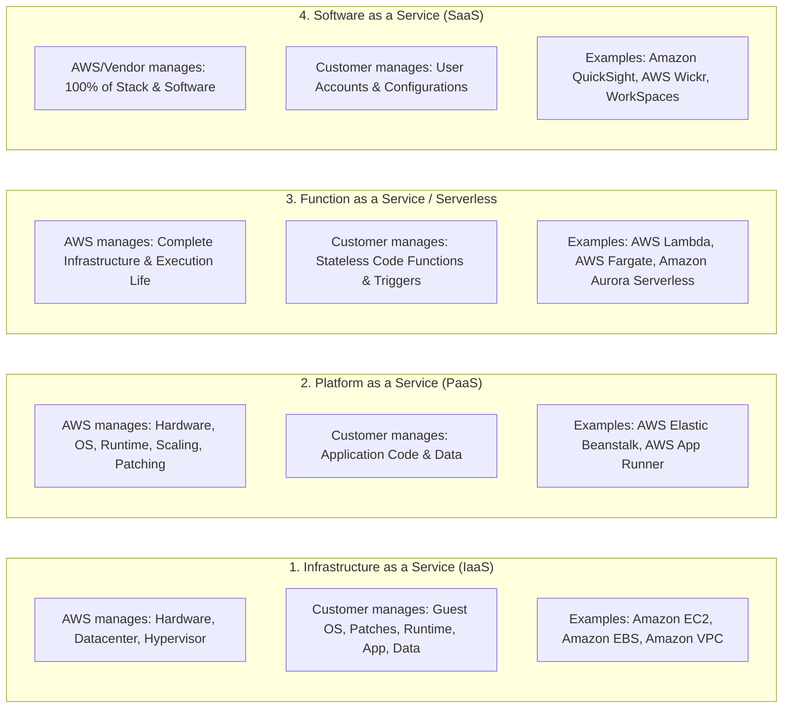
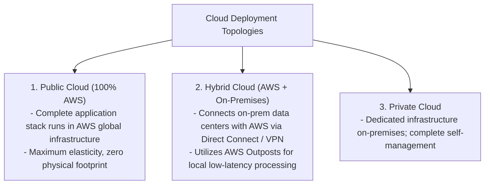
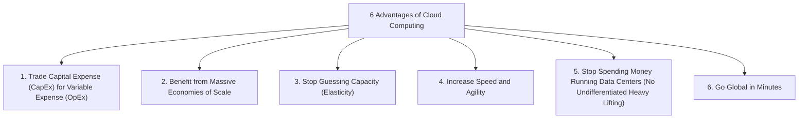
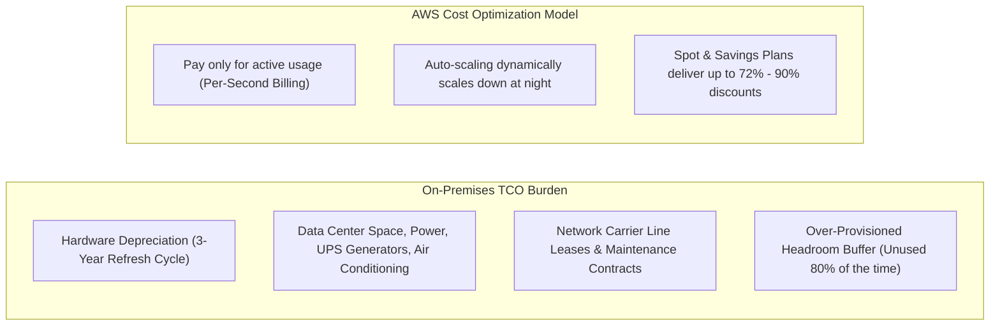
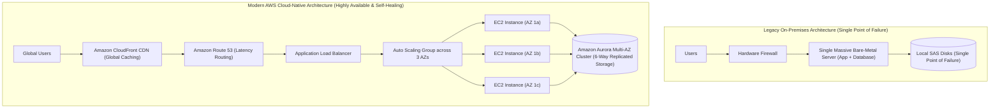

---

title: "Reading 1.2: What is Cloud Computing & AWS Architecture?"
description: "Master-level foundational guide on Cloud Computing fundamentals, IaaS/PaaS/SaaS service models, Public/Private/Hybrid deployment models, the 6 core business advantages of AWS, and eliminating undifferentiated heavy lifting."
category: "AWS Cloud Practitioner & Certifications"
tags: [aws, cloud-computing, iaas, paas, saas, hybrid-cloud, capex-opex, well-architected, fundamentals, technical-skills, software-engineering, learning-note]
date: "2026-08-21"
---

# Reading 1.2: What is Cloud Computing & AWS Architecture?

---

## 1. Executive Summary: The Paradigm Shift in Enterprise IT

Historically, companies were forced to design, finance, construct, and maintain their own on-premises physical data centers. Provisioning an application required multi-month hardware procurement cycles, physical delivery of rack-mounted servers, power grid and cooling system engineering, manual network cabling, operating system installation, and ongoing maintenance.

**Cloud Computing** fundamentally transforms enterprise technology by delivering **on-demand computing power, database storage, applications, and other IT resources over the internet with pay-as-you-go pricing**.

Instead of buying, owning, and maintaining physical servers, organizations consume compute power, storage, and networking as a dynamic utility service from **Amazon Web Services (AWS)**.

```mermaid
flowchart TD
    subgraph TraditionalOnPrem["Traditional On-Premises Data Center (CapEx Model)"]
        Procure["1. Budget Approval & Vendor Procurement (3 - 6 Months)"]
        Hardware["2. Physical Racking, Cabling, Power & Cooling"]
        OS["3. Hypervisor & OS Installation"]
        Deploy1["4. Slow Application Deployment"]
        Procure --> Hardware --> OS --> Deploy1
    end

    subgraph AWSCloudNative["AWS Cloud-Native Computing (OpEx Model)"]
        API["1. On-Demand API Call / Terraform IaC (Milliseconds)"]
        AutoProv["2. Instant Virtualized Resource Provisioning"]
        Deploy2["3. Automated CI/CD Deployment (Minutes)"]
        Scale["4. Dynamic Elastic Auto-Scaling on Demand"]
        API --> AutoProv --> Deploy2 --> Scale
    end
```

---

## 2. Cloud Service Models: IaaS vs. PaaS vs. Serverless vs. SaaS

Understanding the technical boundaries of abstraction dictates the operational model and shared responsibilities between the customer and AWS:

### 2.1 Service Model Comparison Matrix

| Dimension | On-Premises | IaaS (e.g. EC2) | PaaS (e.g. Elastic Beanstalk) | Serverless (e.g. Lambda) | SaaS (e.g. QuickSight) |
| :--- | :--- | :--- | :--- | :--- | :--- |
| **Physical Facilities & Power** | Customer | **AWS** | **AWS** | **AWS** | **AWS** |
| **Physical Network & Servers** | Customer | **AWS** | **AWS** | **AWS** | **AWS** |
| **Virtualization / Hypervisor** | Customer | **AWS** | **AWS** | **AWS** | **AWS** |
| **Operating System & Kernel** | Customer | Customer | **AWS** | **AWS** | **AWS** |
| **Runtime & Language Engines** | Customer | Customer | **AWS** | **AWS** | **AWS** |
| **Scaling & High Availability** | Customer | Customer Configured | Automated / Configured | **Fully Automatic** | **Fully Managed** |
| **Application Logic & Code** | Customer | Customer | Customer | Customer | **Vendor** |
| **Customer Data & Access IAM** | Customer | Customer | Customer | Customer | Customer |

---

## 3. Cloud Deployment Models: Public, Private, Hybrid & Multi-Cloud

---

## 4. The 6 Core Financial & Strategic Advantages of AWS

AWS encapsulates the business case for cloud computing into six foundational principles:

### 4.1 In-Depth Breakdown of the 6 Advantages
1. **Trade Capital Expense (CapEx) for Variable Expense (OpEx)**:
   - Instead of investing millions of dollars upfront in data center real estate, cooling generators, and racks of servers before knowing how your product will perform, you pay only when you consume compute resources, and only for the exact seconds they run.
2. **Benefit from Massive Economies of Scale**:
   - Because hundreds of thousands of active customers aggregate their usage onto AWS, AWS achieves massive purchasing power on silicon, network hardware, and power. This enables AWS to systematically pass operational cost reductions back to customers (over 130+ proactive price reductions since inception).
3. **Stop Guessing Capacity**:
   - In traditional environments, engineers had to guess traffic demand for the next 3 years. Guessing too high led to expensive idle servers; guessing too low resulted in server crashes during traffic spikes. Cloud **Elasticity** provisions capacity automatically to match demand in real time.
4. **Increase Speed and Agility**:
   - In on-premises setups, provisioning test environments takes weeks. In AWS, developers provision isolated environments in seconds via automated scripts, dramatically accelerating innovation cycles and time-to-market.
5. **Stop Spending Money on "Undifferentiated Heavy Lifting"**:
   - Racking servers, replacing failed hard drives, upgrading hypervisors, and managing backup tapes do not differentiate your business from your competitors. Offloading infrastructure maintenance to AWS allows your engineering talent to focus $100\%$ on business code and customer experience.
6. **Go Global in Minutes**:
   - Deploy applications across multiple global geographic Regions with minimal latency using Amazon CloudFront and AWS global backbone fiber.

---

## 5. Total Cost of Ownership (TCO) & Economic Modeling

When evaluating cloud migrations, organizations evaluate the **Total Cost of Ownership (TCO)**, which includes both direct and indirect expenses:

$$\text{On-Premises TCO} = \text{Hardware Acquisition} + \text{Data Center Facility Lease} + \text{Power \& Cooling} + \text{IT Administration Staff} + \text{Hardware Depreciation}$$

$$\text{AWS Cloud TCO} = \sum (\text{Actual Compute, Storage \& Network Consumed}) + \text{Cloud Engineering Staff}$$

---

## 6. Real-World Architectural Transformation: The Monolith to Cloud-Native

---

## 🔗 Graph-Linked Knowledge Base
- ⚓ Global Infrastructure: [[Reading 1.3 AWS Global Infrastructure|Reading 1.3: AWS Global Infrastructure]]
- ⚓ Shared Responsibility: [[Reading 1.5 Security and the AWS Shared Responsibility Model|Reading 1.5: Security & Shared Responsibility]]
- 🔗 Cloud Concepts: [[aws_cloud_concepts_waf|AWS Cloud Concepts & WAF]]
