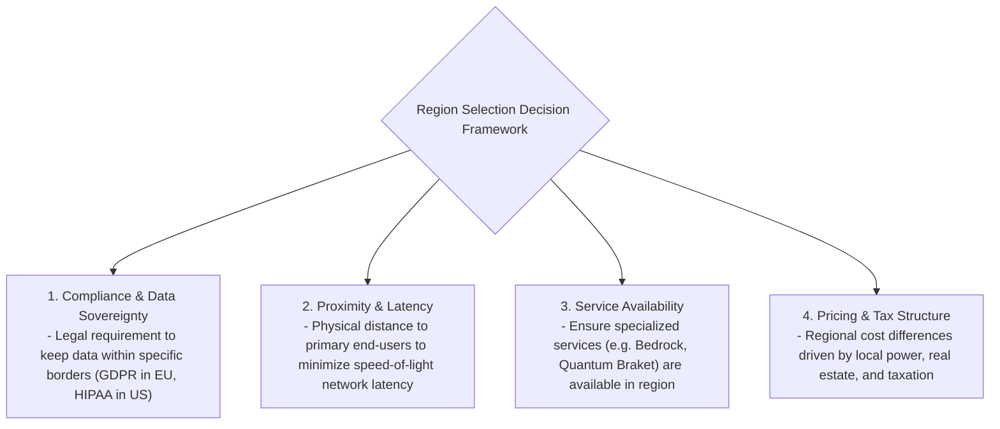
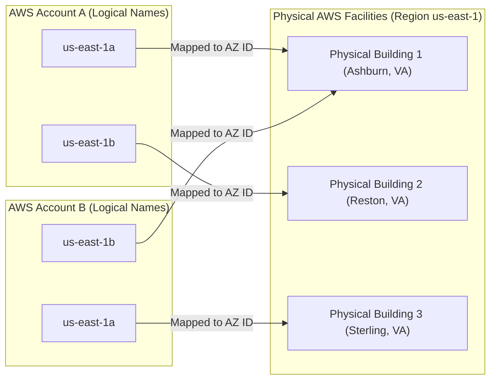
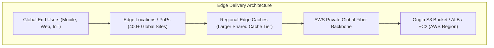
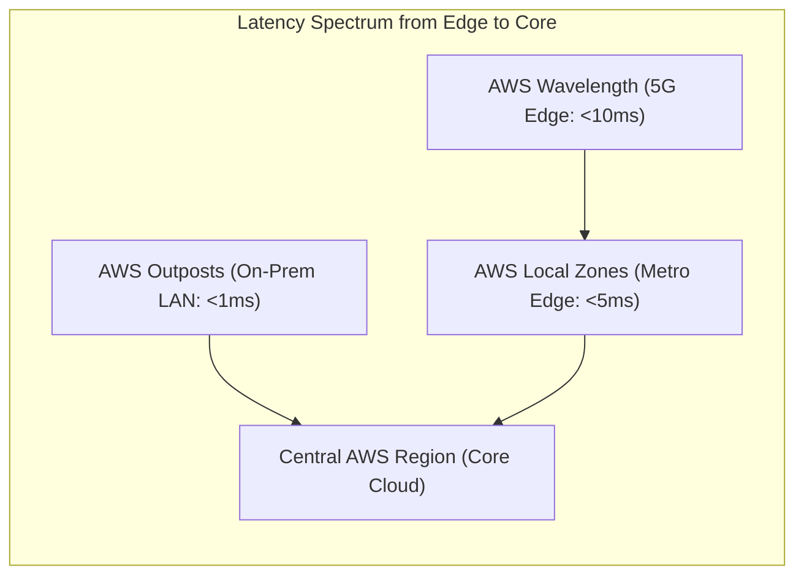
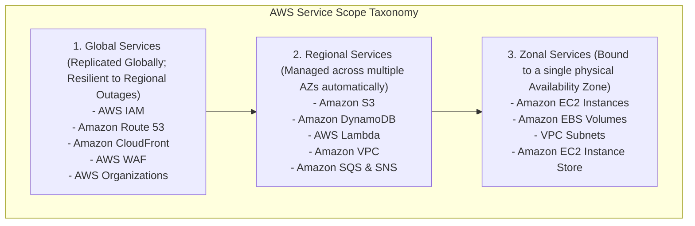
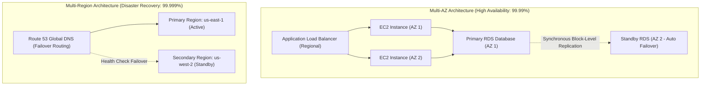

---


title: "Reading 1.3: AWS Global Infrastructure: Regions, AZs & Edge Architecture"
description: "Master-level engineering guide for the AWS Global Infrastructure, covering physical Regions, Availability Zones (AZ IDs), Edge Locations, Local Zones, Wavelength, Outposts, and Service Scoping hierarchy."
category: "AWS Cloud Practitioner & Certifications"
tags: [aws, global-infrastructure, regions, availability-zones, edge-locations, local-zones, outposts, high-availability, disaster-recovery, technical-skills, software-engineering, learning-note]
date: "2026-08-21"
---

# Reading 1.3: AWS Global Infrastructure: Regions, AZs & Edge Architecture

---

## 1. Executive Summary & Physical Infrastructure Topology

The **AWS Global Infrastructure** represents the physical, hardware, electrical, and fiber-optic network foundation upon which all AWS cloud services are deployed. It is designed to deliver ultra-low latency, high fault tolerance, robust data sovereignty compliance, and massive scalability.

The global infrastructure consists of four primary structural tiers:
1. **AWS Regions**: Geographically dispersed locations containing clusters of isolated data centers.
2. **Availability Zones (AZs)**: Distinct physical data center clusters within a Region, isolated from shared failure domains (flood plains, power grids).
3. **Points of Presence (Edge Locations & Regional Edge Caches)**: Globally distributed caching and routing edge nodes for Amazon CloudFront and Route 53.
4. **Specialized Hybrid Extensions**: **AWS Local Zones**, **AWS Wavelength** (5G edge), and **AWS Outposts** (on-premise racks).

```mermaid
flowchart TD
    subgraph GlobalFootprint["AWS Global Infrastructure Hierarchy"]
        Global["AWS Global Backbone Network (Private 100GbE+ Fiber Mesh)"]
        
        subgraph RegionTopology["AWS Region (e.g. us-east-1: N. Virginia)"]
            AZ1["Availability Zone A (us-east-1a / use1-az1)<br/>Discrete Data Center(s)"]
            AZ2["Availability Zone B (us-east-1b / use1-az2)<br/>Discrete Data Center(s)"]
            AZ3["Availability Zone C (us-east-1c / use1-az3)<br/>Discrete Data Center(s)"]
            
            AZ1 <-->|Redundant Low-Latency Dark Fiber (<1ms RTT)| AZ2
            AZ2 <-->|Redundant Low-Latency Dark Fiber (<1ms RTT)| AZ3
            AZ3 <-->|Redundant Low-Latency Dark Fiber (<1ms RTT)| AZ1
        end
        
        subgraph EdgeLayer["Global Edge Network"]
            Edge1["Edge Location (Tokyo)"]
            Edge2["Edge Location (London)"]
            Edge3["Edge Location (New York)"]
        end
        
        Global --- RegionTopology
        Global --- EdgeLayer
    end
```

---

## 2. AWS Regions: Architectural Invariants & Selection Criteria

An **AWS Region** is a physical geographic location in the world where AWS clusters multiple data centers. Every AWS Region is completely independent and autonomous:
- **Data Sovereignty & Independence**: Data stored in an AWS Region remains strictly within that physical territory. AWS never replicates data across Regions without explicit, customer-configured cross-region replication rules.
- **Physical Separation**: Regions are separated by hundreds or thousands of kilometers to ensure that natural disasters (earthquakes, hurricanes, regional power outages) cannot impact multiple Regions simultaneously.



### 2.1 The 4 Decision Criteria Matrix

| Selection Factor | Real-World Engineering Example | Failure Mode if Ignored |
| :--- | :--- | :--- |
| **Data Compliance & Governance** | Storing European citizen PII strictly within `eu-central-1` (Frankfurt) to comply with GDPR. | Severe regulatory fines, legal sanctions, audit failure. |
| **Latency & User Proximity** | Deploying real-time mobile gaming backend in `ap-southeast-1` (Singapore) for Southeast Asian players. | High network round-trip time ($> 200\text{ ms}$) leading to poor UX and user churn. |
| **Service Availability** | Verifying if new generative AI foundation models (Amazon Bedrock) are launched in target Region. | Blocked feature development if dependent service is un-deployed. |
| **Cost & Financial Optimization** | Hosting large batch transcoding workloads in `us-east-1` (N. Virginia) instead of `sa-east-1` (São Paulo) where hardware import tariffs increase compute costs by $\sim 40\%$. | Budget overruns and higher monthly compute spend. |

---

## 3. Availability Zones: Anatomy & Physical AZ ID Mapping

Inside every AWS Region is a minimum of **3 Availability Zones (AZs)** (some large Regions like Northern Virginia have 6 AZs).

### 3.1 Availability Zone Design Invariants
1. **Physical Isolation**: Each AZ comprises one or more discrete data centers with independent redundant utility power feeds, backup diesel generators, cooling infrastructure, and physical security.
2. **Geographical Distance**: AZs are situated meaningful distances apart (typically \$10 - 100\text{ kilometers}$) to mitigate localized flood, fire, or grid failures.
3. **High-Speed Interconnectivity**: Connected via redundant, dedicated metro dark-fiber networks delivering round-trip latency under **$1\text{ millisecond}$**, enabling synchronous relational database replication (e.g. Multi-AZ RDS / Aurora).



### 3.2 AZ Name Randomization vs. Immutable AZ IDs
To prevent all customers from launching instances in `us-east-1a` and causing physical resource exhaustion in a single data center, AWS dynamically randomizes the logical AZ letter mapping for every AWS account.

To coordinate cross-account multi-tenant architectures, refer to the immutable physical **AZ ID**:
```bash
# Inspect immutable AZ ID via AWS CLI
aws ec2 describe-availability-zones --region us-east-1 \
    --query "AvailabilityZones[*].[ZoneName, ZoneId]" --output table
```
*Output*:
```text
-------------------------
| DescribeAvailabilityZones |
+--------------+---------+
|  us-east-1a  | use1-az1|
|  us-east-1b  | use1-az2|
|  us-east-1c  | use1-az4|
+--------------+---------+
```

---

## 4. Edge Infrastructure & Points of Presence (PoPs)



- **Edge Locations (400+ Sites)**: Physical points of presence located in major metropolitan areas worldwide that cache static web assets, images, and video streams via **Amazon CloudFront**, and resolve DNS queries via **Amazon Route 53**.
- **Regional Edge Caches (REC)**: Mid-tier caching nodes situated between Edge Locations and origin servers, holding larger caches to prevent cache evictions for long-tail content.
- **AWS Global Accelerator**: Ingests user TCP/UDP traffic at the closest Edge Location and routes it over AWS's private, congestion-free global fiber network directly to your regional Application Load Balancers.

---

## 5. Specialized Hybrid & Edge Infrastructure: Local Zones, Wavelength & Outposts

| Hybrid Technology | Architectural Deployment Location | Primary Target Use Case | Latency Profile |
| :--- | :--- | :--- | :--- |
| **AWS Local Zones** | Major metropolitan areas without full AWS Regions (e.g. Los Angeles, Dallas, Chicago). | Video rendering, high-frequency financial trading, local media production. | **Single-digit milliseconds** ($< 5\text{ ms}$) to local population centers. |
| **AWS Wavelength** | Embedded inside physical telecommunication carrier 5G data centers (Verizon, Vodafone, KDDI). | Autonomous vehicles, AR/VR streaming, mobile real-time gaming. | **Sub-10 millisecond latency** directly from 5G devices. |
| **AWS Outposts** | Physical 42U rack of native AWS hardware installed directly inside customer on-premises data centers. | Strict on-premise data residency, legacy low-latency factory robotics systems. | **Sub-millisecond local LAN latency**. |



---

## 6. Service Scoping Architecture: Global vs Regional vs Zonal

Understanding the failure domain scope of every AWS service is essential for designing resilient architectures:



---

## 7. High Availability & Disaster Recovery Architecture (Multi-AZ vs Multi-Region)



---

## 🔗 Graph-Linked Knowledge Base
- ⚓ Reading 1.2: [[Reading 1.2 What is AWS|Reading 1.2: What is Cloud Computing & AWS?]]
- ⚓ Reading 1.5: [[Reading 1.5 Security and the AWS Shared Responsibility Model|Reading 1.5: Security & Shared Responsibility]]
- 🔗 Cloud Concepts: [[aws_cloud_concepts_waf|AWS Cloud Concepts & WAF]]
