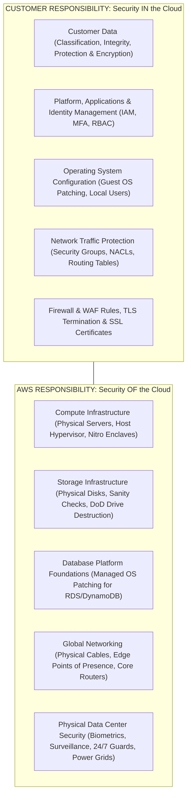
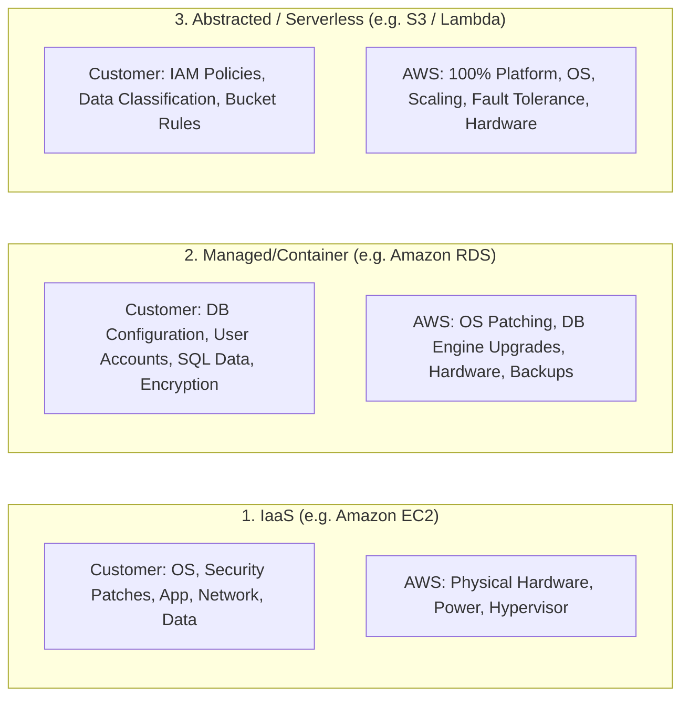
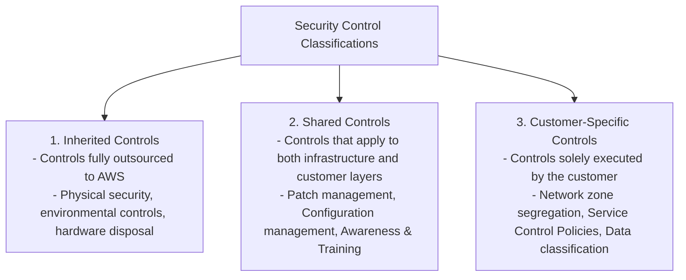
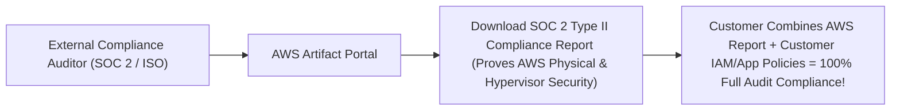

---

title: "Reading 1.5: Security and the AWS Shared Responsibility Model"
description: "Master-level engineering guide for the AWS Shared Responsibility Model, detailing Security OF the Cloud vs Security IN the Cloud across IaaS, Managed/Container, and Abstracted Serverless service tiers."
category: "AWS Cloud Practitioner & Certifications"
tags: [aws, security, shared-responsibility-model, compliance, iaas, paas, serverless, iam, encryption, artifact, technical-skills, software-engineering, learning-note]
date: "2026-08-21"
---

# Reading 1.5: Security and the AWS Shared Responsibility Model

---

## 1. Executive Summary & The Shared Responsibility Paradigm

Security and compliance in cloud computing is not an all-or-nothing proposition; it is a collaborative partnership governed by the **AWS Shared Responsibility Model**.

The model establishes a clear boundary between:
1. **Security OF the Cloud (AWS Responsibility)**: AWS is responsible for protecting and maintaining the global physical infrastructure, hardware facilities, virtualization hypervisors, and foundation network systems that run AWS Cloud services.
2. **Security IN the Cloud (Customer Responsibility)**: The customer is responsible for properly configuring, operating, and managing everything they provision inside AWS, including guest operating systems, application code, network firewall rules, identity access management, and customer data encryption.

---

## 2. Service Tier Responsibility Matrices (IaaS vs. Managed vs. Abstracted)

The operational burden placed on the customer shifts dramatically depending on the category of AWS service consumed:

### 2.1 Deep Comparison Matrix across Service Tiers

| Architecture Layer | Infrastructure Services (Amazon EC2, EBS, VPC) | Managed Platform Services (Amazon RDS, Elastic Beanstalk) | Abstracted / Serverless Services (Amazon S3, DynamoDB, Lambda) |
| :--- | :--- | :--- | :--- |
| **Physical Facilities & Hardware** | **AWS** | **AWS** | **AWS** |
| **Virtualization & Hypervisor** | **AWS** | **AWS** | **AWS** |
| **Host Operating System** | **AWS** | **AWS** | **AWS** |
| **Guest Operating System & Kernel** | **Customer** (Manual yum/apt patching) | **AWS** (Automated OS patching) | **AWS** (Completely hidden) |
| **Database Engine & Platform** | **Customer** (If self-installed on EC2) | **AWS** (Automated minor version upgrades) | **AWS** (Native NoSQL engine managed by AWS) |
| **Network Firewall Rules** | **Customer** (Security Groups & NACLs) | **Customer** (DB Security Groups & Subnet Groups) | **Customer** (Bucket Policies, Resource Policies) |
| **Data Encryption at Rest** | **Customer** (Enable KMS on EBS / App) | **Customer** (Enable KMS on RDS storage) | **Customer** (Configure S3 SSE-KMS / SSE-S3) |
| **Application Logic & Code** | **Customer** | **Customer** | **Customer** (Stateless Lambda Functions) |
| **Customer Data & IAM Policies** | **Customer** | **Customer** | **Customer** |

---

## 3. Control Classifications: Inherited, Shared, and Customer-Specific

AWS categorizes security controls into three distinct governance domains:

### 3.1 Shared Controls in Action: Patch Management
- **AWS Responsibility**: Patching the physical host hardware, firmware, BIOS, network switch operating systems, and virtualization hypervisors without customer downtime.
- **Customer Responsibility**: Patching guest operating systems (Windows Server / Amazon Linux on EC2), installing security updates for web servers (Nginx/Apache), and updating runtime libraries (Node.js, JDK, Python).

---

## 4. Real-World Security Incident Case Studies

| Incident Scenario | Failure Domain | Responsible Party | Root Cause & Engineering Prevention |
| :--- | :--- | :--- | :--- |
| **Public S3 Bucket Leak (10M Records Exposed)** | Configuration IN the Cloud | **Customer** | Customer configured S3 bucket policy allowing `Principal: *` with `s3:GetObject`. **Fix**: Enable AWS S3 Block Public Access at the organization level. |
| **EC2 Crypto-Mining Botnet Infection** | OS & IAM IN the Cloud | **Customer** | Developer hardcoded AWS root access keys in public GitHub repository; EC2 security group had port 22 open to `0.0.0.0/0`. **Fix**: Use IAM Roles, rotate keys via Secrets Manager, use SSM Session Manager. |
| **Meltdown / Spectre Hypervisor Vulnerability** | Virtualization OF the Cloud | **AWS** | Microprocessor hardware flaw affecting CPU speculative execution. **Fix**: AWS patched all underlying Xen/KVM hypervisors globally across all Regions with zero customer intervention required. |
| **Unencrypted Database Backup Compromise** | Data Encryption IN the Cloud | **Customer** | Stored database snapshot in plaintext without enabling KMS encryption. **Fix**: Enforce `aws:SecureTransport` and KMS customer-managed key encryption by default. |

---

## 5. Compliance Verification & Audit Assurance: AWS Artifact

Enterprise customers subject to strict regulatory frameworks (PCI-DSS for payments, HIPAA for healthcare, SOC 2 for SaaS, FedRAMP for US government) cannot physically audit AWS data centers.

AWS provides **AWS Artifact**, an automated self-service portal:
- **AWS Artifact Reports**: Instant access to independent third-party audit reports, ISO certifications, and SOC 1/2/3 Attestations of Compliance (AoC).
- **AWS Artifact Agreements**: Review and electronically accept legal compliance contracts, such as the **Business Associate Addendum (BAA)** required for HIPAA compliance.

---

## 🔗 Graph-Linked Knowledge Base
- ⚓ Global Infrastructure: [[Reading 1.3 AWS Global Infrastructure|Reading 1.3: AWS Global Infrastructure]]
- ⚓ Role-Based Access: [[Reading 1.8 Role Based Access in AWS|Reading 1.8: Role-Based Access in AWS (IAM)]]
- 🔗 Cloud Security: [[02_Technical_Skills/01_theory_and_concepts/24_Security_and_Hardening/owasp_top_10_appsec_hardening_remediation|OWASP Top 10 Security Hardening]]
