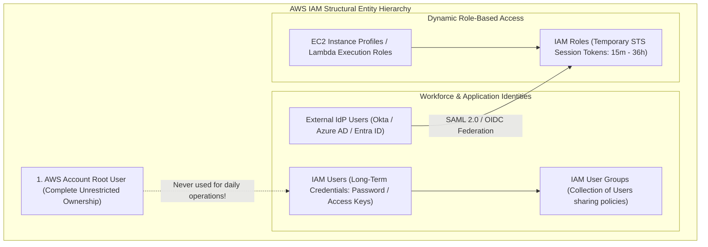
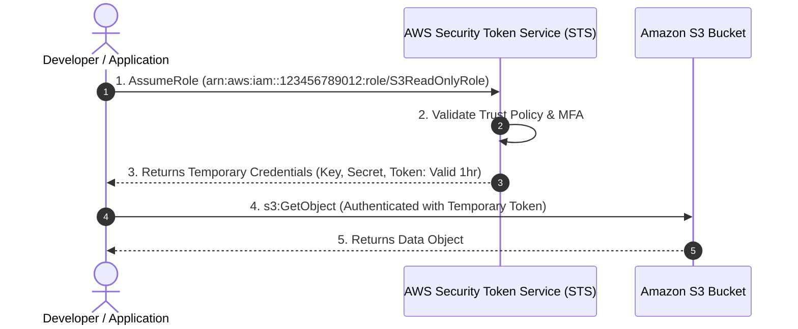
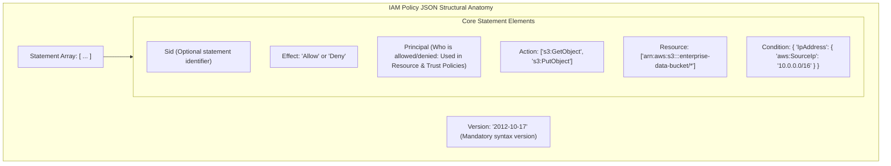
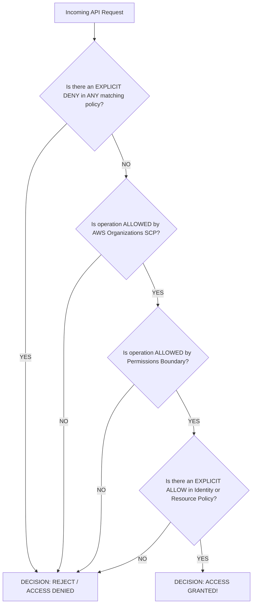
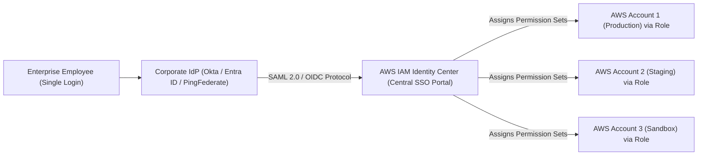

---


title: "Reading 1.8: Role-Based Access Control & IAM Security in AWS"
description: "Master-level engineering guide for AWS Identity and Access Management (IAM), covering IAM Users, Groups, Roles, STS temporary credentials, Policy JSON evaluation logic, IAM Identity Center (SSO), and Organizations SCPs."
category: "AWS Cloud Practitioner & Certifications"
tags: [aws, iam, rbac, security, sts, federation, sso, scp, least-privilege, identity, technical-skills, software-engineering, learning-note]
date: "2026-08-21"
---

# Reading 1.8: Role-Based Access Control & IAM Security in AWS

---

## 1. Executive Summary & Identity Architecture Fundamentals

**AWS Identity and Access Management (IAM)** is the global control plane service that securely manages authentication (verifying who you are) and authorization (specifying what permissions you possess) across all AWS services and resources.

IAM operates on the foundational security principle of **Least Privilege**: granting an identity only the minimum permissions strictly necessary to execute its intended business task, and nothing more.



---

## 2. IAM Core Primitives: Users, Groups, Roles & Policies

| IAM Entity | Credential Type | Lifespan | Typical Production Use Case |
| :--- | :--- | :--- | :--- |
| **Root User** | Email address + Root password + Hardware MFA | Permanent | Account creation, closing account, changing support plans, root billing tasks. |
| **IAM User** | Username + Password (Console) + Static API Access Keys | Long-Term (Static) | Legacy programmatic scripts, individual administrator access (Anti-pattern in enterprise). |
| **IAM Group** | None (Group cannot log in) | N/A | Applying common permission policies to multiple IAM users (e.g. `DevOpsGroup`, `BillingGroup`). |
| **IAM Role** | **Dynamic temporary credentials** issued by AWS STS (`AccessKeyId`, `SecretAccessKey`, `SessionToken`) | Short-Term ($15\text{ mins} - 36\text{ hours}$) | EC2 instance permissions, Lambda execution, cross-account access, IdP Single Sign-On. |



---

## 3. IAM Policy Anatomy & JSON Structure

Permissions are defined exclusively through declarative JSON documents called **IAM Policies**:



### 3.1 Production Least-Privilege IAM Policy Blueprint

```json
{
    "Version": "2012-10-17",
    "Statement": [
        {
            "Sid": "AllowS3ReadWriteEncryptedOnly",
            "Effect": "Allow",
            "Action": [
                "s3:GetObject",
                "s3:PutObject",
                "s3:ListBucket"
            ],
            "Resource": [
                "arn:aws:s3:::production-financial-records",
                "arn:aws:s3:::production-financial-records/*"
            ],
            "Condition": {
                "Bool": {
                    "aws:SecureTransport": "true"
                },
                "NumericLessThanEquals": {
                    "s3:TlsVersion": 1.2
                }
            }
        },
        {
            "Sid": "DenyUnencryptedObjectUploads",
            "Effect": "Deny",
            "Action": "s3:PutObject",
            "Resource": "arn:aws:s3:::production-financial-records/*",
            "Condition": {
                "StringNotEquals": {
                    "s3:x-amz-server-side-encryption": "aws:kms"
                }
            }
        }
    ]
}
```

---

## 4. Policy Evaluation Logic & Invariants

When an identity makes an API request to AWS, the IAM evaluation engine evaluates all applicable policies (Identity-based policies, Resource-based policies, Permissions Boundaries, Session policies, and Organizations SCPs) using a strict mathematical decision pipeline:

$$\text{Decision} = \text{Explicit Deny} \succ \text{Explicit Allow} \succ \text{Implicit Deny (Default)}$$



---

## 5. Enterprise Identity Federation: IAM Identity Center (AWS SSO)

In modern enterprise architectures managing tens or hundreds of AWS accounts, creating manual IAM users in every account is an operational and security anti-pattern. Organizations implement **Centralized Identity Federation**:



### 5.1 Benefits of IAM Identity Center
1. **Single Source of Truth**: User lifecycle (onboarding, role changes, offboarding) is managed exclusively in the corporate IdP.
2. **Instant Deprovisioning**: Terminating an employee in Okta/Entra ID instantly revokes access across all 100+ AWS accounts.
3. **No Static Access Keys**: Eliminates the hazard of developers leaking permanent `AKIA...` access keys to public source repositories.

---

## 6. Multi-Account Governance with Service Control Policies (SCPs)

**Service Control Policies (SCPs)** are organization-level guardrails that specify the **maximum permissions** that member accounts in an **AWS Organization** can execute:

```json
{
    "Version": "2012-10-17",
    "Statement": [
        {
            "Sid": "EnforceRegionLockdown",
            "Effect": "Deny",
            "NotAction": [
                "iam:*",
                "organizations:*",
                "route53:*",
                "cloudfront:*",
                "support:*"
            ],
            "Resource": "*",
            "Condition": {
                "StringNotEquals": {
                    "aws:RequestedRegion": [
                        "us-east-1",
                        "eu-west-1"
                    ]
                }
            }
        }
    ]
}
```
*Impact*: Even a full account administrator with `AdministratorAccess` cannot launch resources in unauthorized Regions (e.g. Asia Pacific or South America), enforcing compliance and preventing accidental spend.

---

## 7. IAM Security Best Practices & Hardening Checklist

| Security Principle | Implementation Standard | Risk Mitigated |
| :--- | :--- | :--- |
| **Lock Down Root Account** | Delete root access keys, enable physical hardware FIPS MFA, lock root credentials in physical safe. | Account-takeover, irreversible infrastructure deletion. |
| **Eliminate Long-Term Static Keys** | Replace IAM user access keys with IAM Roles assumed via STS or AWS IAM Identity Center. | Credential leaks in GitHub, compromised local developer laptops. |
| **Enforce Least Privilege** | Grant specific actions (`s3:GetObject`) and specific resource ARNs; avoid wildcard `*` permissions. | Blast radius explosion during application compromise. |
| **Mandatory MFA Enforcement** | Attach policy condition `"aws:MultiFactorAuthPresent": "true"` for sensitive administrative actions. | Password stuffing and phishing attacks. |
| **Regular Credential Rotation** | Automatically rotate database credentials and API secrets using **AWS Secrets Manager**. | Stale credential exploitation. |

---

## 🔗 Graph-Linked Knowledge Base
- ⚓ Reading 1.5: [[Reading 1.5 Security and the AWS Shared Responsibility Model|Reading 1.5: Security & Shared Responsibility]]
- ⚓ Flashcards: [[aws_clf_c02_flashcards|AWS CLF-C02 Flashcards]]
- 🔗 Cloud Security: [[02_Technical_Skills/01_theory_and_concepts/24_Security_and_Hardening/owasp_top_10_appsec_hardening_remediation|OWASP Top 10 Security Hardening]]
