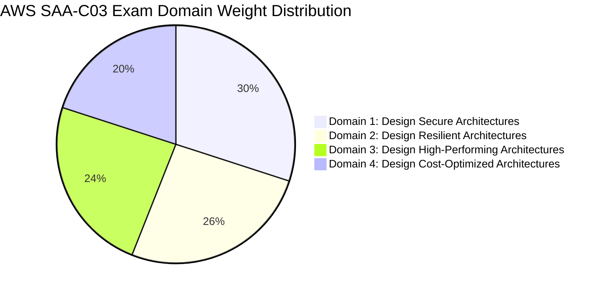
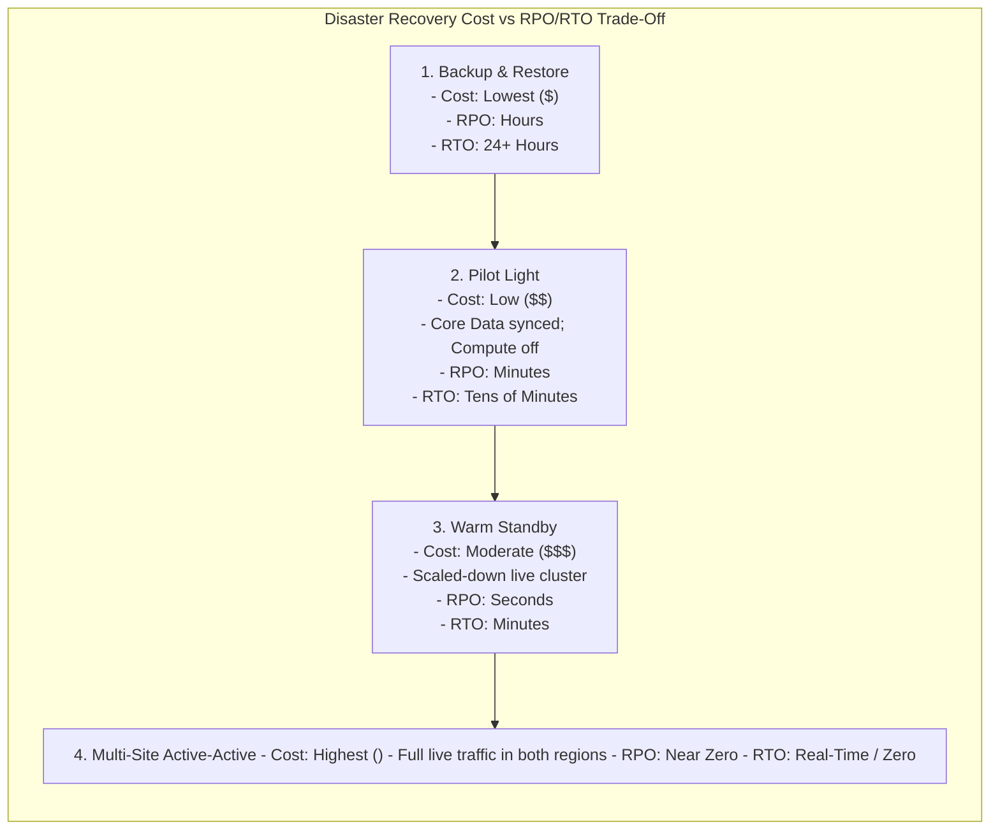
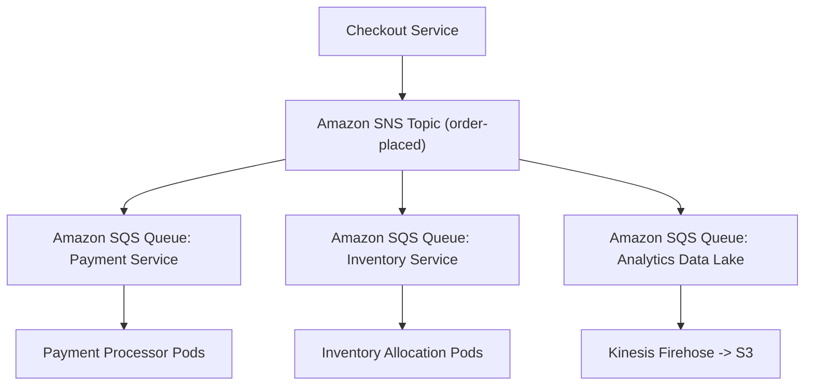
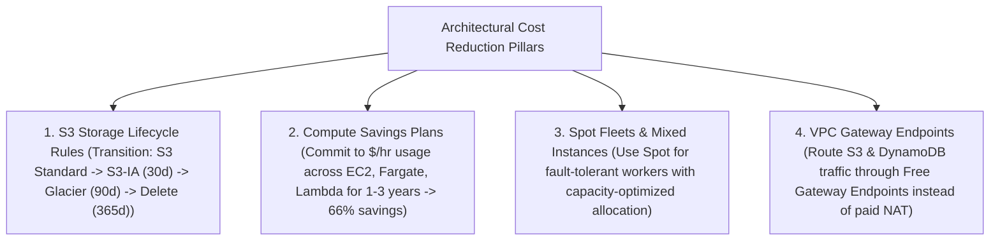

---


title: "AWS SAA-C03: Solutions Architect Associate Master Architecture Mindmap"
description: "Master-level engineering study guide and architectural blueprint for the AWS Certified Solutions Architect - Associate (SAA-C03) exam, covering Secure, Resilient, High-Performing, and Cost-Optimized Architectures."
category: "AWS Cloud Practitioner & Certifications"
tags: [aws, saa-c03, solutions-architect, mindmap, certification, architecture, multi-az, disaster-recovery, security, high-performance, technical-skills, software-engineering, learning-note]
date: "2026-08-21"
---

# AWS Solutions Architect Associate (SAA-C03) Master Architecture Blueprint

---

## 1. Executive Summary & SAA-C03 Examination Domain Weighting

The **AWS Certified Solutions Architect – Associate (SAA-C03)** validates expertise in designing secure, resilient, high-performing, and cost-optimized distributed systems on the AWS Cloud.



---

## 2. Comprehensive SAA-C03 Master Architecture Mindmap

```mermaid
mindmap
  root((AWS SAA-C03 Blueprint))
    Domain 1: Secure Architectures (30%)
      IAM Advanced & Federation
        Permissions Boundaries
        Cross-Account IAM Roles with External ID
        IAM Identity Center (SAML 2.0 / OIDC)
        Organizations Service Control Policies (SCPs)
      Data Protection & Cryptography
        AWS KMS (Customer Managed Keys, Envelope Encryption, Key Policies)
        AWS CloudHSM (Dedicated FIPS 140-2 Level 3 Hardware)
        AWS Secrets Manager (Automated RDS Password Rotation)
        S3 Bucket Policies & Block Public Access
      Network & Infrastructure Hardening
        VPC Multi-Tier Subnet Topology (Public, Private, Isolated Data)
        Security Groups & Stateless NACLs
        VPC Endpoints (Interface via PrivateLink vs Gateway Endpoints)
        AWS WAF (Layer 7 SQLi/XSS) & AWS Shield Advanced (DDoS)
        AWS Network Firewall & Traffic Mirroring
    Domain 2: Resilient Architectures (26%)
      High Availability Multi-Tier Systems
        Elastic Load Balancing (ALB / NLB / GWLB)
        Auto Scaling Groups (Dynamic, Target Tracking, Predictive Scaling)
        Multi-AZ RDS & Amazon Aurora (6-Way Storage Replication)
      Disaster Recovery Strategies (RPO / RTO)
        Backup & Restore (Hours RTO/RPO)
        Pilot Light (Tens of Minutes)
        Warm Standby (Minutes)
        Multi-Site Active-Active (Zero / Sub-second RPO/RTO)
      Asynchronous Decoupling & Event-Driven
        Amazon SQS (Standard vs FIFO Queues, DLQ)
        Amazon SNS (Pub/Sub Fanout, Message Filtering)
        Amazon EventBridge (Schema Registry, Content Filtering)
        AWS Step Functions (Distributed State Machine Sagas)
    Domain 3: High-Performing Architectures (24%)
      Compute Optimization
        EC2 Instance Families (C: Compute, M: General, R: Memory, I: Storage)
        AWS Graviton ARM Silicon (Up to 40% Better Price-Performance)
        AWS Lambda & AWS Fargate (Serverless Scale)
      High-Throughput Storage & Caching
        Amazon EBS (gp3 vs io2 Block Express with Multi-Attach)
        Amazon EFS (POSIX Elastic File System) & Amazon FSx (Lustre / ONTAP)
        Amazon CloudFront & AWS Global Accelerator
        Amazon ElastiCache (Redis Cluster Mode) & DynamoDB DAX
      Database Scaling & Low Latency
        Amazon Aurora Global Databases (Sub-second cross-region replication)
        Amazon DynamoDB Global Tables & On-Demand Capacity
        Amazon Redshift (RA3 Nodes with Managed Storage)
    Domain 4: Cost-Optimized Architectures (20%)
      Compute & Storage Cost Optimization
        Compute Savings Plans & EC2 Instance Savings Plans
        Spot Fleets & Auto Scaling Mixed Instances Policy
        S3 Storage Lifecycle Policies & S3 Intelligent-Tiering
        EBS gp2 to gp3 Migration (20% Baseline Cost Reduction)
      Network & Data Transfer Cost Reduction
        VPC Gateway Endpoints for S3/DynamoDB (Zero Data Transfer Fee)
        CloudFront Free Egress to Edge
        Inter-AZ & Cross-Region Data Transfer Routing Optimization
```

---

## 3. Domain 1: Design Secure Architectures Deep Dive (30%)

### 3.1 Multi-Tier VPC Security Architecture

```mermaid
flowchart TD
    Internet["Public Internet"] --> IGW["Internet Gateway"]
    
    subgraph PublicSubnet["Public Web Subnet (10.0.1.0/24)"]
        ALB["Application Load Balancer (Public IP)"]
        NAT["NAT Gateway (Elastic IP)"]
    end
    
    subgraph PrivateAppSubnet["Private App Subnet (10.0.2.0/24)"]
        AppCluster["EC2 Auto Scaling Group / ECS Fargate"]
    end
    
    subgraph IsolatedDataSubnet["Isolated Database Subnet (10.0.3.0/24: No Internet Route!)"]
        AuroraDB[("Amazon Aurora Multi-AZ Cluster")]
    end
    
    IGW --> ALB
    ALB -->|Port 8080 (SG Inbound: ALB-SG Only)| AppCluster
    AppCluster -->|Port 5432 (SG Inbound: App-SG Only)| AuroraDB
    AppCluster -->|Outbound HTTPS (Updates via NAT)| NAT
    NAT --> IGW
```

### 3.2 VPC Endpoints: Gateway vs. Interface Endpoints

| Dimension | VPC Gateway Endpoints | VPC Interface Endpoints (AWS PrivateLink) |
| :--- | :--- | :--- |
| **Supported Services** | **Amazon S3** and **Amazon DynamoDB** only | Most AWS services (SQS, SNS, Secrets Manager, CloudWatch, Kinesis, 100+ services) |
| **Physical Implementation** | Target route table entry (`pl-xxxxxxx`) | Elastic Network Interface (ENI) with a private IP in your VPC subnet |
| **Cost Profile** | **$100\%$ Free** (Zero hourly fee, zero data transfer fee) | Hourly ENI fee ($\approx \$0.01/\text{hr}$) + per-GB data processing fee |
| **On-Premises Access** | Cannot be accessed from on-premise networks via Direct Connect | Accessible from on-premise networks over Direct Connect / Site-to-Site VPN |

---

## 4. Domain 2: Design Resilient Architectures Deep Dive (26%)

### 4.1 Disaster Recovery (DR) Strategies Spectrum (RPO vs. RTO)



### 4.2 Decoupled Event-Driven Queueing with SQS & SNS (Fanout Pattern)



---

## 5. Domain 3: Design High-Performing Architectures Deep Dive (24%)

### 5.1 Storage Performance Hierarchy (EBS vs EFS vs FSx)

| Storage Engine | Type | Max Throughput / IOPS | Protocol | Optimal Workload |
| :--- | :--- | :--- | :--- | :--- |
| **Amazon EBS gp3** | Block Storage | Up to \$1,000\text{ MB/s}$ / \$16,000\text{ IOPS}$ | NVMe / EBS Direct | General boot volumes, relational databases (PostgreSQL/MySQL). |
| **Amazon EBS io2 Block Express** | Block Storage | Up to \$4,000\text{ MB/s}$ / \$256,000\text{ IOPS}$ | NVMe (\$99.999\%$ Durability) | High-performance mission-critical Oracle / SAP HANA OLTP databases. |
| **Amazon EFS** | Shared File System | Up to $10+\text{ GB/s}$ / \$500,000+\text{ IOPS}$ | NFSv4 (POSIX) | Multi-instance WordPress, container persistent shared storage across AZs. |
| **Amazon FSx for Lustre** | High-Performance File System | Hundreds of $\text{GB/s}$ / Millions of IOPS | Lustre Parallel Client | Machine learning training, genomics processing, HPC big data simulations. |

---

## 6. Domain 4: Design Cost-Optimized Architectures Deep Dive (20%)



---

## 🔗 Graph-Linked Knowledge Base
- ⚓ CLF-C02 Mindmap: [[aws_clf_c02_mindmap|AWS CLF-C02 Mindmap]]
- ⚓ Global Infrastructure: [[Reading 1.3 AWS Global Infrastructure|Reading 1.3: AWS Global Infrastructure]]
- 🔗 Cloud Security: [[Reading 1.5 Security and the AWS Shared Responsibility Model|Reading 1.5: Security & Shared Responsibility]]
