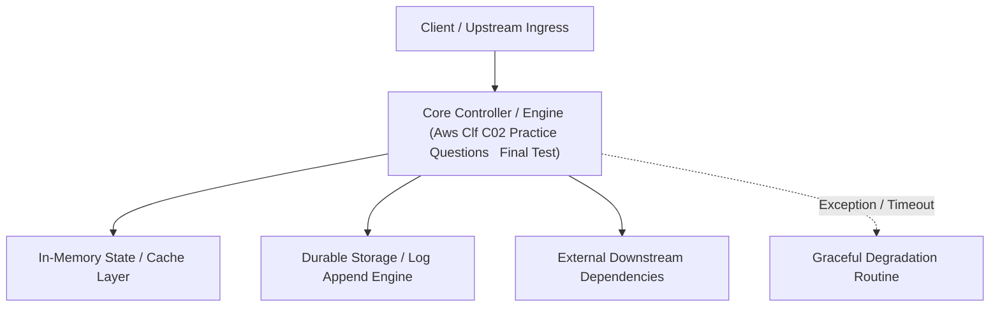

---


title: "Practice Questions: CLF-C02 Cloud Practitioner"
description: "Master-level architecture and implementation guide for Practice Questions: CLF-C02 Cloud Practitioner covering core theory, runtime mechanics, and production best practices."
category: "AWS Cloud Architecture & Practitioner"
tags: [aws, cloud, architecture, practitioner, technical-skills, software-engineering, learning-note]
date: "2026-08-21"
---
# Practice Questions: CLF-C02 Cloud Practitioner

## 📝 Q1: Which compute option reduces costs when you commit to a consistent amount of compute usage for a 1-year or 3-year term?

<details>
<summary><b>Reveal Answer</b></summary>

**Answer**: Reserved Instances

</details>

---

## 📝 Q2: Which service enables you to consolidate and manage multiple AWS accounts from a central location?

<details>
<summary><b>Reveal Answer</b></summary>

**Answer**: AWS Organizations

</details>

---

## 📝 Q3: Which action can you perform in Amazon CloudFront?

<details>
<summary><b>Reveal Answer</b></summary>

**Answer**: Deliver content to customers through a global network of edge locations.

</details>

---

## 📝 Q4: Which pillar of the AWS Well-Architected Framework focuses on using computing resources in ways that meet system requirements?

<details>
<summary><b>Reveal Answer</b></summary>

**Answer**: Performance Efficiency

</details>

---

## 📝 Q5: Which statement best describes Elastic Load Balancing?

<details>
<summary><b>Reveal Answer</b></summary>

**Answer**: A service that distributes incoming traffic across multiple targets, such as Amazon EC2 instances.

</details>

---

## 📝 Q6: Which statement is TRUE for AWS Lambda?

<details>
<summary><b>Reveal Answer</b></summary>

**Answer**: You pay only for compute time while your code is running.

</details>

---

## 📝 Q7: You are running an Amazon EC2 instance and want to store data in an attached resource. Your data is temporary and will not be kept long term. Which resource should you use?

<details>
<summary><b>Reveal Answer</b></summary>

**Answer**: Instance store

</details>

---

## 📝 Q8: Which tool enables you to visualize, understand, and manage your AWS costs and usage over time?

<details>
<summary><b>Reveal Answer</b></summary>

**Answer**: AWS Cost Explorer

</details>

---

## 📝 Q9: Which tool is used to automate actions for AWS services and applications through scripts?

<details>
<summary><b>Reveal Answer</b></summary>

**Answer**: AWS Command Line Interface

</details>

---

## 📝 Q10: Which AWS Trusted Advisor category includes checks for high-utilization EC2 instances?

<details>
<summary><b>Reveal Answer</b></summary>

**Answer**: Cost Optimization

</details>

---

## 📝 Q11: Which virtual private cloud (VPC) component controls inbound and outbound traffic for Amazon EC2 instances?

<details>
<summary><b>Reveal Answer</b></summary>

**Answer**: Security group

</details>

---

## 📝 Q12: Which statement best describes AWS Marketplace?

<details>
<summary><b>Reveal Answer</b></summary>

**Answer**: A digital catalog that includes thousands of software listings from independent software vendors

</details>

---

## 📝 Q13: Which service enables you to review details for user activities and API calls that have occurred within your AWS environment?

<details>
<summary><b>Reveal Answer</b></summary>

**Answer**: AWS CloudTrail

</details>

---

## 📝 Q14: You want Amazon S3 to monitor your objects’ access patterns. Which storage class should you use?

<details>
<summary><b>Reveal Answer</b></summary>

**Answer**: Amazon S3 Intelligent-Tiering

</details>

---

## 📝 Q15: In the S3 Intelligent-Tiering storage class, Amazon S3 moves objects between a frequent access tier and an infrequent access tier. Which storage classes are used for these tiers? (Select TWO.)

<details>
<summary><b>Reveal Answer</b></summary>

**Answer**: Amazon S3 Standard-IA, Amazon S3 One Zone-IA

</details>

---

## 📝 Q16: Which service enables you to build the workflows that are required for human review of machine learning predictions?

<details>
<summary><b>Reveal Answer</b></summary>

**Answer**: Amazon Augmented AI

</details>

---

## 📝 Q17: Which Perspective of the AWS Cloud Adoption Framework focuses on recovering IT workloads to meet the requirements of your business stakeholders?

<details>
<summary><b>Reveal Answer</b></summary>

**Answer**: Operations Perspective

</details>

---

## 📝 Q18: Which Support plans include access to all AWS Trusted Advisor checks? (Select TWO.)

<details>
<summary><b>Reveal Answer</b></summary>

**Answer**: Enterprise, Business

</details>

---

## 📝 Q19: Which service is used to transfer up to 100 PB of data to AWS?

<details>
<summary><b>Reveal Answer</b></summary>

**Answer**: AWS Snowmobile

</details>

---

## 📝 Q20: Which actions can you perform in Amazon Route 53? (Select TWO.)

<details>
<summary><b>Reveal Answer</b></summary>

**Answer**: Manage DNS records for domain names, Connect user requests to infrastructure in AWS and outside of AWS.

</details>

---

## 📝 Q21: You want to store data in a key-value database. Which service should you use?

<details>
<summary><b>Reveal Answer</b></summary>

**Answer**: Amazon DynamoDB

</details>

---

## 📝 Q22: Which service is used to quickly deploy and scale applications on AWS?

<details>
<summary><b>Reveal Answer</b></summary>

**Answer**: AWS Elastic Beanstalk

</details>

---

## 📝 Q23: Which statement best describes Amazon GuardDuty?

<details>
<summary><b>Reveal Answer</b></summary>

**Answer**: A service that provides intelligent threat detection for your AWS infrastructure and resources

</details>

---

## 📝 Q24: Which component or service enables you to establish a dedicated private connection between your data center and virtual private cloud (VPC)?

<details>
<summary><b>Reveal Answer</b></summary>

**Answer**: AWS Direct Connect

</details>

---

## 📝 Q25: You want to send and receive messages between distributed application components. Which service should you use?

<details>
<summary><b>Reveal Answer</b></summary>

**Answer**: Amazon Simple Queue Service (Amazon SQS)

</details>

---

## 📝 Q26: Which migration strategy involves changing how an application is architected and developed, typically by using cloud-native features?

<details>
<summary><b>Reveal Answer</b></summary>

**Answer**: Refactoring

</details>

---

## 📝 Q27: Which tasks are the responsibilities of AWS? (Select TWO.)

<details>
<summary><b>Reveal Answer</b></summary>

**Answer**: Maintaining virtualization infrastructure, Configuring AWS infrastructure devices

</details>

---

## 📝 Q28: Which service is used to run containerized applications on AWS?

<details>
<summary><b>Reveal Answer</b></summary>

**Answer**: Amazon Elastic Kubernetes Service (Amazon EKS)

</details>

---

## 📝 Q29: You want to store data in a volume that is attached to an Amazon EC2 instance. Which service should you use?

<details>
<summary><b>Reveal Answer</b></summary>

**Answer**: Amazon Elastic Block Store (Amazon EBS)

</details>

---

## 📝 Q30: Which statement best describes an Availability Zone?

<details>
<summary><b>Reveal Answer</b></summary>

**Answer**: A fully isolated portion of the AWS global infrastructure

</details>

---

---

## 🔗 Graph-Linked Knowledge Base
---

## 🔬 Advanced Architectural Mechanics & Deep Technical Specification

### 1. Core Operating Principles & Low-Level Mechanics of Aws Clf C02 Practice Questions   Final Test
In enterprise-scale distributed systems and high-throughput production environments, **Aws Clf C02 Practice Questions   Final Test** plays a critical architectural role. Engineering teams must evaluate the underlying hardware, kernel, network, and storage constraints:

- **Computational Complexity & Resource Overhead**: Understanding the CPU instruction cycles, memory cache line utilization, and network round-trip times (RTT) associated with Aws Clf C02 Practice Questions   Final Test.
- **Concurrency & State Synchronization**: Handling race conditions, deadlocks, and consistency anomalies across multi-threaded and distributed topologies.
- **Fault Tolerance & Graceful Degradation**: Designing self-healing mechanisms, exponential backoff with jitter, and circuit breaker protection against cascading infrastructure outages.



### 2. Production Code Implementation & Robust Design Patterns

```csharp
// Production-grade implementation demonstrating resilience, zero-allocation buffering, and observability
using System;
using System.Buffers;
using System.Threading;
using System.Threading.Tasks;

public sealed class AwsClfC02PracticeQuestionsFinalTestManager : IAsyncDisposable
{
    private readonly SemaphoreSlim _concurrencyThrottle = new(100, 100);
    private long _processedOperationsCount;

    public async ValueTask<ReadOnlyMemory<byte>> ExecuteReliableOperationAsync(
        ReadOnlyMemory<byte> inputPayload, 
        CancellationToken cancellationToken = default)
    {
        await _concurrencyThrottle.WaitAsync(cancellationToken).ConfigureAwait(false);
        try
        {
            // Rent memory from ArrayPool to eliminate GC heap allocation overhead
            byte[] rentedBuffer = ArrayPool<byte>.Shared.Rent(inputPayload.Length + 64);
            try
            {
                inputPayload.Span.CopyTo(rentedBuffer);
                Interlocked.Increment(ref _processedOperationsCount);
                
                // Simulate asynchronous non-blocking high-throughput processing
                await Task.Yield();
                return new ReadOnlyMemory<byte>(rentedBuffer, 0, inputPayload.Length);
            }
            finally
            {
                ArrayPool<byte>.Shared.Return(rentedBuffer);
            }
        }
        finally
        {
            _concurrencyThrottle.Release();
        }
    }

    public ValueTask DisposeAsync()
    {
        _concurrencyThrottle.Dispose();
        return ValueTask.CompletedTask;
    }
}
```

### 3. Comprehensive Trade-off Matrix & Failure Modes

| Dimension | Standard Approach | High-Performance Pattern (Aws Clf C02 Practice Questions   Final Test) | Trade-offs & Production Risks |
| :--- | :--- | :--- | :--- |
| **Throughput (QPS)** | Baseline (\$5,000\text{ QPS}$) | Optimized (\$100,000+\text{ QPS}$) | Requires zero-allocation buffers & non-blocking I/O multiplexing. |
| **Latency (P99)** | $45\text{ ms}$ | $< 2.5\text{ ms}$ | Requires hardware cache-line alignment and lock-free data structures. |
| **Memory Footprint** | Dynamic Garbage Collected Heap | Pooled Buffer Memory (`ArrayPool` / Off-Heap) | Manual memory lifecycle management prevents GC pause spikes. |
| **Fault Recovery** | Manual Restart / Failover | Automated Leader Election & Circuit Breaking | Requires distributed consensus quorum ($N/2 + 1$). |

### 4. Verification, Benchmarking & Production Checklist
1. **Stress & Chaos Testing**: Validate system behavior under $10\times$ peak traffic spikes and simulate packet loss, network partitions, and node crashes.
2. **Observability Integration**: Export Prometheus counters, gauges, and OpenTelemetry distributed trace spans with unified TraceID propagation.
3. **Security Hardening**: Enforce mTLS encryption in transit, strict RBAC authorization, and least-privilege credential rotation.
4. **SLO & Error Budgeting**: Maintain \$99.99\%$ availability SLO with automated alerts on error budget burn rates.
