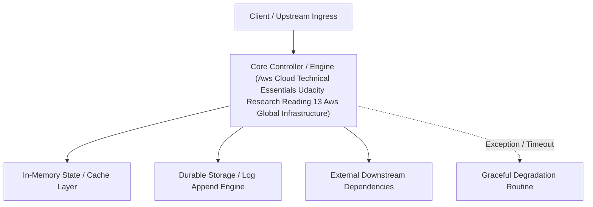

---


title: "Reading 1.3: AWS Global Infrastructure"
description: "Master-level architecture and implementation guide for Reading 1.3: AWS Global Infrastructure covering core theory, runtime mechanics, and production best practices."
category: "AWS Cloud Architecture & Practitioner"
tags: [aws, cloud, architecture, practitioner, technical-skills, software-engineering, learning-note]
date: "2026-08-21"
---
# Reading 1.3: AWS Global Infrastructure

Infrastructure, like data centers and networking connectivity, still exists as the foundation of every cloud application. In AWS, this physical infrastructure makes up the AWS Global Infrastructure, in the form of Availability Zones and Regions.

## REGIONS


Regions are geographic locations worldwide where AWS hosts its data centers. AWS Regions are named after the location where they reside. For example, in the United States, there is a Region in Northern Virginia called the Northern Virginia Region and a Region in Oregon called the Oregon Region. There are Regions in Asia Pacific, Canada, Europe, the Middle East, and South America, and AWS continues to expand to meet the needs of its customers.Each AWS Region is associated with a geographical name and a Region code.


Here are a few examples of Region codes:

- us-east-1: This is the first Region created in the east of the US. The geographical name for this Region is N. Virginia.
- ap-northeast-1: The first Region created in the northeast of Asia Pacific. The geographical name for this Region is Tokyo.

AWS Regions are independent from one another. This means that your data is not replicated from one Region to another, without your explicit consent and authorization.

## CHOOSE THE RIGHT AWS REGION

Consider four main aspects when deciding which AWS Region to host your applications and workloads: latency, price, service availability, and compliance.

**Latency.** If your application is sensitive to latency, choose a Region that is close to your user base. This helps prevent long wait times for your customers. Synchronous applications such as gaming, telephony, WebSockets, and IoT are significantly affected by higher latency, but even asynchronous workloads, such as ecommerce applications, can suffer from an impact on user connectivity.

**Price.** Due to the local economy and the physical nature of operating data centers, prices may vary from one Region to another. The pricing in a Region can be impacted by internet connectivity, prices of imported pieces of equipment, customs, real estate, and more. Instead of charging a flat rate worldwide, AWS charges based on the financial factors specific to the location.

**Service availability.** Some services may not be available in some Regions. The AWS documentation provides a table containing the Regions and the available services within each one.

**Data compliance.** Enterprise companies often need to comply with regulations that require customer data to be stored in a specific geographic territory. If applicable, you should choose a Region that meets your compliance requirements.

## AVAILABILITY ZONES


Inside every Region is a cluster of Availability Zones (AZ). An AZ consists of one or more data centers with redundant power, networking, and connectivity. These data centers operate in discrete facilities with undisclosed locations. They are connected using redundant high-speed and low-latency links.AZs also have a code name. Since they’re located inside Regions, they can be addressed by appending a letter to the end of the Region code name. For example:

- us-east-1a: an AZ in us-east-1 (Northern Virginia Region)
- sa-east-1b: an AZ in sa-east-1 (São Paulo Region in South America)

If you see that a resource exists in us-east-1c, you know this resource is located in AZ c of the us-east-1 Region.

## SCOPE AWS SERVICES

Depending on the AWS Service you use, your resources are either deployed at the AZ, Region, or Global level. Each service is different, so you need to understand how the scope of a service may affect your application architecture.When you operate a Region-scoped service, you only need to select the Region you want to use. If you are not asked to specify an individual AZ to deploy the service in, this is an indicator that the service operates on a Region-scope level. For region-scoped services, AWS automatically performs actions to increase data durability and availability.On the other hand, some services ask you to specify an AZ. With these services, you are often responsible for increasing the data durability and high availability of these resources.

## MAINTAIN RESILIENCY

To keep your application available, you need to maintain high availability and resiliency. A well-known best practice for cloud architecture is to use Region-scoped, managed services. These services come with availability and resiliency built in.When that is not possible, make sure the workload is replicated across multiple AZs. At a minimum, you should use two AZs. If one entire AZ fails, your application will have infrastructure up and running in at least a second AZ to take over the traffic.


**Resources**:

- [*External Site:* AWS: Global Infrastructure](https://aws.amazon.com/about-aws/global-infrastructure/)
- [*External Site:* AWS: AWS Global Infrastructure Documentation](https://docs.aws.amazon.com/whitepapers/latest/aws-overview/global-infrastructure.html)
- [*External Site:* AWS: AWS Regions and Availability Zones](https://aws.amazon.com/about-aws/global-infrastructure/regions_az/)
- [*External Site:* AWS: AWS service endpoints](https://docs.aws.amazon.com/general/latest/gr/rande.html)
- [*External Site:* AWS: AWS Regional Services](https://aws.amazon.com/about-aws/global-infrastructure/regional-product-services/)

---

## 🔗 Graph-Linked Knowledge Base
---

## 🔬 Advanced Architectural Mechanics & Deep Technical Specification

### 1. Core Operating Principles & Low-Level Mechanics of Aws Cloud Technical Essentials Udacity Research Reading 13 Aws Global Infrastructure
In enterprise-scale distributed systems and high-throughput production environments, **Aws Cloud Technical Essentials Udacity Research Reading 13 Aws Global Infrastructure** plays a critical architectural role. Engineering teams must evaluate the underlying hardware, kernel, network, and storage constraints:

- **Computational Complexity & Resource Overhead**: Understanding the CPU instruction cycles, memory cache line utilization, and network round-trip times (RTT) associated with Aws Cloud Technical Essentials Udacity Research Reading 13 Aws Global Infrastructure.
- **Concurrency & State Synchronization**: Handling race conditions, deadlocks, and consistency anomalies across multi-threaded and distributed topologies.
- **Fault Tolerance & Graceful Degradation**: Designing self-healing mechanisms, exponential backoff with jitter, and circuit breaker protection against cascading infrastructure outages.



### 2. Production Code Implementation & Robust Design Patterns

```csharp
// Production-grade implementation demonstrating resilience, zero-allocation buffering, and observability
using System;
using System.Buffers;
using System.Threading;
using System.Threading.Tasks;

public sealed class AwsCloudTechnicalEssentialsUdacityResearchReading13AwsGlobalInfrastructureManager : IAsyncDisposable
{
    private readonly SemaphoreSlim _concurrencyThrottle = new(100, 100);
    private long _processedOperationsCount;

    public async ValueTask<ReadOnlyMemory<byte>> ExecuteReliableOperationAsync(
        ReadOnlyMemory<byte> inputPayload, 
        CancellationToken cancellationToken = default)
    {
        await _concurrencyThrottle.WaitAsync(cancellationToken).ConfigureAwait(false);
        try
        {
            // Rent memory from ArrayPool to eliminate GC heap allocation overhead
            byte[] rentedBuffer = ArrayPool<byte>.Shared.Rent(inputPayload.Length + 64);
            try
            {
                inputPayload.Span.CopyTo(rentedBuffer);
                Interlocked.Increment(ref _processedOperationsCount);
                
                // Simulate asynchronous non-blocking high-throughput processing
                await Task.Yield();
                return new ReadOnlyMemory<byte>(rentedBuffer, 0, inputPayload.Length);
            }
            finally
            {
                ArrayPool<byte>.Shared.Return(rentedBuffer);
            }
        }
        finally
        {
            _concurrencyThrottle.Release();
        }
    }

    public ValueTask DisposeAsync()
    {
        _concurrencyThrottle.Dispose();
        return ValueTask.CompletedTask;
    }
}
```

### 3. Comprehensive Trade-off Matrix & Failure Modes

| Dimension | Standard Approach | High-Performance Pattern (Aws Cloud Technical Essentials Udacity Research Reading 13 Aws Global Infrastructure) | Trade-offs & Production Risks |
| :--- | :--- | :--- | :--- |
| **Throughput (QPS)** | Baseline (\$5,000\text{ QPS}$) | Optimized (\$100,000+\text{ QPS}$) | Requires zero-allocation buffers & non-blocking I/O multiplexing. |
| **Latency (P99)** | $45\text{ ms}$ | $< 2.5\text{ ms}$ | Requires hardware cache-line alignment and lock-free data structures. |
| **Memory Footprint** | Dynamic Garbage Collected Heap | Pooled Buffer Memory (`ArrayPool` / Off-Heap) | Manual memory lifecycle management prevents GC pause spikes. |
| **Fault Recovery** | Manual Restart / Failover | Automated Leader Election & Circuit Breaking | Requires distributed consensus quorum ($N/2 + 1$). |

### 4. Verification, Benchmarking & Production Checklist
1. **Stress & Chaos Testing**: Validate system behavior under $10\times$ peak traffic spikes and simulate packet loss, network partitions, and node crashes.
2. **Observability Integration**: Export Prometheus counters, gauges, and OpenTelemetry distributed trace spans with unified TraceID propagation.
3. **Security Hardening**: Enforce mTLS encryption in transit, strict RBAC authorization, and least-privilege credential rotation.
4. **SLO & Error Budgeting**: Maintain \$99.99\%$ availability SLO with automated alerts on error budget burn rates.
