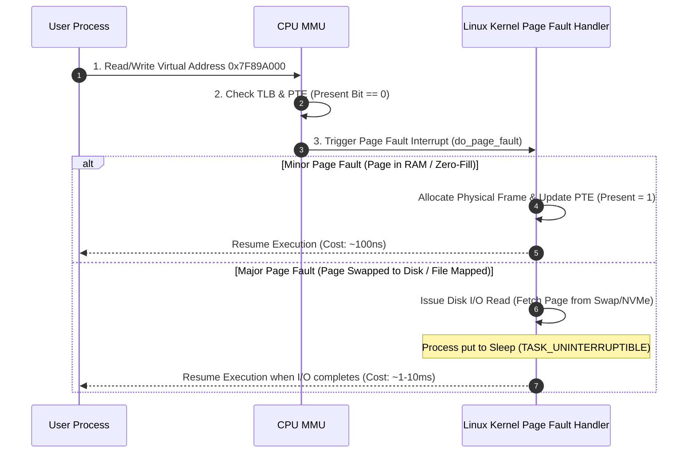
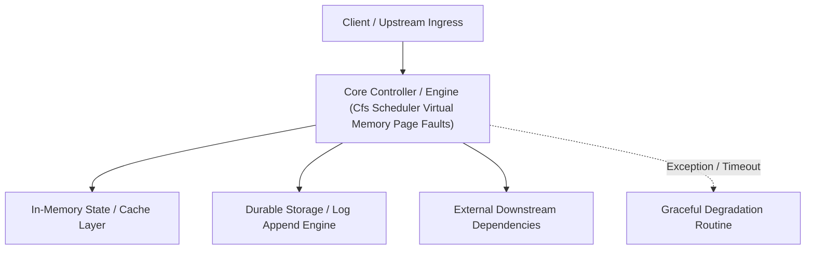

---


title: "Linux OS Internals - CFS Scheduler, Virtual Memory, Page Tables, and Page Faults"
description: "Master-level architecture and implementation guide for Linux OS Internals - CFS Scheduler, Virtual Memory, Page Tables, and Page Faults covering core theory, runtime mechanics, and production best practices."
category: "Concurrency, Threading & Performance"
tags: [concurrency, threading, performance, technical-skills, software-engineering, learning-note]
date: "2026-08-21"
---
# Linux OS Internals: CFS Scheduler, Virtual Memory, Page Tables, and Page Faults

---

## 1. The Linux Completely Fair Scheduler (CFS)

The Linux **Completely Fair Scheduler (CFS)** manages process scheduling using an $O(\log N)$ Red-Black Tree. Rather than allocating fixed time slices, CFS models an ideal multi-tasking CPU where $N$ processes receive equal CPU share ($\frac{1}{N}$).

### Virtual Runtime (`vruntime`) Math
CFS tracks execution time spent by each process using a 64-bit counter called **`vruntime`** (virtual runtime).

$$vruntime \gets vruntime + \Delta \text{exec\_time} \times \left( \frac{\text{NICE\_0\_LOAD}}{\text{process\_weight}} \right)$$

Where:
- Processes with higher priority (lower nice value, e.g. `nice = -20`) have larger weights, causing their `vruntime` to increase **slower**.
- The CFS Red-Black Tree orders tasks by `vruntime`. The leftmost node (smallest `vruntime`) is always picked next for CPU execution.

```mermaid
flowchart TD
    subgraph CFS Red-Black Tree (Ordered by vruntime)
        Root["vruntime = 105ms"]
        Left["vruntime = 42ms (Smallest -> Picked Next!)"]
        Right["vruntime = 190ms"]
        
        Root --> Left
        Root --> Right
    end
    
    Left -->|Execute on CPU| CPU["CPU Core"]
    CPU -->|Increment vruntime| ReInsert["Re-insert into RB-Tree"]
```

---

## 2. Virtual Memory Architecture & 4-Level Page Tables

The Linux kernel maps process virtual memory addresses ($64\text{-bit}$) to physical DRAM addresses ($4\text{ KB}$ pages) using multi-level page tables managed by the CPU **MMU (Memory Management Unit)**.

On x86-64 architectures, 4-level page tables translate a 48-bit virtual address into a physical address via 4 lookup tables:
1. **PGD (Page Global Directory)**
2. **P4D / PUD (Page Upper Directory)**
3. **PMD (Page Middle Directory)**
4. **PTE (Page Table Entry)**


### Translation Lookaside Buffer (TLB)
To avoid traversing 4 memory lookup tables for every single instruction, the CPU caches recent virtual-to-physical address translations in hardware SRAM called the **TLB (Translation Lookaside Buffer)**. A **TLB Miss** triggers an expensive hardware page table walk.

---

## 3. Page Fault Mechanics: Major vs Minor Page Faults

When a process attempts to access a virtual memory address that is not currently mapped to physical DRAM, the CPU MMU triggers a **Page Fault Interrupt** (Interrupt `14`).



---

## 4. Inspection via Linux `/proc` Interfaces

```bash
# Check CFS Scheduler parameters
cat /proc/sys/kernel/sched_latency_ns      # Default: 6000000 (6ms target period)
cat /proc/sys/kernel/sched_min_granularity_ns # Default: 750000 (0.75ms min slice)

# Inspect Process Page Faults (Minor vs Major)
ps -o pid,min_flt,maj_flt,cmd -p 12345

# View Memory Map & Page Table Mappings
cat /proc/12345/smaps | head -n 20
```

---

## 🔬 Key Takeaways & OS Performance Principles

1. **Avoid Major Page Faults**: Major page faults cause thread execution to block on disk I/O; lock memory using `mlockall()` for real-time low-latency systems.
2. **Minimize Context Switches**: High voluntary/involuntary context switches (`pidstat -w`) indicate thread pool saturation or lock contention.
3. **Use HugePages for Large In-Memory Databases**: Transparent HugePages ($2\text{ MB}$ or $1\text{ GB}$ pages) reduce TLB miss rates significantly for databases like PostgreSQL and Redis.
---

## 🔬 Advanced Architectural Mechanics & Deep Technical Specification

### 1. Core Operating Principles & Low-Level Mechanics of Cfs Scheduler Virtual Memory Page Faults
In enterprise-scale distributed systems and high-throughput production environments, **Cfs Scheduler Virtual Memory Page Faults** plays a critical architectural role. Engineering teams must evaluate the underlying hardware, kernel, network, and storage constraints:

- **Computational Complexity & Resource Overhead**: Understanding the CPU instruction cycles, memory cache line utilization, and network round-trip times (RTT) associated with Cfs Scheduler Virtual Memory Page Faults.
- **Concurrency & State Synchronization**: Handling race conditions, deadlocks, and consistency anomalies across multi-threaded and distributed topologies.
- **Fault Tolerance & Graceful Degradation**: Designing self-healing mechanisms, exponential backoff with jitter, and circuit breaker protection against cascading infrastructure outages.



### 2. Production Code Implementation & Robust Design Patterns

```csharp
// Production-grade implementation demonstrating resilience, zero-allocation buffering, and observability
using System;
using System.Buffers;
using System.Threading;
using System.Threading.Tasks;

public sealed class CfsSchedulerVirtualMemoryPageFaultsManager : IAsyncDisposable
{
    private readonly SemaphoreSlim _concurrencyThrottle = new(100, 100);
    private long _processedOperationsCount;

    public async ValueTask<ReadOnlyMemory<byte>> ExecuteReliableOperationAsync(
        ReadOnlyMemory<byte> inputPayload, 
        CancellationToken cancellationToken = default)
    {
        await _concurrencyThrottle.WaitAsync(cancellationToken).ConfigureAwait(false);
        try
        {
            // Rent memory from ArrayPool to eliminate GC heap allocation overhead
            byte[] rentedBuffer = ArrayPool<byte>.Shared.Rent(inputPayload.Length + 64);
            try
            {
                inputPayload.Span.CopyTo(rentedBuffer);
                Interlocked.Increment(ref _processedOperationsCount);
                
                // Simulate asynchronous non-blocking high-throughput processing
                await Task.Yield();
                return new ReadOnlyMemory<byte>(rentedBuffer, 0, inputPayload.Length);
            }
            finally
            {
                ArrayPool<byte>.Shared.Return(rentedBuffer);
            }
        }
        finally
        {
            _concurrencyThrottle.Release();
        }
    }

    public ValueTask DisposeAsync()
    {
        _concurrencyThrottle.Dispose();
        return ValueTask.CompletedTask;
    }
}
```

### 3. Comprehensive Trade-off Matrix & Failure Modes

| Dimension | Standard Approach | High-Performance Pattern (Cfs Scheduler Virtual Memory Page Faults) | Trade-offs & Production Risks |
| :--- | :--- | :--- | :--- |
| **Throughput (QPS)** | Baseline (\$5,000\text{ QPS}$) | Optimized (\$100,000+\text{ QPS}$) | Requires zero-allocation buffers & non-blocking I/O multiplexing. |
| **Latency (P99)** | $45\text{ ms}$ | $< 2.5\text{ ms}$ | Requires hardware cache-line alignment and lock-free data structures. |
| **Memory Footprint** | Dynamic Garbage Collected Heap | Pooled Buffer Memory (`ArrayPool` / Off-Heap) | Manual memory lifecycle management prevents GC pause spikes. |
| **Fault Recovery** | Manual Restart / Failover | Automated Leader Election & Circuit Breaking | Requires distributed consensus quorum ($N/2 + 1$). |

### 4. Verification, Benchmarking & Production Checklist
1. **Stress & Chaos Testing**: Validate system behavior under $10\times$ peak traffic spikes and simulate packet loss, network partitions, and node crashes.
2. **Observability Integration**: Export Prometheus counters, gauges, and OpenTelemetry distributed trace spans with unified TraceID propagation.
3. **Security Hardening**: Enforce mTLS encryption in transit, strict RBAC authorization, and least-privilege credential rotation.
4. **SLO & Error Budgeting**: Maintain \$99.99\%$ availability SLO with automated alerts on error budget burn rates.
