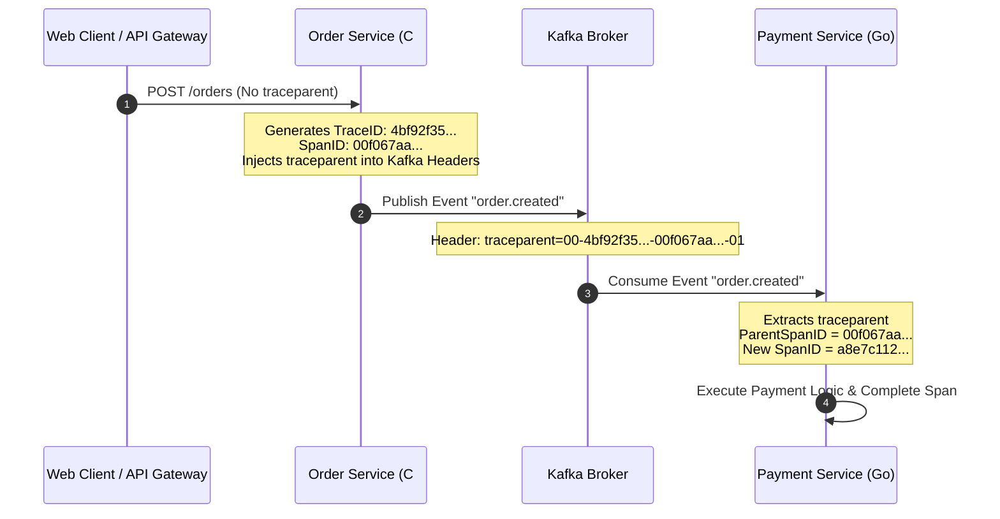
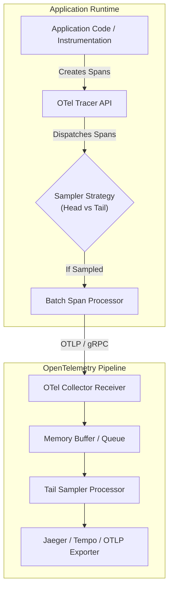

---


title: "Distributed Tracing Architecture: OpenTelemetry Specification, W3C Trace Context & Context Propagation Mechanics"
description: "Master-level architecture and implementation guide for Distributed Tracing Architecture: OpenTelemetry Specification, W3C Trace Context & Context Propagation Mechanics covering core theory, runtime mechanics, and production best practices."
category: "Software QA, Testing & Observability"
tags: [software, testing, observability, technical-skills, software-engineering, learning-note]
date: "2026-08-21"
---
# Distributed Tracing Architecture: OpenTelemetry Specification, W3C Trace Context & Context Propagation Mechanics

In modern distributed microservices and cloud-native architectures, an individual user request traverses dozens of heterogeneous services, asynchronous message brokers, databases, and third-party APIs. Traditional centralized log collection and host-level metric monitoring fail to capture the causality, latency breakdown, and execution dependency graph of cross-boundary operations.

**Distributed Tracing** solves this fundamental observability challenge by establishing a deterministic causal timeline across execution contexts. The **OpenTelemetry (OTel)** standard—backed by the CNCF—unifies trace instrumentation, context propagation protocols, and metric/log collection pipelines under a single vendor-neutral specification.

---

## 1. Executive Summary & Under-the-Hood Mechanics

### 1.1 W3C Trace Context Specification & Header Encoding

The **W3C Trace Context** specification standardizes HTTP headers and message metadata for context propagation across HTTP, gRPC, and messaging boundaries. It eliminates context fragmentation caused by legacy headers (`b3`, `X-B3-TraceId`, `sw8`, `Uber-Trace-Id`).

W3C defines two HTTP header fields:
1. `traceparent`: Mandated header carrying the version, global trace ID, parent span ID, and trace flags.
2. `tracestate`: Optional key-value list designed for vendor-specific routing and filtering metadata.

```
       00 - 4bf92f3577b34da6a3ce929d0e0e4736 - 00f067aa0ba902b7 - 01
       |    |                                |                  |
Version (2 Hex)  Trace ID (32 Hex/128-bit)   Parent/Span ID (16 Hex/64-bit) Trace Flags (2 Hex/8-bit)
```

#### 🔬 Field Breakdown
- **Version** (`8-bit` / `2 Hex chars`): Current specification version (`00`).
- **Trace ID** (`128-bit` / `32 Hex chars`): Globally unique identifier generated at the trace root. All spans belonging to the same transaction share this exact Trace ID.
- **Parent ID / Span ID** (`64-bit` / `16 Hex chars`): Unique identifier of the caller's span. Upon receiving an inbound request, the recipient uses this value as its `ParentSpanId` and generates a new `SpanId` for its internal work.
- **Trace Flags** (`8-bit` / `2 Hex chars`): Bitmask controlling propagation policies.
  - Bit 0 (`01`): `Recorded`/`Sampled` flag. Indicates whether the trace was sampled for persistent storage upstream.



---

### 1.2 OpenTelemetry SDK Architecture & Context Propagation Pipeline

The OpenTelemetry architecture decouples the API (no-op code instrumentation contracts) from the SDK (configurable processing, sampling, and exporting implementation).



#### ⚙️ Key Architectural Components
1. **TracerProvider**: Factory singleton maintaining tracer configurations, resource attributes (e.g., `service.name`, `k8s.pod.name`), and SDK pipelines.
2. **TextMapPropagator**: Responsible for serialization (`Inject`) and deserialization (`Extract`) of span context into cross-cutting carrier objects (HTTP Headers, gRPC Metadata, AMQP/Kafka headers).
3. **Sampling Engines**:
   - **Head Sampling**: Decision made at trace inception (e.g., `AlwaysOnSampler`, `TraceIdRatioBasedSampler`). Low memory footprint, but risks dropping rare error traces.
   - **Tail Sampling**: Collector-side buffering where sampling decisions are deferred until an entire trace finishes. Retains 100% of failed or slow traces ($>2000\text{ms}$) while sampling normal traces at 1%.

---

## 2. Production-Grade Code Implementations & Best Practices

### 2.1 Production C# / .NET OpenTelemetry & W3C Trace Context Implementation

In modern .NET 8+, OpenTelemetry maps directly to `System.Diagnostics.Activity` and `System.Diagnostics.ActivitySource`.

```csharp
using System;
using System.Collections.Generic;
using System.Diagnostics;
using System.Net.Http;
using System.Threading;
using System.Threading.Tasks;
using OpenTelemetry;
using OpenTelemetry.Context.Propagation;
using OpenTelemetry.Resources;
using OpenTelemetry.Trace;

public class OrderProcessingService
{
    private static readonly ActivitySource ActivitySource = new("OrderService.Core", "1.0.0");
    private static readonly TextMapPropagator Propagator = Propagators.DefaultTextMapPropagator;
    private readonly HttpClient _httpClient;

    public OrderProcessingService(HttpClient httpClient)
    {
        _httpClient = httpClient;
    }

    public async Task<bool> ProcessOrderAsync(string orderId, IDictionary<string, string> inboundHeaders)
    {
        // 1. Extract Parent Trace Context from Inbound Carrier
        PropagationContext parentContext = Propagator.Extract(default, inboundHeaders, ExtractHeaderValues);
        
        // 2. Start Activity (Span) with Extracted Parent Context
        using Activity? activity = ActivitySource.StartActivity(
            "OrderProcessing.ProcessOrder",
            ActivityKind.Server,
            parentContext.ActivityContext);

        if (activity != null)
        {
            activity.SetTag("order.id", orderId);
            activity.SetTag("messaging.system", "kafka");
            activity.AddEvent(new ActivityEvent("OrderValidationStarted"));
        }

        try
        {
            // Simulate work & propagate context downstream via HTTP
            return await DispatchPaymentAsync(orderId, activity?.Context ?? default);
        }
        catch (Exception ex)
        {
            activity?.SetStatus(ActivityStatusCode.Error, ex.Message);
            activity?.RecordException(ex);
            throw;
        }
    }

    private async Task<bool> DispatchPaymentAsync(string orderId, ActivityContext currentContext)
    {
        using Activity? childActivity = ActivitySource.StartActivity("OrderProcessing.DispatchPayment", ActivityKind.Client);
        
        var request = new HttpRequestMessage(HttpMethod.Post, "https://payment-service.internal/pay");
        
        // 3. Inject Current Span Context into Outbound HTTP Request Headers
        Propagator.Inject(new PropagationContext(currentContext, Baggage.Current), request.Headers, InjectHeaderValues);

        HttpResponseMessage response = await _httpClient.SendAsync(request);
        return response.IsSuccessStatusCode;
    }

    private static IEnumerable<string> ExtractHeaderValues(IDictionary<string, string> carrier, string key)
    {
        if (carrier.TryGetValue(key, out var value))
        {
            return new[] { value };
        }
        return Array.Empty<string>();
    }

    private static void InjectHeaderValues(HttpHeaders carrier, string key, string value)
    {
        carrier.Remove(key);
        carrier.Add(key, value);
    }
}
```

---

### 2.2 Production Go OpenTelemetry SDK & HTTP Context Propagation

```go
package main

import (
	"context"
	"fmt"
	"net/http"
	"time"

	"go.opentelemetry.io/otel"
	"go.opentelemetry.io/otel/attribute"
	"go.opentelemetry.io/otel/codes"
	"go.opentelemetry.io/otel/propagation"
	semconv "go.opentelemetry.io/otel/semconv/v1.24.0"
	"go.opentelemetry.io/otel/trace"
)

type PaymentHandler struct {
	tracer trace.Tracer
}

func NewPaymentHandler() *PaymentHandler {
	return &PaymentHandler{
		tracer: otel.GetTracerProvider().Tracer("payment-service", trace.WithInstrumentationVersion("1.0.0")),
	}
}

func (h *PaymentHandler) ServeHTTP(w http.ResponseWriter, r *http.Request) {
	// 1. Extract W3C Trace Context from HTTP Headers
	propagator := otel.GetTextMapPropagator()
	ctx := propagator.Extract(r.Context(), propagation.HeaderCarrier(r.Header))

	// 2. Start Server Span
	ctx, span := h.tracer.Start(
		ctx,
		"PaymentService.ServeHTTP",
		trace.WithSpanKind(trace.SpanKindServer),
		trace.WithAttributes(
			semconv.HTTPMethodKey.String(r.Method),
			semconv.HTTPURLKey.String(r.URL.String()),
		),
	)
	defer span.End()

	// Perform internal domain operation
	if err := h.executeTransaction(ctx, "TX-99823"); err != nil {
		span.RecordError(err)
		span.SetStatus(codes.Error, err.Error())
		http.Error(w, err.Error(), http.StatusInternalServerError)
		return
	}

	span.SetStatus(codes.Ok, "Transaction Processed Successfully")
	w.WriteHeader(http.StatusOK)
}

func (h *PaymentHandler) executeTransaction(ctx context.Context, txID string) error {
	ctx, span := h.tracer.Start(ctx, "PaymentService.executeTransaction")
	defer span.End()

	span.SetAttributes(attribute.String("transaction.id", txID))

	// Simulate work
	time.Sleep(25 * time.Millisecond)
	return nil
}
```

---

## 3. Performance Benchmark & Big-O Analysis

### 3.1 Trace Overhead & Computational Complexity

| Operation / Subsystem | Time Complexity | Memory Complexity | Notes / Bottleneck Details |
| :--- | :--- | :--- | :--- |
| **Span Creation (Sampled)** | $\mathcal{O}(1)$ | $\mathcal{O}(1)$ (~500B to 1KB allocation) | Object pool creation via `Activity` or Go `Span`. |
| **Span Creation (Not Sampled)** | $\mathcal{O}(1)$ | $\mathcal{O}(1)$ (Zero allocation) | Returns non-recording no-op handle immediately. |
| **W3C `traceparent` Injection/Extraction**| $\mathcal{O}(K)$ | $\mathcal{O}(1)$ | $K$ = Number of headers scanned (typically 1-3 string lookups). |
| **Batch Processor Exporter Queue** | $\mathcal{O}(N)$ | $\mathcal{O}(N)$ | $N$ = Batch buffer size. Ring buffer lock overhead under high concurrency. |
| **Collector Tail Sampling Engine** | $\mathcal{O}(T \cdot S)$ | $\mathcal{O}(T \cdot S)$ | $T$ = Active traces, $S$ = Spans per trace buffered in collector memory. |

### 3.2 Sampling Trade-Off Matrix

$$\text{Memory Required} = N_{\text{traces}} \times \bar{S}_{\text{spans/trace}} \times \text{Size}_{\text{span}} \times T_{\text{retention window}}$$

- **Head Sampling (100% Rate)**: Generates high network throughput (~$50\text{MB/sec}$ per 10k RPS) and CPU overhead for serialization.
- **Head Sampling (Probabilistic 1%)**: Reduces storage cost by $99\%$, but completely drops low-frequency failure traces ($<0.1\%$ occurrence rate).
- **Tail Sampling (Adaptive)**: Retains $100\%$ of HTTP 5xx errors and latency anomalies while capping memory bound via sliding window ring buffers.

---

## 4. Anti-Patterns & Bad Practices vs Correct Solutions

### 4.1 Anti-Pattern 1: Unbounded Span Creation in Tight Loops

#### ❌ Bad Practice (High Garbage Collection & Allocation Pressure)
```csharp
// Iterating over 50,000 records and starting a span per item
foreach (var item in batchItems)
{
    using var activity = activitySource.StartActivity("ProcessItem"); // 50,000 heap allocations!
    ProcessSingleItem(item);
}
```

#### ✅ Correct Solution (Aggregated Batch Span with Events)
```csharp
using var activity = activitySource.StartActivity("BatchProcessItems");
activity?.SetTag("batch.count", batchItems.Count);

int successCount = 0;
foreach (var item in batchItems)
{
    ProcessSingleItem(item);
    successCount++;
}
activity?.SetTag("batch.success_count", successCount);
```

---

### 4.2 Anti-Pattern 2: Unbound Context Passing in Async/Goroutine Boundaries

#### ❌ Bad Practice (Losing Parent Trace Context across Async Boundary)
```go
// Launching asynchronous background processing without forwarding context
go func() {
    // Uses context.Background(), breaking the parent-child span lineage!
    _, span := tracer.Start(context.Background(), "AsyncWorker")
    defer span.End()
    doWork()
}()
```

#### ✅ Correct Solution (Forwarding Trace Context Explicitly)
```go
// Capture and pass original ctx into closure
go func(asyncCtx context.Context) {
    ctx, span := tracer.Start(asyncCtx, "AsyncWorker")
    defer span.End()
    doWork(ctx)
}(ctx)
```

---

### 4.3 Anti-Pattern 3: Massive Payloads in Span Attributes or Baggage

#### ❌ Bad Practice
Attaching raw JSON bodies, SQL queries with inline parameters, or large PII data directly to `Baggage` or `Span Attributes`. Baggage propagates across **every downstream HTTP call**, inflating network header overhead.

#### ✅ Correct Solution
- Sanitize and strip SQL parameters (use parameterized statements).
- Hash or truncate payload attributes ($<256$ bytes).
- Limit Baggage strictly to low-cardinality routing metadata (e.g., `tenant_id`).

---

## 5. Real-World Troubleshooting & Operational Edge Cases

### 5.1 Asynchronous Messaging (Kafka/RabbitMQ) Context Disconnection

#### 🚨 Root Cause
Message brokers do not natively parse HTTP headers. If producers fail to inject `traceparent` into Kafka `RecordHeaders` or AMQP `BasicProperties`, consumers process messages under a detached, newly generated root trace ID.

#### 🔧 Operational Fix
Always configure dedicated messaging interceptors or manually invoke `Propagator.Inject` before publishing to a broker queue:

```csharp
var record = new ProducerRecord<string, string>(topic, key, value);
Propagator.Inject(
    new PropagationContext(Activity.Current?.Context ?? default, Baggage.Current),
    record.Headers,
    (headers, k, v) => headers.Add(k, Encoding.UTF8.GetBytes(v)));
```

---

### 5.2 Distributed Clock Skew Anomalies

#### 🚨 Symptom
Jaeger or Zipkin UI shows child spans starting *before* parent spans, or negative duration spans ($\text{Duration} < 0\text{ms}$).

#### 🔧 Diagnostics & Remediation
- **Cause**: Network Time Protocol (NTP) drift between microservice worker nodes exceeds span execution latency ($>10\text{ms}$).
- **Fix**: Synchronize host clocks using `chrony` with PTP (Precision Time Protocol) in cloud virtualization environments. Collector tail processors apply heuristic start-time adjustment based on causal DAG edges.

---

### 5.3 OTel Collector Batch Processor Queue Overflow

#### 🚨 Symptom
High metric count for `otelcol_processor_dropped_spans`. Collector logs indicate `Queue full. Dropping spans`.

#### 🔧 Tuning Strategy
Adjust OTel Collector configuration queue size and export timeout parameters:

```yaml
processors:
  batch:
    send_batch_size: 8192
    timeout: 1s
    send_batch_max_size: 10240
  memory_limiter:
    check_interval: 1s
    limit_percentage: 80
    spike_limit_percentage: 20

service:
  pipelines:
    traces:
      receivers: [otlp]
      processors: [memory_limiter, batch]
      exporters: [otlp/tempo]
```
