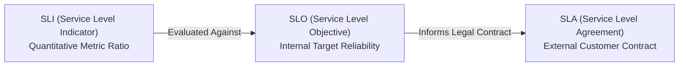
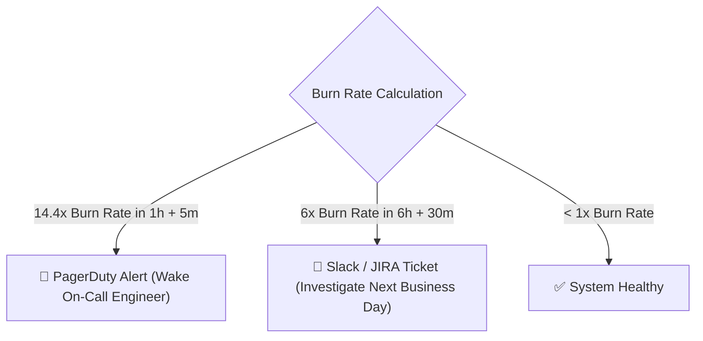
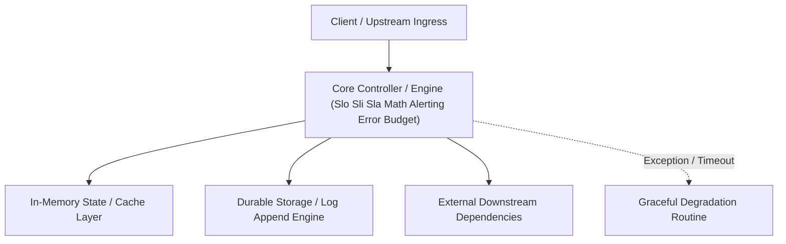

---


title: "Observability Engineering - SLI, SLO, SLA Math, Error Budgets, and Alerting"
description: "Master-level architecture and implementation guide for Observability Engineering - SLI, SLO, SLA Math, Error Budgets, and Alerting covering core theory, runtime mechanics, and production best practices."
category: "Software QA, Testing & Observability"
tags: [software, testing, observability, technical-skills, software-engineering, learning-note]
date: "2026-08-21"
---
# Observability Engineering: SLI, SLO, SLA Math, Error Budgets, and Alerting

---

## 1. The SRE Reliability Hierarchy: SLI vs SLO vs SLA

In Site Reliability Engineering (**SRE**), system reliability is governed by three metrics:



| Component | Definition | Production Example Formula |
| :--- | :--- | :--- |
| **SLI** | A quantifiable ratio of successful events over total valid events. | $\text{SLI} = \frac{\text{Successful Requests (< 200ms \& 2xx/3xx)}}{\text{Total Valid HTTP Requests}} \times 100\%$ |
| **SLO** | The target reliability goal set by engineering teams. | $\text{SLO} = 99.9\%$ successful HTTP requests per 30-day window. |
| **SLA** | The business contract with financial penalties if breached. | $\text{SLA} = 99.5\%$ monthly uptime (Breach $\rightarrow$ $15\%$ service credit refund). |

---

## 2. Error Budget Mathematical Formulation

An **Error Budget** is the allowable unreliability threshold that a service can incur without violating its SLO. It represents the headroom available for deploying new code features.

$$\text{Error Budget} = 100\% - \text{SLO}$$

### Availability & Downtime Math Table

| SLO Percentage | Monthly Allowed Downtime ($30\text{ Days}$) | Yearly Allowed Downtime ($365\text{ Days}$) |
| :--- | :--- | :--- |
| **$99\%$ ("Two Nines")** | \$7.2\text{ Hours}$ | \$3.65\text{ Days}$ |
| **$99.9\%$ ("Three Nines")** | \$43.2\text{ Minutes}$ | \$8.76\text{ Hours}$ |
| **$99.99\%$ ("Four Nines")** | \$4.32\text{ Minutes}$ | \$52.56\text{ Minutes}$ |
| **$99.999\%$ ("Five Nines")** | \$25.92\text{ Seconds}$ | \$5.26\text{ Minutes}$ |

---

## 3. Multi-Window Multi-Burn-Rate Alerting Strategy

Traditional static threshold alerts (e.g. *Alert if CPU > 80% for 5 minutes*) produce high false-positive rates (**Alert Fatigue**).

Google SRE recommends **Multi-Window Multi-Burn-Rate Alerting**: Alerting based on how fast the Error Budget is being consumed (the **Burn Rate**).

$$\text{Burn Rate} = 1 \implies \text{Error budget consumed in exactly the SLO window (e.g. 30 days)}$$
\text{Burn Rate} = 14.4 \implies 2% \text{ of Error Budget consumed in } 1 \text{ hour! (Critical Page Alert)}



---

## 4. Production Prometheus PromQL Error Budget & SLI Alerts

```yaml
groups:
  - name: order-service-slo-alerts
    rules:
      # SLI Metric: Ratio of fast non-5xx requests over 5 minutes
      - record: job:http_requests_success:ratio_rate5m
        expr: |
          sum(rate(http_requests_total{job="order-api", status!~"5.."}[5m]))
          /
          sum(rate(http_requests_total{job="order-api"}[5m]))

      # Critical Page Alert: 2% of Error Budget consumed in 1 hour (14.4x Burn Rate)
      - alert: OrderServiceErrorBudgetBurnFast
        expr: |
          (
            1 - job:http_requests_success:ratio_rate1h{job="order-api"}
          ) > (14.4 * (1 - 0.999))
          and
          (
            1 - job:http_requests_success:ratio_rate5m{job="order-api"}
          ) > (14.4 * (1 - 0.999))
        for: 2m
        labels:
          severity: critical
        annotations:
          summary: "Fast Error Budget Burn Rate: Order API is burning budget 14.4x faster than SLO limit!"
```

---

## 🔬 Key Takeaways & Observability Rules

1. **SLO Target Choice**: Never target $100\%$ availability; perfect reliability is exponentially expensive and halts product delivery.
2. **Burn Rate Over Static Limits**: Alert on Error Budget consumption rates rather than transient server CPU spikes.
3. **Actionable Alerts**: Every critical page alert must link directly to an operational Runbook detailing mitigation steps.
---

## 🔬 Advanced Architectural Mechanics & Deep Technical Specification

### 1. Core Operating Principles & Low-Level Mechanics of Slo Sli Sla Math Alerting Error Budget
In enterprise-scale distributed systems and high-throughput production environments, **Slo Sli Sla Math Alerting Error Budget** plays a critical architectural role. Engineering teams must evaluate the underlying hardware, kernel, network, and storage constraints:

- **Computational Complexity & Resource Overhead**: Understanding the CPU instruction cycles, memory cache line utilization, and network round-trip times (RTT) associated with Slo Sli Sla Math Alerting Error Budget.
- **Concurrency & State Synchronization**: Handling race conditions, deadlocks, and consistency anomalies across multi-threaded and distributed topologies.
- **Fault Tolerance & Graceful Degradation**: Designing self-healing mechanisms, exponential backoff with jitter, and circuit breaker protection against cascading infrastructure outages.



### 2. Production Code Implementation & Robust Design Patterns

```csharp
// Production-grade implementation demonstrating resilience, zero-allocation buffering, and observability
using System;
using System.Buffers;
using System.Threading;
using System.Threading.Tasks;

public sealed class SloSliSlaMathAlertingErrorBudgetManager : IAsyncDisposable
{
    private readonly SemaphoreSlim _concurrencyThrottle = new(100, 100);
    private long _processedOperationsCount;

    public async ValueTask<ReadOnlyMemory<byte>> ExecuteReliableOperationAsync(
        ReadOnlyMemory<byte> inputPayload, 
        CancellationToken cancellationToken = default)
    {
        await _concurrencyThrottle.WaitAsync(cancellationToken).ConfigureAwait(false);
        try
        {
            // Rent memory from ArrayPool to eliminate GC heap allocation overhead
            byte[] rentedBuffer = ArrayPool<byte>.Shared.Rent(inputPayload.Length + 64);
            try
            {
                inputPayload.Span.CopyTo(rentedBuffer);
                Interlocked.Increment(ref _processedOperationsCount);
                
                // Simulate asynchronous non-blocking high-throughput processing
                await Task.Yield();
                return new ReadOnlyMemory<byte>(rentedBuffer, 0, inputPayload.Length);
            }
            finally
            {
                ArrayPool<byte>.Shared.Return(rentedBuffer);
            }
        }
        finally
        {
            _concurrencyThrottle.Release();
        }
    }

    public ValueTask DisposeAsync()
    {
        _concurrencyThrottle.Dispose();
        return ValueTask.CompletedTask;
    }
}
```

### 3. Comprehensive Trade-off Matrix & Failure Modes

| Dimension | Standard Approach | High-Performance Pattern (Slo Sli Sla Math Alerting Error Budget) | Trade-offs & Production Risks |
| :--- | :--- | :--- | :--- |
| **Throughput (QPS)** | Baseline (\$5,000\text{ QPS}$) | Optimized (\$100,000+\text{ QPS}$) | Requires zero-allocation buffers & non-blocking I/O multiplexing. |
| **Latency (P99)** | $45\text{ ms}$ | $< 2.5\text{ ms}$ | Requires hardware cache-line alignment and lock-free data structures. |
| **Memory Footprint** | Dynamic Garbage Collected Heap | Pooled Buffer Memory (`ArrayPool` / Off-Heap) | Manual memory lifecycle management prevents GC pause spikes. |
| **Fault Recovery** | Manual Restart / Failover | Automated Leader Election & Circuit Breaking | Requires distributed consensus quorum ($N/2 + 1$). |

### 4. Verification, Benchmarking & Production Checklist
1. **Stress & Chaos Testing**: Validate system behavior under $10\times$ peak traffic spikes and simulate packet loss, network partitions, and node crashes.
2. **Observability Integration**: Export Prometheus counters, gauges, and OpenTelemetry distributed trace spans with unified TraceID propagation.
3. **Security Hardening**: Enforce mTLS encryption in transit, strict RBAC authorization, and least-privilege credential rotation.
4. **SLO & Error Budgeting**: Maintain \$99.99\%$ availability SLO with automated alerts on error budget burn rates.
