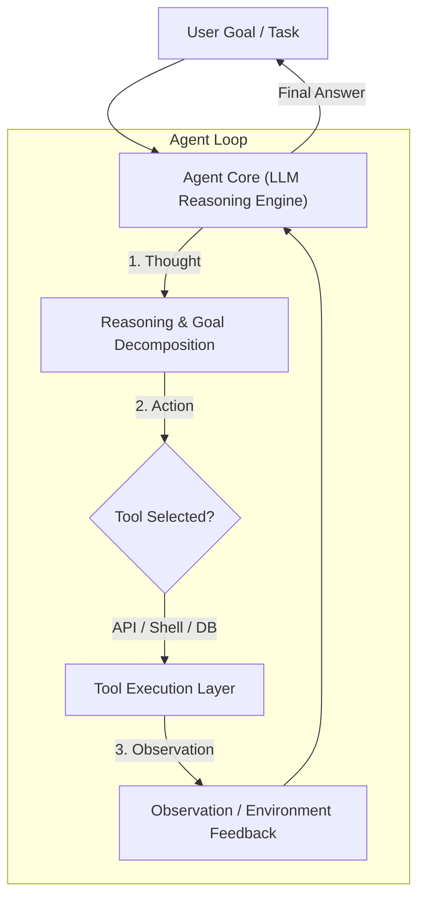
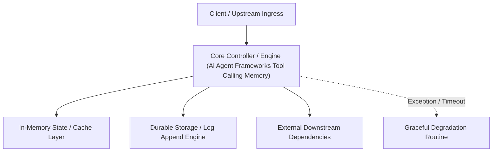

---


title: "AI Agent Frameworks - ReAct Loop, Tool Calling, and Agentic Memory"
description: "Master-level architecture and implementation guide for AI Agent Frameworks - ReAct Loop, Tool Calling, and Agentic Memory covering core theory, runtime mechanics, and production best practices."
category: "AI Engineering & Machine Learning"
tags: [engineering, machine, learning, technical-skills, software-engineering, learning-note]
date: "2026-08-21"
---
# AI Agent Frameworks: ReAct Loop, Tool Calling, and Agentic Memory

---

## 1. Autonomous AI Agents vs Standard LLM Prompts

Standard LLM invocations follow a single stateless Request-Response interaction. In contrast, an **Autonomous AI Agent** combines an LLM core with:
1. **Planning & Reasoning Engine**: Breaking down multi-step goals (**ReAct Pattern**).
2. **Tool Execution Registry**: Invoking external APIs, executing shell scripts, or querying databases.
3. **Memory Systems**: Retaining short-term conversational context and long-term episodic memories.



---

## 2. The ReAct (Reasoning + Acting) Loop Paradigm

The **ReAct Pattern** (Yao et al., 2022) interleaves explicit reasoning trace logs (**Thought**) with task-specific execution commands (**Action** and **Observation**).

```text
Thought: The user wants to know the latest stock price for NVIDIA and calculate its 14-day RSI.
Action: fetch_stock_quote(symbol="NVDA")
Observation: {"symbol": "NVDA", "price": 128.50, "volume": 45000000}

Thought: Now I need to calculate the 14-day RSI using historical price data.
Action: execute_python_code(script="import pandas as pd...")
Observation: "RSI_14: 64.2"

Thought: I have gathered all necessary information. I will format the response for the user.
Final Answer: NVIDIA (NVDA) is currently trading at $128.50 with a 14-day RSI of 64.2.
```

---

## 3. Tool Calling JSON Schema Specification

Modern LLMs accept structured JSON schemas defining registered tools, enabling the model to emit deterministic tool calls.

```json
{
  "name": "query_customer_database",
  "description": "Fetches active customer records by email or customer ID.",
  "parameters": {
    "type": "object",
    "properties": {
      "customer_id": {
        "type": "string",
        "description": "The unique UUID of the customer."
      },
      "include_billing_history": {
        "type": "boolean",
        "description": "Whether to return historical invoices."
      }
    },
    "required": ["customer_id"]
  }
}
```

---

## 4. Production Python Agent Core Implementation

```python
import json
from typing import Callable, Dict, Any

class AutonomousAgent:
    def __init__(self, llm_client, tools: Dict[str, Callable]):
        self.llm_client = llm_client
        self.tools = tools
        self.conversation_memory = []

    def run_task(self, user_prompt: str, max_iterations: int = 5) -> str:
        """
        Executes an autonomous ReAct loop up to max_iterations.
        """
        self.conversation_memory.append({"role": "user", "content": user_prompt})
        
        for iteration in range(max_iterations):
            # Step 1: Request LLM response with registered tool definitions
            response = self.llm_client.generate(
                messages=self.conversation_memory,
                tools=list(self.tools.keys())
            )
            
            # Step 2: Check if LLM output requires tool execution
            if response.tool_calls:
                for tool_call in response.tool_calls:
                    tool_name = tool_call.name
                    tool_args = tool_call.arguments
                    
                    if tool_name in self.tools:
                        # Execute registered local tool function
                        tool_result = self.tools[tool_name](**tool_args)
                        
                        # Append observation back into agent memory
                        self.conversation_memory.append({
                            "role": "tool",
                            "tool_call_id": tool_call.id,
                            "content": json.dumps(tool_result)
                        })
            else:
                # Agent reached Final Answer
                return response.content
                
        return "Agent execution exceeded maximum iteration limit."
```

---

## 🔬 Key Takeaways & Agentic Guardrails

1. **Loop Termination Controls**: Always set strict `max_iterations` caps to prevent infinite tool-calling loops when API calls return unexpected errors.
2. **Human-in-the-Loop (HITL)**: For high-risk actions (e.g., executing database migrations or issuing refunds), pause execution and request explicit user confirmation.
3. **Structured Outputs**: Use Pydantic or JSON Mode validation to ensure agent tool calls adhere to target API contract types.
---

## 🔬 Advanced Architectural Mechanics & Deep Technical Specification

### 1. Core Operating Principles & Low-Level Mechanics of Ai Agent Frameworks Tool Calling Memory
In enterprise-scale distributed systems and high-throughput production environments, **Ai Agent Frameworks Tool Calling Memory** plays a critical architectural role. Engineering teams must evaluate the underlying hardware, kernel, network, and storage constraints:

- **Computational Complexity & Resource Overhead**: Understanding the CPU instruction cycles, memory cache line utilization, and network round-trip times (RTT) associated with Ai Agent Frameworks Tool Calling Memory.
- **Concurrency & State Synchronization**: Handling race conditions, deadlocks, and consistency anomalies across multi-threaded and distributed topologies.
- **Fault Tolerance & Graceful Degradation**: Designing self-healing mechanisms, exponential backoff with jitter, and circuit breaker protection against cascading infrastructure outages.



### 2. Production Code Implementation & Robust Design Patterns

```csharp
// Production-grade implementation demonstrating resilience, zero-allocation buffering, and observability
using System;
using System.Buffers;
using System.Threading;
using System.Threading.Tasks;

public sealed class AiAgentFrameworksToolCallingMemoryManager : IAsyncDisposable
{
    private readonly SemaphoreSlim _concurrencyThrottle = new(100, 100);
    private long _processedOperationsCount;

    public async ValueTask<ReadOnlyMemory<byte>> ExecuteReliableOperationAsync(
        ReadOnlyMemory<byte> inputPayload, 
        CancellationToken cancellationToken = default)
    {
        await _concurrencyThrottle.WaitAsync(cancellationToken).ConfigureAwait(false);
        try
        {
            // Rent memory from ArrayPool to eliminate GC heap allocation overhead
            byte[] rentedBuffer = ArrayPool<byte>.Shared.Rent(inputPayload.Length + 64);
            try
            {
                inputPayload.Span.CopyTo(rentedBuffer);
                Interlocked.Increment(ref _processedOperationsCount);
                
                // Simulate asynchronous non-blocking high-throughput processing
                await Task.Yield();
                return new ReadOnlyMemory<byte>(rentedBuffer, 0, inputPayload.Length);
            }
            finally
            {
                ArrayPool<byte>.Shared.Return(rentedBuffer);
            }
        }
        finally
        {
            _concurrencyThrottle.Release();
        }
    }

    public ValueTask DisposeAsync()
    {
        _concurrencyThrottle.Dispose();
        return ValueTask.CompletedTask;
    }
}
```

### 3. Comprehensive Trade-off Matrix & Failure Modes

| Dimension | Standard Approach | High-Performance Pattern (Ai Agent Frameworks Tool Calling Memory) | Trade-offs & Production Risks |
| :--- | :--- | :--- | :--- |
| **Throughput (QPS)** | Baseline (\$5,000\text{ QPS}$) | Optimized (\$100,000+\text{ QPS}$) | Requires zero-allocation buffers & non-blocking I/O multiplexing. |
| **Latency (P99)** | $45\text{ ms}$ | $< 2.5\text{ ms}$ | Requires hardware cache-line alignment and lock-free data structures. |
| **Memory Footprint** | Dynamic Garbage Collected Heap | Pooled Buffer Memory (`ArrayPool` / Off-Heap) | Manual memory lifecycle management prevents GC pause spikes. |
| **Fault Recovery** | Manual Restart / Failover | Automated Leader Election & Circuit Breaking | Requires distributed consensus quorum ($N/2 + 1$). |

### 4. Verification, Benchmarking & Production Checklist
1. **Stress & Chaos Testing**: Validate system behavior under $10\times$ peak traffic spikes and simulate packet loss, network partitions, and node crashes.
2. **Observability Integration**: Export Prometheus counters, gauges, and OpenTelemetry distributed trace spans with unified TraceID propagation.
3. **Security Hardening**: Enforce mTLS encryption in transit, strict RBAC authorization, and least-privilege credential rotation.
4. **SLO & Error Budgeting**: Maintain \$99.99\%$ availability SLO with automated alerts on error budget burn rates.
