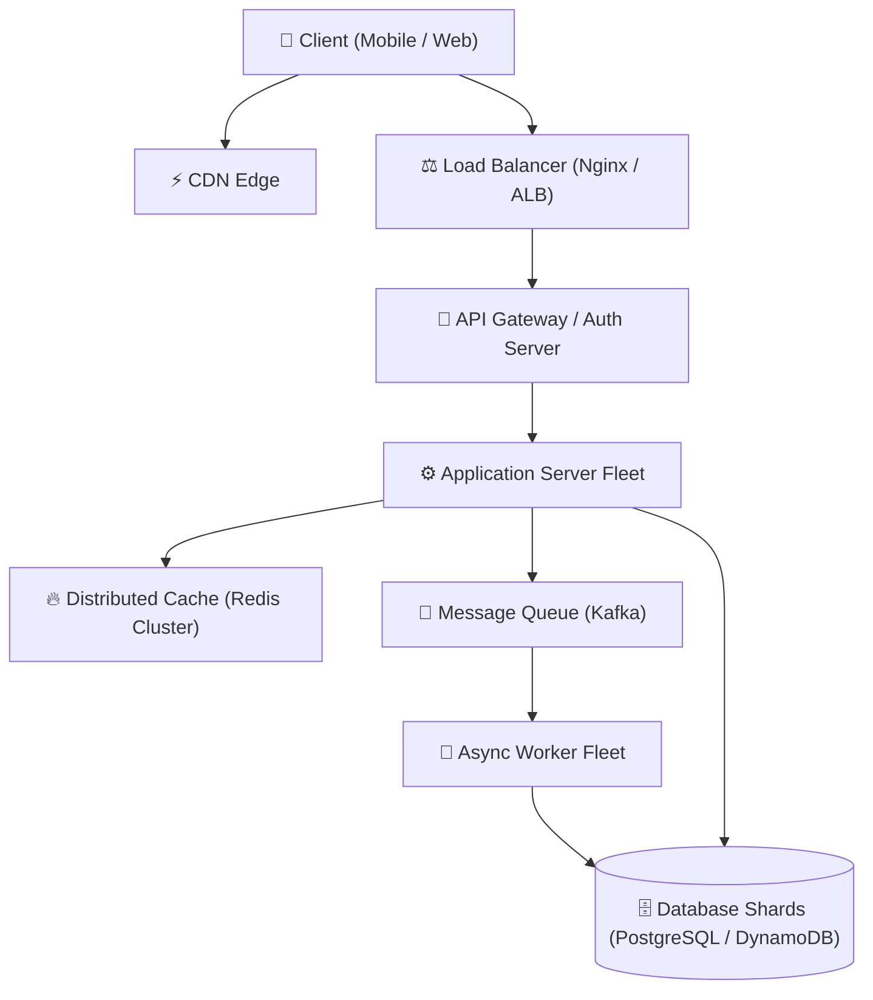

---


title: "07.Design Chat System"
tags: [system-design, distributed-systems, architecture, learning-note]
---

# 🏗️ System Design Blueprint: Design a Real-Time Chat System (WhatsApp/Slack) (07. Design-Chat-System)

- **Focus Area**: `WebSockets, State Server, Cassandra Storage`
- **Primary Blueprint**: [`07.Design-Chat-System.md`](file:///D:/learning/06_system_design_solutions/07.Design-Chat-System/07.Design-Chat-System.md)
- **Practice Scratchpad**: [`practice_scratchpad.md`](file:///D:/learning/06_system_design_solutions/07.Design-Chat-System/practice_scratchpad.md)

---

## 1. 🎯 Requirements & System Scope

### Functional Requirements
1. System should support core operation for **Design a Real-Time Chat System (WhatsApp/Slack)**.
2. High reliability and accurate state updates.

### Non-Functional Requirements
- **Availability**: \$99.99\%$ uptime ($4$ nines).
- **Latency**: Low latency SLA ($< 50\text{ ms}$ read response).
- **Scalability**: Horizontal scalability to support millions of daily active users (DAU).
- **Durability**: Zero data loss for persistent state.

---

## 2. 📊 Capacity Estimation & Back-of-the-Envelope Calculations

### QPS & Storage Estimations
- **DAU**: \$10,\text{000},\text{000}$ Users ($10\text{ Million DAU}$).
- **Average QPS**:
  $$\text{Average QPS} = \frac{10,\text{000},\text{000} \times 10 \text{ req/day}}{86,\text{400} \text{ seconds}} \approx 1,\text{157} \text{ QPS}$$
- **Peak QPS**: \$2 \times \text{Average QPS} \approx 2,\text{300} \text{ QPS}$.
- **5-Year Storage Capacity**:
  $$\text{Storage/Day} = 10,\text{000},\text{000} \times 500 \text{ Bytes} = 5 \text{ GB/day}$$
  $$\text{5-Year Storage} = 5 \text{ GB} \times 365 \times 5 \approx 9.125 \text{ TB}$$

---

## 3. 🔌 API Interface Specifications (RESTful API)

### Endpoint: Main Action
```http
POST /api/v1/system-endpoint
Content-Type: application/json

{
  "request_id": "req-1001",
  "user_id": "usr-8842",
  "data_payload": { ... }
}
```

**Response (`200 OK`)**:
```json
{
  "status": "success",
  "system_id": "sys-9921",
  "created_at": 1700000000
}
```

---

## 4. 🗄️ Data Model & DB Schema

### Table: Core Entity (`CoreEntity`)

| Column Name | Type | Key | Index | Description |
| :--- | :--- | :---: | :---: | :--- |
| `entity_id` | `VARCHAR(64)` | PK | B-Tree | Unique Primary Identifier |
| `user_id` | `VARCHAR(64)` | FK | B-Tree | Owner User ID |
| `payload` | `JSONB` | - | - | Structured Metadata Payload |
| `created_at` | `TIMESTAMP` | - | B-Tree | Creation Timestamp |

---

## 5. 🌐 High-Level Architecture



---

## 6. 🔍 Component Deep Dives

### Core Architectural Mechanics
Detailed breakdown of **WebSockets, State Server, Cassandra Storage**:
1. **Handling Concurrency**: Lock-free atomic increments or optimistic concurrency control (`OCC`).
2. **Caching Strategy**: Cache-Aside pattern with Redis Cluster to serve hot read queries.

---

## 7. 🛡️ Resilience, Scaling & Bottleneck Mitigations

| Failure Scenario | Impact | Mitigation Strategy |
| :--- | :--- | :--- |
| **Cache Server Node Crash** | High DB Read Spike | Multi-AZ Redis replication with Sentinel automatic failover. |
| **Database Shard Hotspot** | Elevated Write Latency | Consistent Hashing with virtual nodes for uniform data distribution. |
| **Network Partition (CAP)** | Potential Stale Reads | Enforce eventual consistency with read repair & vector clocks. |
