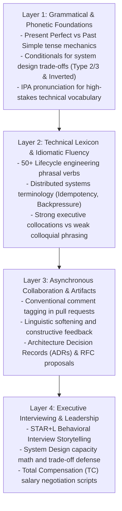
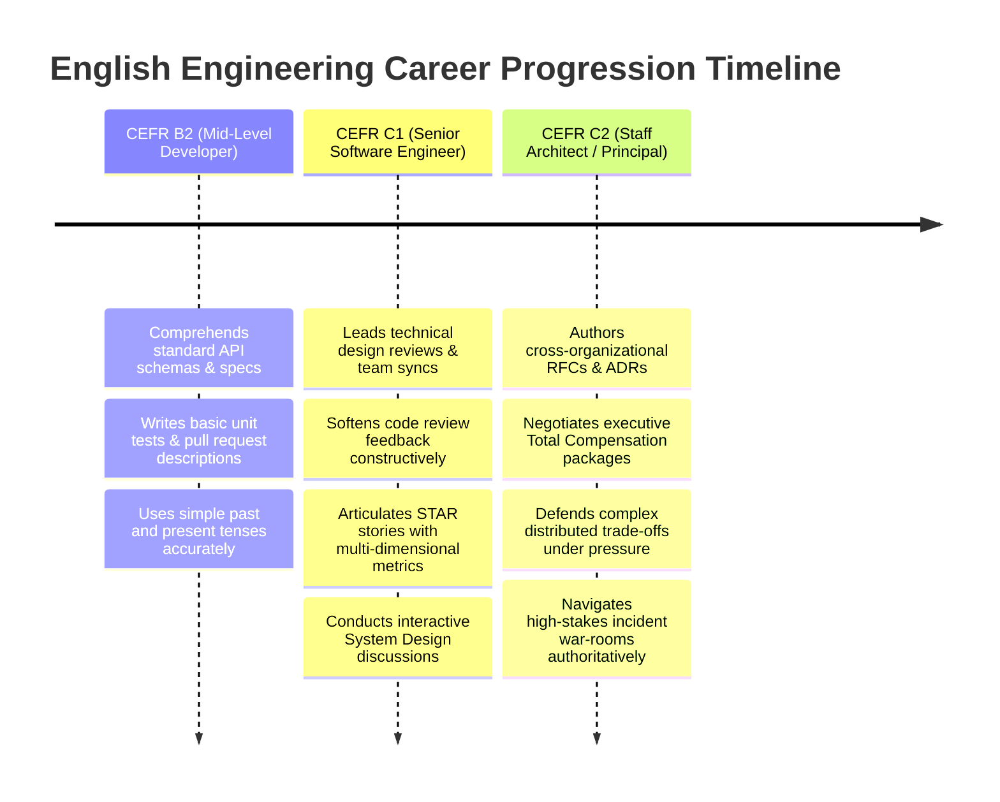
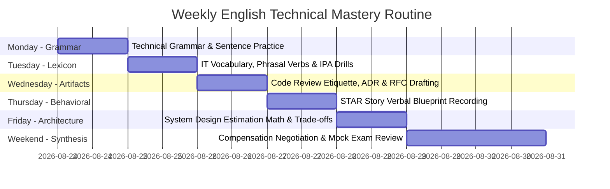

---

title: English Technical Communication for Global Software Engineers
category: Languages - English Technical Communication
tags: [english, software-engineering, technical-grammar, it-vocabulary, code-review, star-method, system-design, salary-negotiation, hub, comprehensive-guide, languages, learning-note]
---

# 🇺🇸 English Technical Communication for Global Software Engineers

---

## 1. Executive Curriculum Architecture & Communication Stack

In global software engineering organizations (Silicon Valley, London, Singapore, Remote), English proficiency is not simply about conversational fluency—it is about **structural precision, architectural clarity, and professional authority**. International tech teams evaluate engineers across six critical communication layers:

---

## 2. Complete Module Index & Study Sequence

### Module 1: Technical Grammar Core & Sentence Precision
Master the precise syntactic structures that separate junior developers from senior technical leaders.
- 📘 **Technical Grammar Resource**: Deep grammatical rules, IPA phonetics table, tense architecture, conditional matrices, subjunctive mood, and real-world post-mortem dialogues.
- 💻 **Grammar Practice Drills**: 6 multi-tier drill sets covering tense precision, trade-off conditionals, passive voice pipelines, subjunctive mood, negative inversion, and incident error refactoring.
- 📝 **Grammar Assessment Exam**: 100-point comprehensive assessment with CEFR C1–C2 evaluation rubrics, error identification, and oral blueprint construction.
- ❓ **Grammar Q&A Bank**: 10 high-scoring Senior/Staff model responses with grammatical breakdowns and linguistic rationales.
- 📚 **12 English Tenses Master Guide**: Comprehensive formulas, timeline visualizations, and engineering usage examples.
- 🗺️ **Grammar Visual Mindmaps**: Flowcharts for conditionals, passive voice, reported speech, and Obsidian flashcard hooks.

---

### Module 2: IT Vocabulary, Phrasal Verbs & Distributed Systems Lexicon
Eliminate awkward translations and master authentic engineering team vernacular.
- 📘 **IT Vocabulary & Phrasal Verbs Compendium**: 50+ lifecycle phrasal verbs (*spin up, scale out, throttle back, fall back on, abstract away*), distributed systems terminology (*idempotency, backpressure, linearizability, split-brain*), power collocations, and war-room transcripts.
- 💻 **IT Vocab Practice Drills**: Phrasal verb insertion, distributed concept matching, power collocation upgrades, phonetic stress drills, and incident lexicon refactoring.
- 📝 **IT Vocab Assessment Exam**: 100-point assessment on technical lexicon, prepositional mastery, paraphrasing, and oral system design blueprints.
- ❓ **IT Vocab Q&A Bank**: 10 interview scenarios demonstrating authoritative distributed systems explanations.
- 💼 **Globish Workplace Vocabulary Compendium**: High-impact workplace collocations, `-ate` suffix phonetic stress rules, and reduced relative clauses.

---

### Module 3: Code Review Etiquette, RFCs & Asynchronous Communication
Build trust, maintain psychological safety, and lead distributed teams across global time zones.
- 📘 **Code Review Etiquette & RFC Writing Resource**: Conventional comments (`[Blocking]`, `[Suggestion]`, `[Praise]`), linguistic softening devices, ADR templates, and async Slack protocols.
- 💻 **Code Review Practice Drills**: Intent classification, comment softening refactoring, ADR drafting, and cross-timezone hand-off drills.
- 📝 **Code Review Assessment Exam**: 100-point exam evaluating pull request communication and async leadership.
- ❓ **Code Review Q&A Bank**: 10 real-world workplace scenarios (rejecting monolithic PRs, handling pedantic reviewers, incident updates).

---

### Module 4: Executive Interviewing, Architecture & Negotiation
Land senior and staff engineering roles at top-tier global tech firms.
- 🌟 **STAR Behavioral Interview Mastery**:
  - 📘 **STAR Method Resource**: STAR+L framework, FAANG leadership principle mappings, power verbs, and 2-minute blueprints.
  - 💻 **STAR Practice Drills** | 📝 **STAR Assessment Exam** | ❓ **STAR Q&A Bank**.
- 🏗️ **System Design Architectural Speaking**:
  - 📘 **Architecture Speaking Resource**: 4-phase interview orchestration, math out loud, and PACELC trade-off defense.
  - 💻 **Architecture Drills** | 📝 **Architecture Exam** | ❓ **Architecture Q&A Bank**.
- 💰 **Salary & Offer Total Compensation Negotiation**:
  - 📘 **Negotiation Resource**: Total Compensation formulas, phone deflection scripts, counter-offer templates, and recruiter phone negotiation scripts.
  - 💻 **Negotiation Drills** | 📝 **Negotiation Exam** | ❓ **Negotiation Q&A Bank**.

---

## 3. CEFR B2 to C2 Progression Benchmark & Evaluation Rubric

| Evaluation Dimension | CEFR B2 (Working Professional) | CEFR C1 (Senior Technical Lead) | CEFR C2 (Staff / Principal Architect) |
| :--- | :--- | :--- | :--- |
| **Grammatical Precision** | Understandable; occasional slips in tense consistency or prepositions. | Consistently accurate; masters Present Perfect and standard conditionals. | Flawless syntactic command; authoritative use of subjunctive mood and negative inversion. |
| **Technical Vocabulary** | Uses common programming terms (*function, database, bug*). | Employs lifecycle phrasal verbs (*spin up, roll back, throttle back*) and collocations. | Deploys exact distributed systems lexicon (*idempotency, linearizability, backpressure, split-brain*). |
| **Code Review & Feedback** | Direct and blunt (*"Change this loop"*). | Collaborative and polite (*"Would it make sense to extract this helper?"*). | Strategic and standard-driven (*"To adhere to ADR-014, let's explore asynchronous CDC"*). |
| **Interview Storytelling** | Passive / collective (*"We built a caching layer"*). | Structured STAR format with personal ownership (*"I architected the Redis tier"*). | STAR+L with quantified business ROI metrics and organizational multiplier effects. |

---

## 4. Recommended Weekly Study & Spaced Repetition Plan

### Daily Study Protocol (45 Minutes):
1. **15 Mins - Active Recall**: Review flashcards in Grammar Flashcards and IT vocabulary tables.
2. **15 Mins - Reading & Analysis**: Study a resource guide (e.g., System Design Speaking).
3. **15 Mins - Spoken Output Generation**: Record yourself delivering a 2-minute STAR story or back-of-the-envelope capacity estimation out loud.
