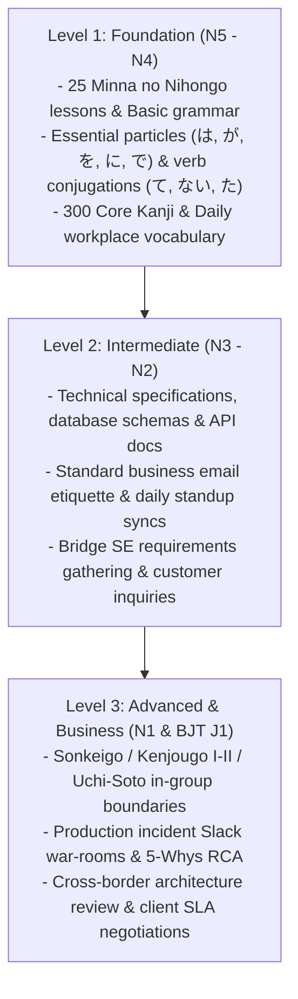
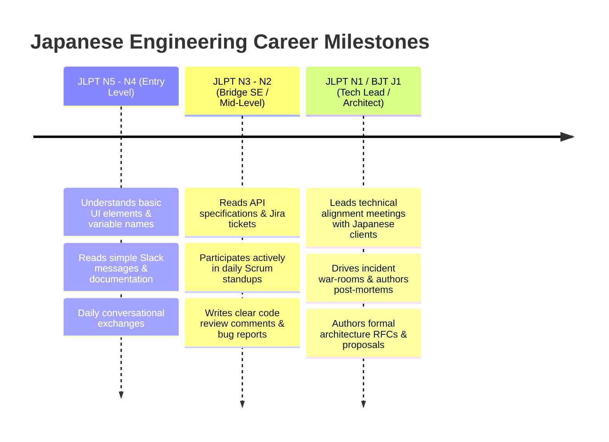
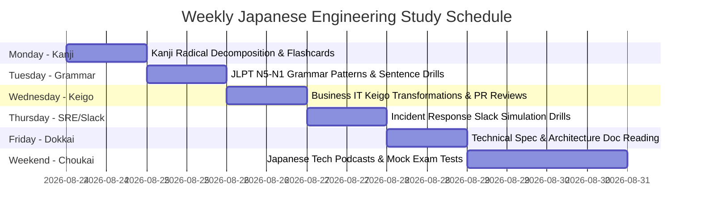

---

title: Japanese IT Engineering & JLPT Mastery Hub (JLPT N5 - N1 & Business Keigo)
category: Languages - Japanese Technical Communication
tags: [japanese, jlpt, keigo, software-engineering, brse, offshore-development, nihongo, hub, comprehensive-guide, languages, learning-note]
---

# 🇯🇵 Japanese IT Engineering & JLPT Mastery Hub (JLPT N5 - N1 & Business Keigo)

---

## 1. Executive Japanese IT Curriculum Framework

This curriculum bridges academic JLPT language mastery with professional software engineering in Japanese tech enterprises, multinationals, and bilingual offshore development (BrSE).

---

## 2. Comprehensive Module Directory & Study Guides

### Module 1: IT Business Keigo & Uchi/Soto Architecture
Master the rules of corporate hierarchy, customer elevation, self-humbling, and polite code reviews.
- 📘 **IT Engineering Keigo Mastery Resource**: Sonkeigo, Kenjougo I/II, Teineigo, Uchi/Soto boundaries, 16-verb transformation matrix, and cushion phrases (*恐れ入りますが, 差し支えなければ, お手数をおかけいたしますが*).
- 💻 **Keigo Practice Drills**: Verb transformations, Uchi/Soto error corrections, and PR comment softening refactoring.
- 📝 **Keigo Assessment Exam**: 100-point comprehensive exam evaluating business Japanese Keigo fluency.
- ❓ **Keigo Q&A Bank**: 10 real-world client interaction scenarios for BrSEs and Tech Leads.
- 🏢 **Business Keigo Engineering Matrix** & **Advanced Grammar Nuances Matrix**.

---

### Module 2: Production Incident Slack & Emergency Communication
Handle P0/P1 system outages in real-time Japanese Slack channels with high speed and business etiquette.
- 🚨 **Incident Response & Slack Communication Protocol**: 5-phase incident protocol (*第一報 $\to$ 一次切り分け $\to$ 暫定措置 $\to$ 復旧完了報 $\to$ 障害報告書/ポストモーテム*), war-room transcripts, and RCA 5-whys.
- 📘 **JLPT N1 Grammar Nuances Compendium** & **N1 Formal Written Grammar Matrix**.

---

### Module 3: JLPT Progressive Roadmaps & Spaced Repetition (N5 to N1)
Systematic, step-by-step roadmaps from beginner fundamentals to N1 literature and technical fluency.
- 🗺️ **JLPT N5 Master Study Guide**: 12-week study schedule, 25 Minna no Nihongo grammar matrix, and 100 core Kanji.
- 🗺️ **JLPT N4 Master Study Guide**: Intermediate grammar (Potential, Passive, Causative, Conditionals).
- 🗺️ **JLPT N3 Study Guide**, **JLPT N2 Study Guide**, and **JLPT N1 Study Guide**.
- 🃏 **Vocabulary & Grammar Mindmap**: Visual classification of N5/N4 parts of speech and particle logic trees.
- 📖 **Flashcard & Spaced Repetition Study Methodology**: Ebbinghaus forgetting curve, 3-step active recall, and Obsidian/Anki integration.

---

### Module 4: Kanji Radical Decomposition & Deep Etymology
Master 2,000+ Joyo Kanji by breaking characters down into core semantic radicals (部首).
- 🏮 **Kanji Etymology & Radical Decomposition N1**: Comprehensive radical breakdowns for advanced technical and business Kanji.

---

## 3. High-Yield Japanese IT & Engineering Vocabulary Reference

| Japanese Term (Kanji / Katakana) | Furigana | Romaji | Technical Meaning | Pragmatic Engineering Context |
| :--- | :--- | :--- | :--- | :--- |
| **要件定義** | ようけんていぎ | youken teigi | Requirements Definition | *"クライアントと要件定義のすり合わせを行います。"* (Align on requirement specs with client). |
| **設計書** | せっけいしょ | sekkeisho | Architecture Design Document | *"基本設計書と詳細設計書を作成いたしました。"* (Authored basic & detailed design docs). |
| **開発環境** | かいはつかんきょう | kaihatsu kankyou | Development Environment | *"Dockerを用いてローカル開発環境を構築します。"* (Set up local dev environment via Docker). |
| **本番環境** | ほんばんかんきょう | honban kankyou | Production Environment | *"本番環境へのリリース作業を実施します。"* (Execute release into production). |
| **結合テスト** | けつごうテスト | ketsugou tesuto | Integration Testing | *"マイクロサービス間の結合テストを実行中です。"* (Running inter-service integration tests). |
| **不具合 / バグ** | ふぐあい / バグ | fuguai / bagu | Defect / Bug | *"重大な不具合を検知いたしました。"* (Detected a critical system defect). |
| **障害対応** | しょうがいたいおう | shougai taiou | Incident Response / Triage | *"SREチームが緊急の障害対応を行っています。"* (SRE team is conducting emergency triage). |
| **巻き戻し / ロールバック**| まきもどし / ロールバック| makimodoshi / rōrubakku | Rollback | *"直前のバージョンへロールバックを実施しました。"* (Executed rollback to previous version). |
| **負荷分散** | ふかぶんさん | fuka bunsan | Load Balancing | *"ロードバランサーによる負荷分散を設定します。"* (Configure load balancing via LB). |
| **冪等性** | べきとうせい | bekitousei | Idempotency | *"決済APIの冪等性を担保します。"* (Guarantee idempotency for payment APIs). |
| **冗長化** | じょうちょうか | jouchouka | Redundancy / High Availability | *"DBサーバーをマルチAZで冗長化いたします。"* (Make DB redundant across Multi-AZ). |
| **移行** | いこう | ikou | Migration | *"クラウド基盘へのデータ移行を推進します。"* (Drive data migration to cloud platform). |

---

## 4. JLPT & BJT Career Progression Benchmark

---

## 5. Weekly Study Protocol & Spaced Repetition Routine

### Daily Study Protocol (45 Minutes):
1. **15 Mins - Active Recall**: Review 30 Kanji and vocabulary cards in Flashcards N5 or Flashcards N4.
2. **15 Mins - Keigo & Grammar Analysis**: Study IT Keigo Resource or Incident Slack Protocol.
3. **15 Mins - Output Generation**: Write a mock pull request comment or client Slack update using proper cushion words (*恐れ入りますが, 差し支えなければ*).
