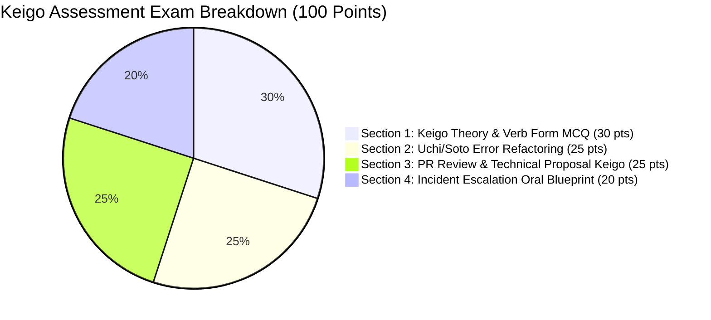
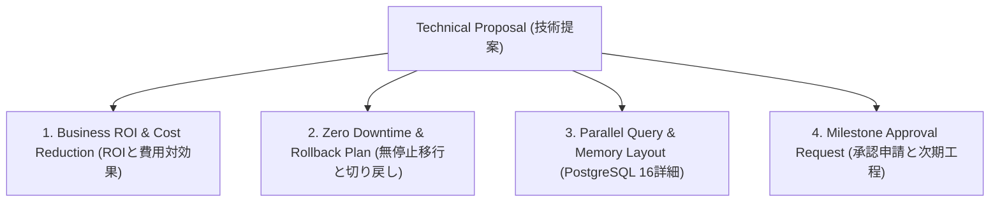

---

title: 45-Minute Japanese IT Keigo Assessment Exam & Engineering Evaluation Rubric
category: Languages - Japanese Technical Communication
tags: [japanese, keigo-exam, assessment, evaluation, sonkeigo, kenjougo, business-japanese, rubrics, languages, learning-note]
---

# 📝 45-Minute Japanese IT Keigo Assessment Exam & Engineering Evaluation Rubric

- 🔗 Related Patterns: [[03_Languages/03_japanese/01_Japanese_Business/01_keigo_problems|Keigo Practice Drills]] | [[03_Languages/03_japanese/01_Japanese_Business/01_keigo_qa|Keigo Q&A Bank]]

---

## ⏱️ Exam Overview & Scoring Scale

| Parameter | Detail |
| :--- | :--- |
| **Duration** | 45 Minutes |
| **Total Marks** | 100 Points (Pass: 80 / Distinction: 90+) |
| **Target Level** | JLPT N2–N1 / Business Japanese BJT J2–J1 (Senior Engineer & BrSE Level) |
| **Focus Areas** | Sonkeigo/Kenjougo Verb Matrix, Uchi/Soto Rules, Cushion Words, Incident Escalations |

---

## 📝 Section 1: Keigo Theory & Verb Form MCQ (30 Points / 3 pts each)

**1.** クライアント（外）に対して、自社（内）のエンジニアが仕様書を確認したことを伝える場合の正しい敬語表現はどれか。  
[A] 弊社のエンジニアが仕様書をご高覧なさいました。  
[B] 弊社のエンジニアが仕様書を拝見いたしました。  
[C] 弊社のエンジニア様が仕様書をご覧になりました。  
[D] 弊社のエンジニアが仕様書を拝読なさいました。  

**2.** 「言う」の尊敬語（相手の動作）として適切なものはどれか。  
[A] 申す  
[B] 申し上げる  
[C] おっしゃる  
[D] 存じ上げる  

**3.** 「知っている」の謙譲語（自分の状態）として適切なものはどれか。  
[A] ご存じである  
[B] 存じ上げております  
[C] お知りになります  
[D] ご承知くださる  

**4.** クライアントからの指示を受けた際、最も適切なビジネス返答はどれか。  
[A] 了解しました。  
[B] 分かりました。  
[C] 承知いたしました（かしこまりました）。  
[D] オッケーです。  

**5.** 相手にプルリクエストのレビューを依頼する際、冒頭に置く最も適切なクッション言葉はどれか。  
[A] どうしても恐縮ですが  
[B] お手数をおかけいたしますが  
[C] 差し支えがあれば  
[D] ご苦労様ですが  

**6.** 自社の会社名をクライアントに対して呼ぶ際の正しい表現はどれか。  
[A] 貴社 (kisha)  
[B] 御社 (onsha)  
[C] 弊社 (heisha) / わたくしども  
[D] 当社様 (tousha-sama)  

**7.** 「する」の謙譲語として適切なものはどれか。  
[A] なさる  
[B] される  
[C] いたす  
[D] あそばす  

**8.** 相手の会社に訪問することを伝える謙譲表現はどれか。  
[A] 明日、貴社にいらっしゃいます。  
[B] 明日、貴社に伺います（参ります）。  
[C] 明日、貴社にお越しになります。  
[D] 明日、貴社に行かれます。  

**9.** 提案書の末尾で「検討してくれたら嬉しい」という意向を最も格調高く伝える表現はどれか。  
[A] 検討してください。  
[B] ご検討いただけますと幸甚に存じます。  
[C] 検討してもらいたいです。  
[D] ご検討を希望します。  

**10.** 「見る」の尊敬語（クライアントの動作）はどれか。  
[A] 拝見する  
[B] ご覧になる  
[C] 拝読する  
[D] 見られる  

---

## 📝 Section 2: Uchi/Soto Error Refactoring (25 Points / 5 pts each)

以下の不適切な敬語表現を、ビジネスIT現場で通用する正しい表現に修正せよ。

1. ❌ *"弊社の山田リーダー様が、明日そちらのオフィスにいらっしゃいます。"*  
   - **修正後**: __________________________________________________________________
2. ❌ *"クライアントの佐藤様が、昨日の障害報告書を拝見しました。"*  
   - **修正後**: __________________________________________________________________
3. ❌ *"このAPIの仕様は、私がお客様に教えてあげました。"*  
   - **修正後**: __________________________________________________________________
4. ❌ *"了解です。ご提示いただいた修正案でコミットします。"*  
   - **修正後**: __________________________________________________________________
5. ❌ *"御社のサーバーを私たちが調査して差し上げます。"*  
   - **修正後**: __________________________________________________________________

---

## 📝 Section 3: Keigo Code Review & Technical Proposal (25 Points)

GitHubのプルリクエストにおいて、以下の指摘を**クッション言葉と丁寧な敬語（〜いただけますと幸いです 等）**を用いて洗練された日本語で記述せよ（50〜70文字程度）。

- **指摘内容**: *"このSQLクエリはインデックスが使われていないため、テーブル全体スキャンが発生します。`user_id` にインデックスを追加してください。"*

- **あなたの作成文**:  
  ___________________________________________________________________________________  
  ___________________________________________________________________________________  
  ___________________________________________________________________________________  

---

## 📝 Section 4: Incident Escalation Oral Blueprint (20 Points)

日本のクライアント（佐藤様）に対して、深夜に発生したデータベース障害の緊急連絡を電話またはSlackで行うスクリプト（70〜90文字程度）を作成せよ。以下を含めること：
- 恐縮のクッション言葉
- 障害の発生（接続プール枯渇）と現在の対応状況（ロールバック実施中）
- 復旧後の報告の約束

- **あなたの作成スクリプト**:  
  ___________________________________________________________________________________  
  ___________________________________________________________________________________  
  ___________________________________________________________________________________  

---

## 🔑 Comprehensive Answer Key & Rubric

🔍 View Complete Answer Key & Model Answers

### Section 1 Answers
1. **[B] 弊社のエンジニアが仕様書を拝見いたしました。**
2. **[C] おっしゃる**
3. **[B] 存じ上げております**
4. **[C] 承知いたしました（かしこまりました）。**
5. **[B] お手数をおかけいたしますが**
6. **[C] 弊社 (heisha) / わたくしども**
7. **[C] いたす**
8. **[B] 明日、貴社に伺います（参ります）。**
9. **[B] ご検討いただけますと幸甚に存じます。**
10. **[B] ご覧になる**

### Section 2 Model Corrections
1. *"弊社のリーダーの山田が、明日貴社のオフィスに**伺います（参ります）**。"*
2. *"クライアントの佐藤様が、昨日の障害報告書を**ご覧になりました**。"*
3. *"こちらのAPIの仕様につきまして、私からお客様に**ご説明申し上げました**。"*
4. *"**承知いたしました**。ご提示いただきました修正案にてコミットいたします。"*
5. *"貴社のサーバーにつきまして、弊社のチームにて**調査を実施させていただきます**。"*

### Section 3 Model PR Comment
> *"**恐れ入りますが**、こちらのSQLクエリですとフルテーブルスキャンが発生し、パフォーマンスに影響を及ぼす可能性がございます。`user_id` へのインデックス追加を**ご検討いただけますと幸甚に存じます**。"*

### Section 4 Model Incident Script
> *"佐藤様、夜分遅くに大変恐縮でございます。緊急でご報告申し上げます。先ほどDB接続プール枯渇による障害が発生したため、直ちに直前バージョンへのロールバックを実施中でございます。復旧次第、速やかにご報告申し上げます。"*

---

## 📝 Section 5: Architectural Defense & Proposal Evaluation (20 Points)

Translate and rephrase the following software architectural statements into formal Japanese business keigo suitable for C-level executives and client project directors (顧客CIO・役員向け技術提案):

### Question 5.1: Proposing Database Migration to PostgreSQL 16 (PostgreSQL 16への移行提案)
- **Drafting Task**: Express the proposal to migrate from legacy MySQL 5.7 to PostgreSQL 16 due to JSONB indexing, parallel query execution, and partitioning improvements.
- **Model Answer (模範解答)**:
  > *「現行のMySQL 5.7におきましては、今後のデータ量増大に伴う検索パフォーマンスの低下が懸念されております。つきましては、JSONBインデックスの高度な最適化およびパラレルクエリ処理の恩恵を享受すべく、PostgreSQL 16へのデータベース移行をご提案申し上げます。本移行により、バッチ集計処理時間を約45%短縮し、システム全体の運用安定性を大幅に向上させることが可能と存じます。詳細な移行計画書を添付いたしましたので、ご査収のほどよろしくお願い申し上げます。」*

### Question 5.2: Explaining a Microservice Incident Root Cause (マイクロサービス障害原因の報告)
- **Drafting Task**: Explain that a deadlock occurred in the payment saga transaction due to unindexed foreign key locks, which has been hotfixed and mitigated with distributed locking.
- **Model Answer (模範解答)**:
  > *「昨夜発生いたしました決済マイクロサービスの遅延障害について、深くお詫び申し上げます。原因を究明いたしましたところ、決済トランザクション処理における外部キーのインデックス未設定に起因するデッドロックの発生が判明いたしました。直ちにインデックスの追加およびRedis分散ロックの導入による緊急パッチを適用し、現在は正常稼働に復旧しております。再発防止策として、全テーブルのインデックス監査および負荷試験体制を強化してまいります。」*

---

## 📊 Comprehensive Keigo Assessment Rubric & Scoring Criteria

| Score Tier | Proficiency Level | Business Readiness |
| :--- | :--- | :--- |
| **90 - 100** | **Distinction (S-Rank)** | Ready for executive board pitching, cross-border architectural negotiations, and lead BrSE role. |
| **80 - 89** | **Pass (A-Rank)** | Fully proficient in daily client communication, incident slack escalation, and code reviews. |
| **70 - 79** | **Borderline (B-Rank)** | Requires review on Uchi/Soto distinctions and Cushion word fluency. |
| **< 70** | **Needs Improvement (C-Rank)** | Remedial training needed on basic Sonkeigo vs Kenjougo verb transformations. |

---

## 🔬 Section 6: Comprehensive Model Essay Answers & Cross-Cultural Commentary

### Detailed Analysis of Question 5.1 & Enterprise Pitching Strategy
When proposing major architectural migrations (such as upgrading PostgreSQL or migrating microservices) to Japanese enterprise stakeholders:
1. **Highlight Business Value First**: Japanese leadership evaluates technical risk through business continuity. Always quantify latency reduction, operational cost, and security improvements before diving into low-level compiler or kernel details.
2. **Use Kenjougo for In-Group Capabilities**: When describing your engineering team's abilities, frame it with humility (*「弊社開発チームにて綿密な移行検証を行わせていただき、ダウンタイムゼロでのマイグレーションを実現いたします」*).
3. **Provide Reversible Contingency Plans (ロールバック計画の提示)**: Emphasize that fallback procedures (*切り戻し手順*) are documented and tested.

### Complete Scoring & Evaluation Rubrics (詳細採点基準)
- **Grammatical Accuracy (30%)**: Correct distinction between Sonkeigo (尊敬語), Kenjougo (謙譲語), and Teineigo (丁寧語).
- **Contextual Appropriateness (30%)**: Accurate application of Uchi/Soto (内外) rules in client-vendor relationships.
- **Engineering Terminology (20%)**: Precise utilization of Japanese IT domain vocabulary (e.g. デッドロック, 冗長化, フェイルオーバー, 負荷分散).
- **Communication Etiquette (20%)**: Smooth usage of cushion words (クッション言葉) to soften requests and mitigate conflict.

---

## 📚 Section 7: Key Vocabulary Glossary & High-Frequency Reference Table

To ensure mastery of all terms tested across this examination, review the following essential engineering honorific reference table:

| Japanese IT Term | English Definition | Keigo Nuance & Usage Rule |
| :--- | :--- | :--- |
| **仕様書 (Shiyousho)** | Technical Specification | Use `ご高覧` when presenting to clients; use `拝見` when our team reviews client specs. |
| **ご査収 (Gosashuu)** | Check and Confirm (Files/PRs) | Standard polite formula attached at the conclusion of deliverables (`ご査収のほどよろしくお願いいたします`). |
| **ご教示 (Gokyouji)** | Teach / Provide Guidance | Used when asking clients for domain requirements or credentials (`ご教示いただけますと幸甚に存じます`). |
| **ご相伴 (Goshouban)** | Partake / Accompany | Formal polite expression in corporate dinner meetings with client executives. |
| **ご容赦 (Goyousha)** | Pardon / Excuse | Used when informing clients of temporary maintenance downtime (`何卒ご容赦のほどお願い申し上げます`). |
| **深謝 (Shinsha)** | Deep Gratitude / Apology | Highest formal written tier in formal corporate apology documentation following outages. |
