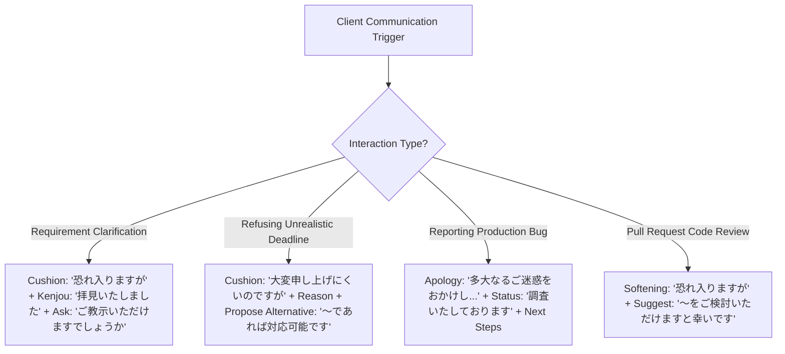
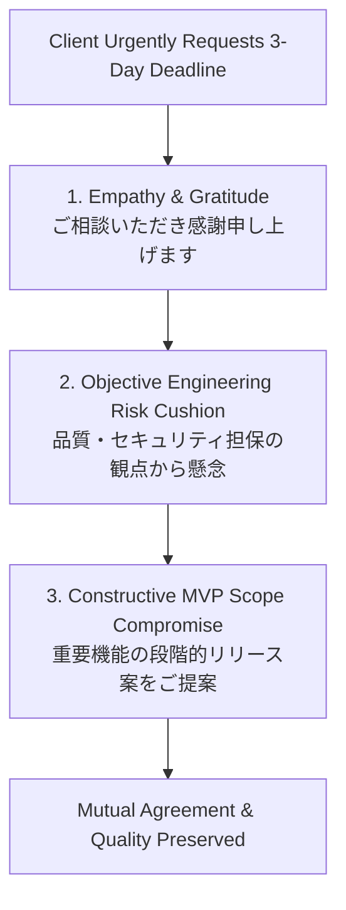
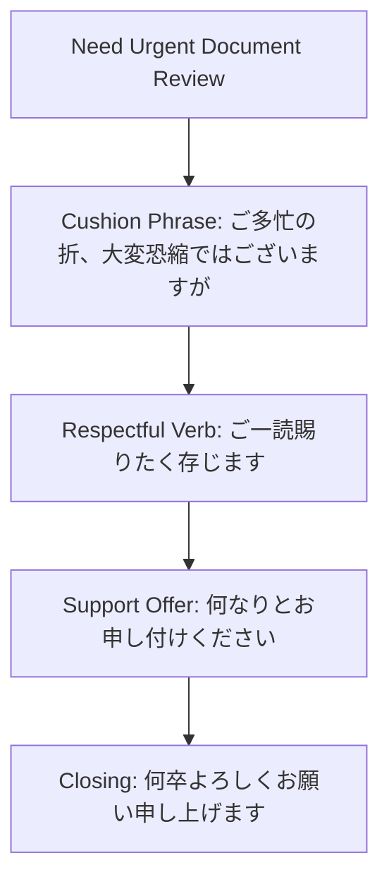

---

title: Japanese IT Keigo Q&A Bank & Client Interaction Scripts
category: Languages - Japanese Technical Communication
tags: [japanese, keigo-qa, business-japanese, client-communication, brse, offshore-development, languages, learning-note]
---

# ❓ Japanese IT Keigo Q&A Bank & Client Interaction Scripts

- 🔗 Related Patterns: [[03_Languages/03_japanese/01_Japanese_Business/01_keigo_problems|Keigo Drills]] | [[03_Languages/03_japanese/01_Japanese_Business/01_keigo_exam|Keigo Exam]]

---

## 🧭 IT Keigo Situational Response Framework

---

## ❓ Question 1: How do you clarify ambiguous requirements with a Japanese client?

> **Situation**: The client's requirement specification document for a payment gateway integration has conflicting timeout parameters.

### 🌟 High-Scoring Bilingual SE / BrSE Model Response
> *"佐藤様、お世話になっております。弊社のNguyenでございます。  
> 
> 先ほどご共有いただきました要件定義書を**拝見いたしました**。決済タイムアウトの設定値について、1点ご確認させていただきたく存じます。  
> 
> 仕様書の3ページ目では『5秒』と記載されておりますが、別紙のシーケンス図では『3秒』と表記されております。外部決済基盤のレスポンス遅延を考慮いたしますと、**差し支えなければ**『5秒（5,000ms）』に統一させていただきたいと考えておりますが、佐藤様のご見解を**ご教示いただけますでしょうか**。  
> 
> お忙しいところお手数をおかけいたしますが、**ご検討いただけますと幸甚に存じます**。"*

- **Linguistic Breakdown**: *拝見いたしました* (Kenjougo for reading spec) $\to$ *差し支えなければ* (Polite cushion) $\to$ *ご教示いただけますでしょうか* (Respectful request for guidance) $\to$ *ご検討いただけますと幸甚に存じます* (Formal sign-off).

---

## ❓ Question 2: How do you politely push back against an impossible release deadline?

> **Situation**: The client requests that a complex feature requiring 3 weeks of work be deployed in 3 days.

### 🌟 High-Scoring Technical Lead Model Response
> *"佐藤様、日頃より大変お世話になっております。追加機能のご要望をいただきありがとうございます。  
> 
> 納期につきまして、弊社の開発チームにて工数精査を**実施いたしましたところ**、大変申し上げにくいのですが、今週末（3日後）の本番リリースは品質担保および結合テストの観点から**技術的に極めて困難な状況でございます**。  
> 
> もし可能でございましたら、**2段階に分けたリリースをご提案させていただきたく存じます**。  
> - **第1フェーズ（今週金曜）**: コアとなるデータ閲覧機能のみを先行リリース。  
> - **第2フェーズ（来週金曜）**: 外部連携機能を含めた完全版をリリース。  
> 
> このようなスケジュールであれば、不具合の発生リスクを抑えつつ安全にリリースが可能でございます。**ご検討いただけますと幸いです**。"*

- **Linguistic Breakdown**: Acknowledges request gratefully $\to$ Uses *大変申し上げにくいのですが* (Cushion for bad news) $\to$ States objective risk (*品質担保の観点*) $\to$ Proposes concrete 2-phase compromise.

---

## ❓ Question 3: How do you apologize and explain an urgent production outage?

> **Situation**: A memory leak caused a 15-minute outage in production. You are communicating on Slack.

### 🌟 High-Scoring Incident Lead Model Update
> *"【障害報告・第一報】決済サービス接続エラーに関するご報告  
> 
> 佐藤様、関係者の皆様  
> 平素より大変お世話になっております。緊急でご報告申し上げます。  
> 
> 本日14:15頃より、本番環境の決済マイクロサービスにおきまして、メモリ使用率の上昇に伴う504エラーが発生いたしました。  
> 弊社のSREチームにて直ちに原因を調査し、直前バージョンへのロールバックを**実施させていただきました**。14:30現在、全機能が正常に復旧していることを**確認いたしております**。  
> 
> 貴社ならびにお客様に多大なるご迷惑とご心配をおかけいたしましたことを、**深くお詫び申し上げます**。  
> 詳細な根本原因（RCA）および再発防止策につきましては、本日18:00までに正式な障害報告書にて**ご提出申し上げます**。"*

---

## ❓ Question 4: How do you write a polite Code Review suggestion on GitHub?

> **Situation**: A Japanese developer's pull request uses a sequential `for` loop for querying the database, causing an N+1 query performance bottleneck.

### 🌟 High-Scoring Senior Reviewer Model Comment
> *"**[Suggestion]**: 実装ありがとうございます！コード全体が非常にシンプルに整理されており、可読性が高いですね。  
> 
> **恐れ入りますが**、こちらの `getUserOrders()` 処理におきまして、ループ内で毎回DBクエリを発行しているため、データ量が増加した際にN+1問題による遅延が発生する恐れがございます。  
> 
> もしよろしければ、`IN` 句を用いた一括取得（Batch Query）またはJOIN処理への変更を**ご検討いただけますでしょうか**。参考実装のリンクを添付いたします。**お手数をおかけいたしますが**、よろしくお願いいたします。"*

---

## ❓ Question 5: How do you ask a Japanese client for sensitive credentials or logs?

> **Situation**: You need production read-only logs from AWS CloudWatch to debug an issue.

### 🌟 High-Scoring Bilingual SE Model Response
> *"佐藤様、お疲れ様でございます。  
> 
> 先ほどご報告いただきました認証エラーの調査を進めております。  
> エラーの詳細な発生契機を特定するため、**差し支えなければ**、AWS CloudWatchの該当時間帯（13:00〜14:00）のアクセスログを**ご共有いただくことは可能でしょうか**。  
> 
> ログ内の個人情報に関しましては、弊社のセキュリティ規定に則り厳重に管理いたします。**ご多忙中恐れ入りますが、ご対応のほどよろしくお願い申し上げます**。"*

---

## ❓ Question 6: How do you introduce your engineering team during a kickoff meeting?

> **Situation**: You are the offshore tech lead introducing your squad to the client's executive board.

### 🌟 High-Scoring Tech Lead Model Opening
> *"本日はお忙しい中、キックオフミーティングにお時間をいただき誠にありがとうございます。  
> 本プロジェクトの開発リーダーを**担当させていただきます**、Nguyen（グエン）と**申します**。  
> 
> 本日は、バックエンドアーキテクチャの設計を**担当いたします**Tran、およびフロントエンドリードのLeが同席**いたしております**。  
> 貴社のECプラットフォーム刷新におきまして、安定性と高いパフォーマンスを実現できるよう、弊社のチーム一丸となって**尽力いたす所存でございます**。何卒よろしくお願い申し上げます。"*

---

## ❓ Question 7: How do you decline a client's invalid technical suggestion tactfully?

> **Situation**: The client suggests disabling SSL certificate verification to bypass a local network connection error.

### 🌟 High-Scoring Security Architect Model Response
> *"佐藤様、アドバイスをいただきありがとうございます。  
> 
> ご提案いただきましたSSL検証の無効化（`verify=False`）につきまして、弊社のセキュリティ担当と**協議いたしましたところ**、ローカル環境での通信テストは可能となるものの、中間者攻撃（MITM）に対する重大な脆弱性を招く恐れがございます。  
> 
> つきましては、セキュリティ監査の基準を満たすため、無効化するのではなく、開発用ルート証明書をコンテナ内にインポートする手法を**採用させていただきたく存じます**。こちらの対応手順書を作成いたしましたので、**ご確認いただけますと幸いです**。"*

---

## ❓ Question 8: How do you accept a client's request with high professionalism?

> **Situation**: The client asks you to implement an extra telemetry dashboard before next week's demo.

### 🌟 High-Scoring Model Response
> *"佐藤様、ダッシュボード追加のご依頼、**承知いたしました（かしこまりました）**。  
> 
> 来週のデモに向けて、PrometheusおよびGrafanaを用いたリアルタイム監視ダッシュボードの構築を**進めさせていただきます**。  
> 金曜日の夕方までにステージング環境へ反映し、動作確認のご案内を**お送り申し上げます**。引き続きよろしくお願いいたします。"*

---

## ❓ Question 9: How do you follow up on an unanswered email or PR review request?

> **Situation**: You sent an urgent architecture proposal to the client 3 days ago and have not received a response.

### 🌟 High-Scoring Follow-up Model Response
> *"佐藤様、いつも大変お世話になっております。弊社のNguyenでございます。  
> 
> 先日（水曜日）に**お送り申し上げました**『決済DB移行に関するアーキテクチャ提案書』につきまして、その後のご進捗状況はいかがでしょうか。  
> 
> ご多忙のところ催促するようで大変恐縮ではございますが、来週からのスプリント計画に反映したく存じますので、**差し支えなければ本日中に一度ご意見をいただけますと幸甚に存じます**。何卒よろしくお願い申し上げます。"*

---

## ❓ Question 10: How do you conclude an offshore development project successfully?

> **Situation**: Final handover meeting after a 6-month software delivery project with zero critical defects.

### 🌟 High-Scoring Project Lead Closing Speech
> *"佐藤様、ならびにプロジェクト関係者の皆様。  
> 本日、無事に新システムのリリースおよび引き継ぎを完了することができ、弊社の開発チーム一同、**心より御礼申し上げます**。  
> 
> 6ヶ月にわたる開発期間中、佐藤様をはじめ貴社の皆様には温かいご指導と迅速なご協力を**賜り**、深く感謝申し上げます。今後ともシステムの安定稼働に向けてサポートを**継続させていただきたく存じます**。改めて、深く御礼申し上げます。"*

---

## ❓ Deep Q&A: Advanced Keigo Nuances & High-Stakes Escalations

### Q11: When speaking to a client about our company's CTO or CEO, why is it forbidden to say 「田中社長様がおっしゃいました」?
**Answer**:
Under the foundational **Uchi/Soto (内と外)** rule of Japanese business etiquette, anyone inside your company (including the CEO, CTO, and company founder) is classified as **Uchi (In-group)** when conversing with external clients (**Soto / Out-group**).
- Attaching the honorific suffix `-sama (様)` or using the Sonkeigo verb `ossharu (おっしゃる)` elevates an in-group member above the client, which is considered a severe business blunder.
- **Correct Formulation**:
  > *「弊社の代表の田中が、そのように**申しておりました**。」*  
  *(Dropping `-sama`, using Kenjougo `mousu / 申す`).*

### Q12: How should an engineer politely refuse an impossible deadline requested by a client without causing friction?
**Answer**:
Employ the **Three-Step Cushion Refusal Technique**:
1. **Empathy & Acceptance**: Acknowledge the client's urgency (`ご要望の趣旨、大変よく理解いたしました`).
2. **Cushion + Objective Constraint**: State the engineering risk politely (`大変恐縮ではございますが、現行のリソースおよび品質検証期間を考慮いたしますと、期日までの全機能リリースはセキュリティ上のリスクを伴う可能性がございます`).
3. **Constructive Alternative (代替案の提示)**:
  > *「つきましては、コア機能である決済APIを先行して期日までにリリースし、管理画面機能については次週に分割リリースする形をご検討いただけないでしょうか。」*

---

## ❓ Deep Q&A: Cross-Cultural Engineering Nuances & Etiquette Rules

### Q13: Why is 「ご苦労様です (Gokurousama-desu)」 forbidden when addressing clients or senior managers?
**Answer**:
`Gokurousama-desu` is an expression used exclusively by superiors to praise subordinates for their labor. When addressing clients, project managers, or team leads, using it is perceived as condescending.
- **Always use**: `お疲れ様です (Otsukaresama-desu)` for colleagues and internal leads.
- **For clients**: Use `いつも大変お世話になっております (Itsumo taihen osewa ni natte orimasu)` or `お忙しいところ恐れ入ります (Oisogashii tokoro osoreirimasu)`.

### Q14: How to ask a client to review an urgent architectural RFC document before an end-of-day deadline?
**Answer**:
Use high-level cushion phrasing with respectful urgency:
> *「ご多忙の折、大変恐縮ではございますが、本日夕方のアーキテクチャ判定会議に向け、添付の設計方針書（RFC）をご一読賜りたく存じます。万が一ご不明点やお気づきの点がございましたら、何なりとお申し付けください。何卒よろしくお願い申し上げます。」*

