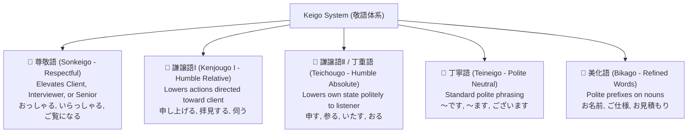
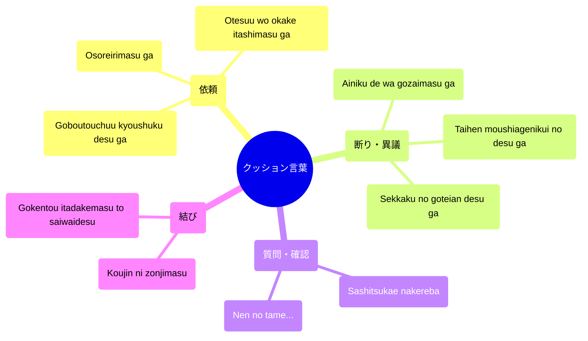
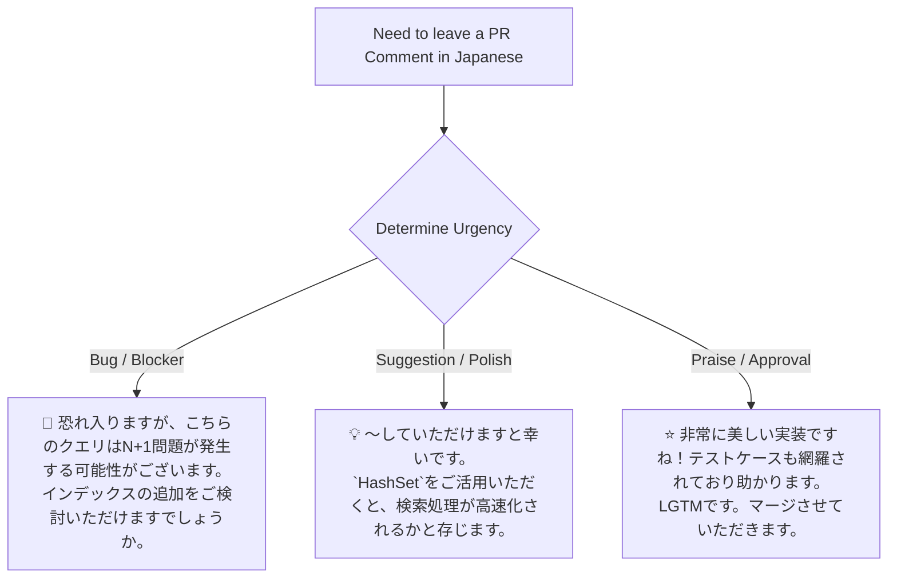
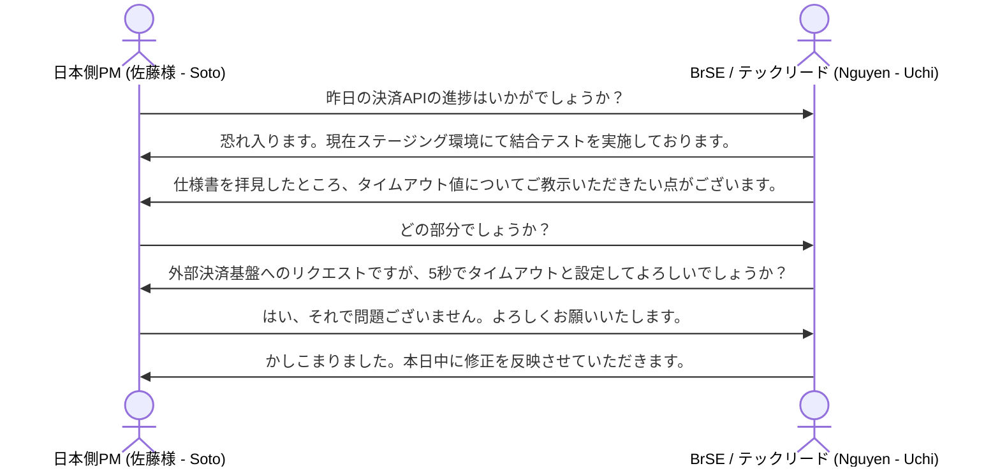

---


title: IT Engineering Keigo Mastery (Sonkeigo, Kenjougo, Teineigo & Cushion Words)
category: Languages - Japanese Technical Communication
tags: [japanese, keigo, sonkeigo, kenjougo, business-japanese, software-engineering, uchi-soto, code-review, languages, learning-note]
---

# 🗣️ IT Engineering Keigo Mastery (Sonkeigo, Kenjougo, Teineigo & Cushion Words)

- 🔗 Related Patterns: [[03_Languages/03_japanese/01_Japanese_Business/01_keigo_problems|Keigo Practice Drills]] | [[03_Languages/03_japanese/01_Japanese_Business/01_keigo_qa|Keigo Q&A Bank]] | [[03_Languages/03_japanese/01_Japanese_Business/01_keigo_exam|Keigo Assessment Exam]]

---

## 1. Executive IT Keigo Architecture & Taxonomy

In Japanese IT engineering and offshore/bilingual software delivery (BrSE), **Keigo (敬語)** is not merely politeness—it defines professional hierarchy, psychological safety, and clear operational boundaries between inside teams (**Uchi / 内**) and external clients (**Soto / 外**).



---

## 2. In-Group vs. Out-Group (Uchi vs. Soto) Architecture in Tech

The golden law of Japanese business Keigo is the **Uchi/Soto (内と外)** principle. When speaking to a client or external partner (**Soto**), you must refer to anyone in your own company (**Uchi**)—even your CEO or Tech Lead—in **humble form (謙譲語)** without honorific titles like *-san* or *Shachou*.

```mermaid
flowchart LR
    subgraph Uchi ["内 (Uchi - Your Company / Squad)"]
        Me["自分 (Self)"]
        MyLead["自社のテックリード (Yamada)"]
        MyCompany["弊社 / わたくしども"]
    end
    
    subgraph Soto ["外 (Soto - Client / Customer)"]
        Client["お客様 / 貴社 (Client Lead)"]
        Partner["パートナー企業 (Partner)"]
    end
    
    Me -->|謙譲語 (Humble Speech)| Client
    MyLead -.->|Humble Reference to Soto: '山田が申し上げます'| Client
    Client -->|尊敬語 (Respectful Speech)| Client
```

| Situation / Entity | Internal In-Group Term (内 - Uchi) | External Out-Group Term (外 - Soto) |
| :--- | :--- | :--- |
| **Company** | **弊社 (heisha)** / わたくしども (watakushidomo) | **貴社 (kisha - written)** / **御社 (onsha - spoken)** |
| **Tech Lead Yamada** | **山田 (Yamada - no honorific)** / 担当の山田 | **山田様 (Yamada-sama)** / テックリードの山田様 |
| **Our Developers** | 弊社のエンジニア (heisha no enjinia) | 貴社の開発チーム様 (kisha no kaihatsu-chiimu-sama) |
| **Specification Doc** | 弊社の設計書 (heisha no sekkeisho) | **ご仕様書 (goshiyousho)** / ご要件定義書 |

---

## 3. Comprehensive Engineering Verb Transformation Matrix

Master these 16 core IT verbs across all Keigo registers:

| Base Verb (辞書形) | Meaning | 尊敬語 (Sonkeigo - Client's Action) | 謙譲語 (Kenjougo - My Action) | 丁寧語 (Teineigo) |
| :--- | :--- | :--- | :--- | :--- |
| **言う** (iu) | Say / Explain | **おっしゃる** / 言われる | **申し上げる** (moushiageru) / 申す | 言います |
| **する** (suru) | Do / Implement | **なさる** / される | **いたす** (itasu) / させていただく | します |
| **見る** (miru) | Inspect / Review | **ご覧になる** (goran ni naru) | **拝見する** (haiken suru) | 見ます |
| **行く / 来る** | Go / Visit | **いらっしゃる** / お越しになる | **伺う** (ukagau) / **参る** (mairu) | 行きます / 来ます |
| **知っている** | Know / Be aware | **ご存じである** (gozonji de aru) | **存じ上げる** / 存じております | 知っています |
| **貰う** (morau) | Receive / Accept | — | **いただく** (itadaku) / **頂戴する** | もらいます |
| **会う** (au) | Meet / Sync | **お会いになる** | **お目にかかる** (ome ni kakaru) | 会います |
| **聞く** (kiku) | Inquire / Listen | **お聞きになる** | **伺う** (ukagau) / **拝聴する** | 聞きます |
| **伝える** (tsutaeru) | Relay / Inform | **お伝えになる** | **申し伝える** (moutsutaeru) | 伝えます |
| **考える** (kangaeru) | Evaluate / Design | **お考えになる** | **拝察する** (haisatsu suru) / 検討いたす | 考えます |
| **読む** (yomu) | Read / Review PR | **お読みになる** / ご覧になる | **拝読する** (haidoku suru) | 読みます |
| **確認する** | Verify / Check | **ご確認なさる** / ご確認いただく | **確認いたす** / 拝見いたす | 確認します |
| **修正する** | Refactor / Fix bug | **ご修正なさる** | **修正いたす** / 修正させていただきます | 修正します |
| **開発する** | Develop / Code | **ご開発なさる** | **開発いたす** / 開発を担当いたす | 開発します |
| **共有する** | Share / Sync info | **ご共有いただく** | **共有いたす** / 共有申し上げます | 共有します |
| **待つ** (matsu) | Wait | **お待ちになる** / お待ちいただく | **お待ち申し上げる** | 待ちます |

---

## 4. Cushion Phrases (クッション言葉) for Tech Leads & BrSEs

In Japanese business communication, making a direct request or reporting a bug without a **Cushion Phrase (クッション言葉)** sounds demanding and abrasive.



### High-Frequency Cushion Phrases Reference Table

| Cushion Phrase | Kanji & Furigana | Literal & Pragmatic Meaning | Engineering Context |
| :--- | :--- | :--- | :--- |
| **恐れ入りますが** | 恐れ入りますが (おそれいりますが) | *"Excuse me / I am deeply grateful for your trouble"* | Preceding a request for API documentation or credentials. |
| **お手数をおかけしますが** | お手数をおかけいたしますが | *"I apologize for giving you extra work, but..."* | Asking a client to review a revised PR or test on staging. |
| **差し支えなければ** | 差し支えなければ (さしつかえなければ) | *"If it is not inconvenient / If permissible..."* | Asking for sensitive database logs or architecture schemas. |
| **大変恐縮ですが** | 大変恐縮ですが (たいへんきょうしゅくですが) | *"I am terribly embarrassed to trouble you, but..."* | Escalating an urgent P0 production incident to client leads. |
| **幸甚に存じます** | 幸甚に存じます (こうじんにぞんじます) | *"I would be exceptionally grateful (Highest Formal Written)"* | Concluding formal engineering proposals or RFC sign-offs. |

---

## 5. Keigo Pull Request & Code Review Comment Matrix



| Tone / Level | Example PR Comment | Linguistic & Cultural Analysis |
| :--- | :--- | :--- |
| ❌ **Blunt / Rude** | `「コードを直してください。間違っています。」` | Direct imperative; destroys psychological safety. |
| 🟡 **Neutral Polite** | `「こちらの処理に誤りがありますので、修正をお願いします。」` | Acceptable for internal peers, but lacking collaborative softening. |
| 🌟 **Senior Softened Keigo** | `「恐れ入りますが、こちらの処理ですとNULLポインタ例外が発生する恐れがございます。Optional等でのラップをご検討いただけますと幸甚に存じます。」` | Uses cushion phrase + speculative risk phrasing (`恐れがございます`) + polite desire (`ご検討いただけますと幸甚に存じます`). |

---

## 6. Comprehensive Japanese Engineering Dialogues

### Dialogue 1: Client Daily Standup & Requirement Alignment (Bilingual SE / BrSE)



- **Dialogue Transcript**:
  > **日本側PM (佐藤様)**: *"おはようございます。昨日の決済マイクロサービスの開発進捗はいかがでしょうか？"*  
  > **BrSE (Nguyen)**: *"おはようございます、佐藤様。お時間をいただきありがとうございます。現在、弊社の開発チームにてステージング環境での結合テストを**担当させていただいております**。昨夜**ご共有いただきました**新しい要件定義書を**拝見いたしました**が、1点ご確認させていただきたい点がございます。"*  
  > **日本側PM (佐藤様)**: *"はい、どのような点でしょうか？"*  
  > **BrSE (Nguyen)**: *"恐れ入りますが、外部決済ゲートウェイとの通信タイムアウト値について、**差し支えなければ** `5,000ms` に設定いたしてもよろしいでしょうか？ネットワーク遅延時のリトライ処理を**考慮いたしまして**、このように設計させていただきたく存じます。"*  
  > **日本側PM (佐藤様)**: *"なるほど、その設計で問題ございません。ご提案ありがとうございます。"*  
  > **BrSE (Nguyen)**: *"**承知いたしました（かしこまりました）**。それでは本日中に設計書を更新し、PRを**ご提出申し上げます**。"*(

---

### Dialogue 2: Production Incident Slack & Emergency Call with Client Lead

> **BrSE / Lead SRE**: *"佐藤様、大変お忙しいところ恐縮でございます。緊急でご報告申し上げます。本日14時10分頃より、本番環境のデータベースにおきまして接続プールが枯渇し、一部のお客様に504エラーが発生している事象を**確認いたしました**。"  
> **日本側PM**: *"原因と現在の影響範囲はどうなっていますか？"*  
> **BrSE / Lead SRE**: *"はい、ただいま弊社のSREチームがログを**詳細に調査いたしましたところ**、バッチ処理における未インデックスのクエリが原因であると**判明いたしました**。現在、直前のリリースバージョンへの**ロールバックを実施させていただいております**。完了次第、速やかにご報告申し上げます。多大なるご迷惑をおかけしておりますことを、深くお詫び申し上げます。"*

---

## 7. Summary & Keigo Golden Rules for Global IT Engineers

1. **Strictly Apply Uchi/Soto**: Never add *-san* or use Sonkeigo when referring to yourself or your company's engineers in front of clients.
2. **Master the Verb Transformations**: Always substitute *iu $\to$ moushiageru*, *miru $\to$ haiken suru*, *suru $\to$ itasu*.
3. **Prefix Requests with Cushion Words**: Always soften inquiries with *Osoreirimasu ga*, *Otesuu wo okake itashimasu ga*, *Sashitsukae nakereba*.
4. **Use "Kashikomarimashita" instead of "Ryokai desu"**: In formal client situations, *Ryokai desu (了解です)* is considered disrespectful; use **承知いたしました (Shouchi itashimashita)** or **かしこまりました (Kashikomarimashita)**.
