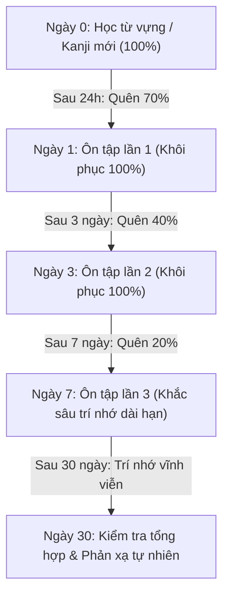
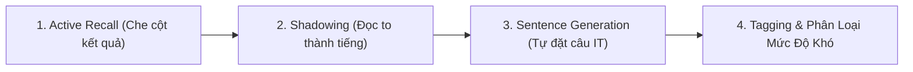
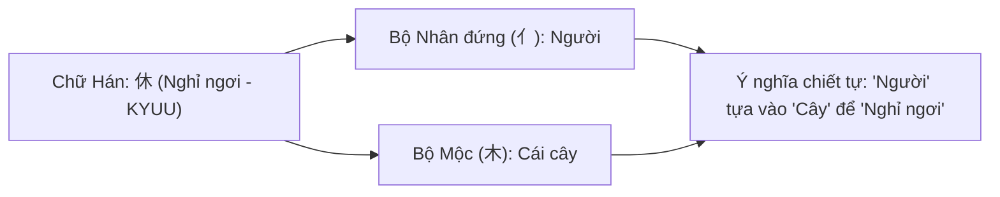

---


title: Hướng Dẫn Phương Pháp Học Flashcard & Spaced Repetition Tiếng Nhật
category: Languages - Japanese Study Methodology
tags: [japanese, flashcards, spaced-repetition, anki, obsidian, kanji-study, ebbinghaus, languages, learning-note]
---

# 📚 Hướng Dẫn Phương Pháp Học Flashcard & Spaced Repetition Tiếng Nhật

- 🔗 Related Patterns: [[03_Languages/03_japanese/dungmori-jp-crawl-data-format/Flashcards/01_Flashcards_N5|Flashcards N5]] | [[03_Languages/03_japanese/dungmori-jp-crawl-data-format/Flashcards/02_Flashcards_N4|Flashcards N4]]

---

## 1. Cơ Sở Khoa Học Của Phương Pháp Spaced Repetition (Lặp Lại Ngắt Quãng)

Phương pháp học từ vựng và chữ Hán (Kanji) dựa trên nghiên cứu về **Đường cong quên lãng Ebbinghaus (Ebbinghaus Forgetting Curve)**. Não bộ con người sẽ quên tới 70% thông tin mới tiếp nhận sau 24 giờ nếu không có sự gợi nhớ chủ động (**Active Recall**).



---

## 2. Cấu Trúc Hệ Thống Flashcards Trong Kho Tri Thức

Mỗi bộ Flashcard trong hệ thống (`01_Flashcards_N5.md`, `02_Flashcards_N4.md`) được thiết kế đồng bộ theo bảng chuẩn 5 trường thông tin:

| Trường Thông Tin | Định Dạng | Mục Đích Sư Phạm | Ví Dụ Minh Họa |
| :--- | :--- | :--- | :--- |
| **Kanji / Từ Vựng** | Chữ Hán gốc (Không kèm Romaji) | Rèn luyện nhận diện mặt chữ Hán trực tiếp, tránh phụ thuộc vào phiên âm Latinh. | **開発** |
| **Cách Đọc (Hiragana)** | Furigana / Hiragana chuẩn | Nắm chắc On-yomi (Âm Hán) và Kun-yomi (Âm thuần Nhật). | かいはつ (kaihatsu) |
| **Từ Loại (POS)** | Noun / Verb (Nhóm 1, 2, 3) / Adj | Định hình vai trò ngữ pháp trong câu. | Danh từ / Động từ nhóm 3 (〜する) |
| **Ý Nghĩa Tiếng Việt** | Ngữ nghĩa chính xác + Thuật ngữ IT | Hiểu rõ nghĩa đời sống lẫn nghĩa chuyên ngành công nghệ. | Phát triển (Phần mềm, hệ thống) |
| **Câu Ví Dụ & Ngữ Cảnh** | Câu giao tiếp / IT thực tế | Học từ vựng trong ngữ cảnh câu văn hoàn chỉnh. | *"新機能の開発を担当しています。"* |

---

## 3. Quy Trình 3 Bước Tự Học Flashcard Hiệu Quả Cao



### Bước 1: Active Recall (Gợi nhớ chủ động)
- Khi mở file Markdown trong VSCode hoặc Obsidian (dùng `Ctrl + Shift + V` để xem Preview):
- **Che cột "Ý nghĩa" và "Cách đọc"**, chỉ nhìn vào cột **Kanji**.
- Tự phát âm cách đọc và giải nghĩa tiếng Việt trong đầu trước khi nhìn đáp án.
- *Nếu trả lời đúng trong vòng 2 giây* $\to$ Đánh dấu "Dễ".
- *Nếu ngập ngừng hoặc sai* $\to$ Đánh dấu "Cần ôn lại ngay".

### Bước 2: Shadowing (Luyện phản xạ phát âm)
- Đọc to câu ví dụ tiếng Nhật ít nhất 3 lần theo đúng ngữ điệu và trọng âm.
- Không đọc rời rạc từng từ mà đọc theo cụm từ (`Phó từ + Trợ từ + Động từ`).

### Bước 3: Tự Đặt Câu Ngữ Cảnh (Output Generation)
- Với mỗi từ vựng mới, tự viết ra một câu văn liên quan trực tiếp đến công việc hoặc đời sống của bản thân.
  - *Ví dụ với từ `修正 (しゅうせい)`*: *"バグを修正してPRを作成しました。"* (Tôi đã sửa bug và tạo PR).

---

## 4. Tích Hợp Flashcards Vào Obsidian & Anki

### 4.1 Cấu Hình Obsidian Spaced Repetition Plugin
Bạn có thể cài đặt plugin **Spaced Repetition** trong Obsidian để tự động biến các bảng từ vựng thành thẻ flashcard tương tác:

```markdown
# Ghi chú dạng thẻ 2 mặt (Obsidian Flashcard Format):

開発 (かいはつ)::Phát triển phần mềm / hệ thống (Development)
<!--SR:!2026-08-30,4,270-->

仕様書 (しようしょ)::Bản đặc tả yêu cầu kỹ thuật (Specification document)
<!--SR:!2026-09-02,7,290-->
```

### 4.2 Nhập Dữ Liệu Vào Anki (Anki Import CSV Format)
Để đồng bộ lên điện thoại di động:
1. Xuất bảng từ file `01_Flashcards_N5.md` thành định dạng CSV hoặc Tab-separated Text.
2. Thiết lập Card Template trên Anki:
   - **Front Template**: `{{Kanji}}`
   - **Back Template**: `{{Furigana}}<br><hr>{{Y_Nghia}}<br><small>{{Vi_Du}}</small>`

---

## 5. Phương Pháp Học Kanji Theo Bộ Thủ (Radical Decomposition)

Học chữ Hán theo bộ thủ giúp bạn hiểu sâu bản chất chiết tự và không bao giờ bị nhầm lẫn giữa các chữ có nét tương đồng.



### Ví Dụ Phân Tích Chữ Hán Chuyên Ngành IT:
- **Chữ 設 (Thiết - trong `設計` Thiết kế)**:
  - Gồm bộ **Ngôn (言 - Lời nói)** + bộ **Kỷ (殳 - Binh khí/Thao tác)** $\implies$ Dùng lời nói và phương pháp để thiết lập, sắp đặt quy trình.
- **Chữ 認 (Nhận - trong `確認` Xác nhận)**:
  - Gồm bộ **Ngôn (言 - Lời nói)** + chữ **Nhẫn (忍 - Kiên nhẫn)** $\implies$ Lắng nghe và kiểm tra cẩn thận để nhận biết chính xác.

---

## 6. Lịch Trình Ôn Tập Khuyến Nghị Hàng Tuần

| Ngày Trong Tuần | Khối Lượng Học Tập | Nội Dung Chi Tiết |
| :--- | :--- | :--- |
| **Thứ 2 – Thứ 6** | 20 Flashcard mới + 40 Flashcard ôn tập | Học theo từng chủ đề trong `01_Flashcards_N5.md` / `02_Flashcards_N4.md`. |
| **Thứ 7** | Tổng ôn tập (Weekly Review) | Lọc toàn bộ các từ bị đánh dấu "Khó / Sai" trong tuần để làm bài test nhanh. |
| **Chủ Nhật** | Ứng dụng thực tế (Application) | Viết nhật ký công việc (Daily Work Log) hoặc đọc tài liệu kỹ thuật tiếng Nhật có chứa các từ đã học. |

---

## 7. Tóm Tắt & 5 Nguyên Tắc Vàng Khi Học Flashcard

1. **Tuyệt đối không dùng Romaji**: Nhìn Romaji sẽ làm tê liệt khả năng nhận diện Hiragana/Kanji của não bộ.
2. **Không học từ vựng đơn lẻ**: Luôn ghi nhớ từ vựng đi kèm với trợ từ và động từ tương ứng (*ví dụ: `コードを読む`, không học mỗi `コード`*).
3. **Học ngắt quãng đều đặn 15 phút mỗi ngày**: Hiệu quả hơn gấp nhiều lần so với việc dồn 3 tiếng học vào cuối tuần.
4. **Kiên trì lặp lại theo chu kỳ Ebbinghaus**: Không nản lòng khi quên; quên và gợi nhớ lại chính là quá trình khắc sâu trí nhớ dài hạn.
