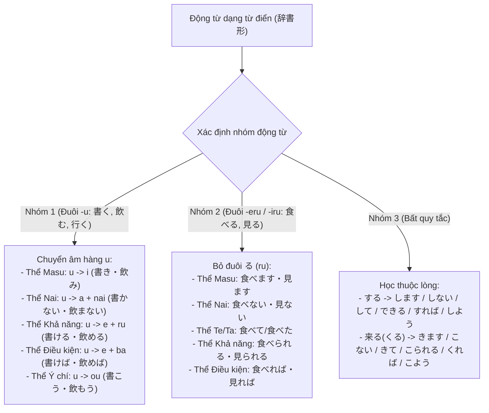
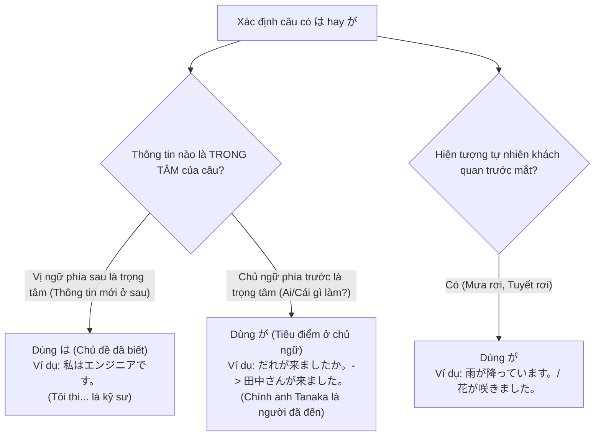
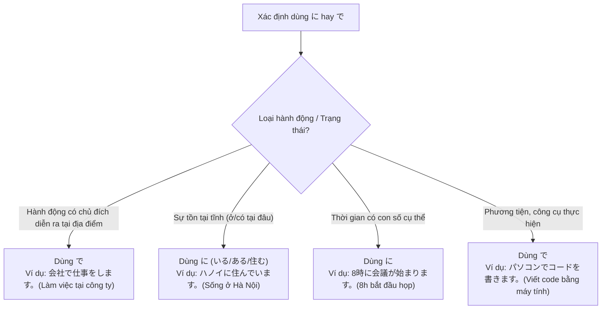

---


title: Sơ Đồ Cấu Trúc Từ Vựng & Ngữ Pháp Tiếng Nhật Sơ Cấp (N5 - N4 Mindmap)
category: Languages - Japanese Sơ Cấp
tags: [japanese, n5, n4, mindmap, vocab, grammar-architecture, particles, verb-conjugation, languages, learning-note]
---

# 🗺️ Sơ Đồ Cấu Trúc Từ Vựng & Ngữ Pháp Tiếng Nhật Sơ Cấp (N5 - N4 Mindmap)

- 🔗 Related Patterns: [[03_Languages/03_japanese/dungmori-jp-crawl-data-format/Flashcards/01_Flashcards_N5|Flashcards N5]] | [[03_Languages/03_japanese/dungmori-jp-crawl-data-format/Flashcards/02_Flashcards_N4|Flashcards N4]]

---

## 1. Bản Đồ Tổng Quan Hệ Thống Từ Vựng & Ngữ Pháp Sơ Cấp

```mermaid
mindmap
  root((Hệ Thống Tiếng Nhật Sơ Cấp))
    Từ Loại (Từ Vựng N5 - N4)
      Danh từ: Đời sống, Trường học, Công nghệ, Thời gian, Địa điểm
      Động từ: Nhóm 1 (五段), Nhóm 2 (一段), Nhóm 3 (不規則: する/来る)
      Tính từ: Tính từ đuôi い (い形容詞), Tính từ đuôi な (な形容詞)
      Trạng từ: Tần suất, Mức độ, Trạng thái (きっと, ずっと, なかなか, ぜひ)
    Hệ Thống Trợ Từ (助詞 - Particles)
      Trợ từ chủ đề & chủ ngữ: は (Chủ đề / Tương phản), が (Chủ ngữ mới / Tiêu điểm)
      Trợ từ đối tượng & đích đến: を (Tác động), に (Thời gian / Đích đến / Tồn tại), へ (Phương hướng)
      Trợ từ phương tiện & địa điểm: で (Nơi diễn ra hành động / Phương tiện)
      Trợ từ liên kết: と (Và / Cùng với), や (Liệt kê không đầy đủ), から / まで (Từ / Đến)
    Hệ Thống Biến Đổi Động Từ (動詞の活用)
      Thể て (Te): Sai khiến, Nối câu, Đang diễn ra (~ている)
      Thể ない (Nai): Phủ định, Cấm đoán (~ないでください), Bắt buộc (~なければならない)
      Thể た (Ta): Quá khứ, Kinh nghiệm (~たことがある)
      Thể Khả năng (可能形): Có thể làm (~ことができる / ~られる)
      Thể Điều kiện (ば形 / たら): Nếu (~ば, ~たら)
      Thể Ý chí (意向形): Rủ rê, Dự định (~ようと思う)
      Thể Bị động & Sai khiến (受身・使役): Bị/Được (~られる), Bắt/Cho phép (~させる)
```

---

## 2. Lưu Đồ Biến Đổi 7 Thể Động Từ Cốt Lõi (N5 - N4 Verb Conjugation Flowchart)



---

## 3. Lưu Đồ Phân Biệt Các Cặp Trợ Từ Dễ Nhầm Lẫn

### 3.1 Phân Biệt Trợ Từ 「は」 và 「が」



---

### 3.2 Phân Biệt Trợ Từ 「に」 và 「で」



---

## 4. Ma Trận Ngữ Pháp Trọng Điểm N5 - N4 Dành Cho Kỹ Sư IT

| Mẫu Ngữ Pháp | Cấu Trúc | Ý Nghĩa & Ngữ Cảnh Sử Dụng | Ví Dụ Kỹ Thuật IT Minh Họa |
| :--- | :--- | :--- | :--- |
| **〜てから (Te kara)** | $V_{\text{te}} + \text{から}$ | Sau khi làm V1 thì làm tiếp V2 | *"テストを実行し**てから**、本番環境へデプロイします。"* (Sau khi chạy test xong mới deploy lên production). |
| **〜ほうがいい (Hou ga ii)** | $V_{\text{ta}} / V_{\text{nai}} + \text{ほうがいい}$ | Lời khuyên nên / không nên làm gì | *"データベースのバックアップを取っ**たほうがいい**です。"* (Nên sao lưu cơ sở dữ liệu thì hơn). |
| **〜ことができる (Koto ga dekiru)** | $V_{\text{dictionary}} + \text{ことができる}$ | Diễn tả khả năng có thể làm gì | *"このAPIは1秒間に1万リクエストを処理する**ことができます**。"* (API này có thể xử lý 10,000 req/s). |
| **〜なければならない (Nakereba naranai)** | $V_{\text{nai}} \to \text{なければならない}$ | Bắt buộc phải làm gì (Quy chuẩn) | *"セキュリティ規程に従わ**なければなりません**。"* (Bắt buộc phải tuân thủ quy chuẩn bảo mật). |
| **〜てもいい (Te mo ii)** | $V_{\text{te}} + \text{もいい}$ | Xin phép / Được phép làm gì | *"ステージング環境でテストし**てもいい**ですか。"* (Tôi có thể test trên staging được không?). |
| **〜てはいけない (Te wa ikenai)** | $V_{\text{te}} + \text{はいけない}$ | Cấm đoán không được làm gì | *"本番サーバーで直接ファイルを編集し**てはいけません**。"* (Tuyệt đối không được sửa file trực tiếp trên production server). |
| **〜ようと思う (You to omou)** | $V_{\text{volitional}} + \text{と思う}$ | Dự định, ý chí của bản thân | *"来週からDockerの勉強を始め**ようと思います**。"* (Tôi dự định tuần sau bắt đầu học Docker). |

---

## 5. Thẻ Ghi Nhớ & Tagging Obsidian Cho Spaced Repetition

Khi ôn tập qua Obsidian Flashcards:
- `#japanese/grammar/n5/te_form`: Thể て dùng để nối câu, sai khiến (`〜てください`), đang diễn ra (`〜ています`).
- `#japanese/grammar/n5/nai_form`: Thể ない dùng cho cấm đoán (`〜ないで`), bắt buộc (`〜なければならない`).
- `#japanese/grammar/n4/potential`: Thể khả năng chuyển đuôi hàng `u $\to$ e + ru` (Nhóm 1) hoặc `bỏ ru + rareru` (Nhóm 2).
- `#japanese/grammar/n4/conditional`: Mẫu `〜たら` dùng cho điều kiện xảy ra trong tương lai hoặc giả định.
- `#japanese/particles/wa_vs_ga`: `は` nhấn mạnh vị ngữ phía sau; `が` nhấn mạnh chủ ngữ phía trước hoặc hiện tượng tự nhiên.
