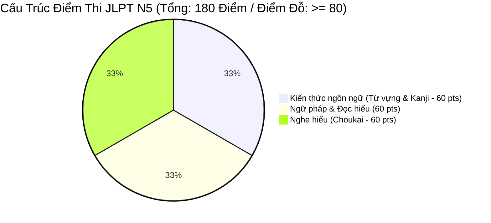
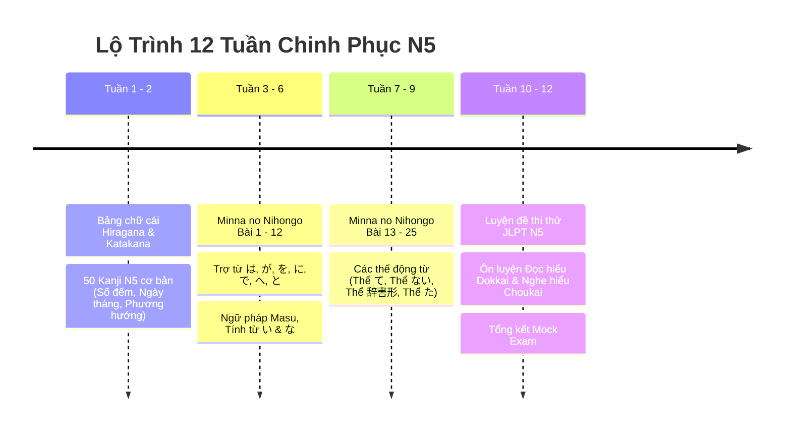
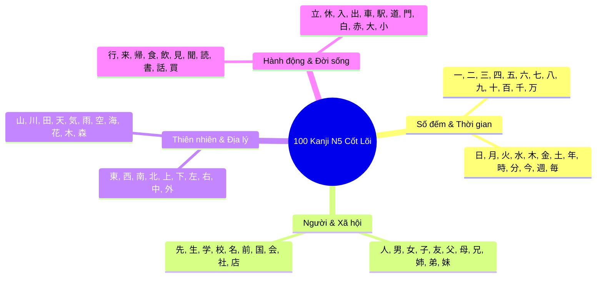

---

title: Lộ Trình Chinh Phục JLPT N5 & Tiếng Nhật Sơ Cấp Toàn Diện (N5 Master Study Guide)
category: Languages - Japanese Roadmap
tags: [japanese, jlpt-n5, roadmap, minna-no-nihongo, kanji-n5, grammar-n5, study-guide, languages, learning-note]
---

# 🗾 Lộ Trình Chinh Phục JLPT N5 & Tiếng Nhật Sơ Cấp Toàn Diện (N5 Master Study Guide)

- 🔗 Related Patterns: [[Japanese_Vocab_Mindmap|Sơ Đồ Từ Vựng & Ngữ Pháp N5 - N4]] | [[02_Roadmap_N4|Lộ Trình N4]]

---

## 1. Tổng Quan Cấu Trúc Kỳ Thi JLPT N5

Cấp độ **JLPT N5** là nền móng nhập môn cho toàn bộ hành trình tiếng Nhật, đánh giá khả năng đọc hiểu các câu văn, chữ Hán đơn giản và nghe hiểu các hội thoại đời sống chậm rãi, rõ ràng.

### Tiêu Chuẩn Đạt Chuẩn JLPT N5:
- **Tổng điểm tối thiểu để đỗ**: $\ge 80 / 180$ điểm.
- **Điểm liệt (Mức sàn mỗi phần)**: Không có phần nào $< 19 / 60$ điểm (Phần Kiến thức + Đọc hiểu gom chung $\ge 38/120$, Nghe hiểu $\ge 19/60$).
- **Khối lượng kiến thức cần tích lũy**:
  - **Chữ cái**: Thành thạo 46 chữ Hiragana, 46 chữ Katakana, âm đục, âm ghép, trường âm, âm ngắt (促音).
  - **Chữ Hán (Kanji)**: $\approx 100 - 120$ chữ Hán cơ bản.
  - **Từ vựng**: $\approx 800 - 1,000$ từ vựng thông dụng (Bài 1 - 25 Minna no Nihongo).
  - **Ngữ pháp**: Toàn bộ 25 bài ngữ pháp sơ cấp tập 1.

---

## 2. Kế Hoạch Lộ Trình Học 12 Tuần Chuẩn Hóa (12-Week Study Roadmap)

---

## 3. Ma Trận Ngữ Pháp Cốt Lõi 25 Bài Minna no Nihongo

| Bài (Lesson) | Mẫu Ngữ Pháp Chính | Công Thức | Ý Nghĩa Ngữ Pháp | Ví Dụ Đời Sống & Kỹ Thuật IT |
| :--- | :--- | :--- | :--- | :--- |
| **Bài 1** | Khẳng định / Nghi vấn | $N_1\ \text{は}\ N_2\ \text{です / ではありません}$ | $N_1$ là / không phải là $N_2$ | *"私はソフトウェアエンジニアです。"* (Tôi là kỹ sư phần mềm). |
| **Bài 2** | Đại từ chỉ định | これ / それ / あれ / この $N$ | Cái này / Cái đó / Cái kia | *"これは弊社の設計書です。"* (Đây là tài liệu thiết kế của công ty chúng tôi). |
| **Bài 3** | Địa điểm / Phương hướng | ここ / そこ / あそこ / どこ | Ở đây / Ở đó / Ở đằng kia | *"サーバー室はあそこです。"* (Phòng máy chủ ở đằng kia). |
| **Bài 4** | Thời gian & Động từ | \text{Giờ}\ \text{に}\ V\ \text{ます} \quad / \quad \text{Từ}\ \text{から}\ \text{Đến}\ \text{まで} | Làm gì lúc mấy giờ / Từ... đến... | *"毎朝9時半にスタンドアップミーティングが始まります。"* (9h30 sáng bắt đầu họp standup). |
| **Bài 5** | Di chuyển & Phương tiện | Địa điểm \text{へ}\ \text{行く/来る} \quad / \quad \text{Phương tiện}\ \text{で} | Đi đến đâu bằng phương tiện gì | *"新幹線で東京のクライアントへ行きます。"* (Đi tàu shinkansen đến gặp client ở Tokyo). |
| **Bài 6** | Tân ngữ hành động | N\ \text{を}\ V\ \text{ます} \quad / \quad \text{Địa điểm}\ \text{で}\ V | Làm hành động gì tại địa điểm nào | *"オフィスでコードを書きます。"* (Viết code tại văn phòng). |
| **Bài 7** | Công cụ / Cho & Nhận | Công cụ $\text{で}\ V \quad / \quad \text{あげます / もらいます}$ | Làm bằng công cụ gì / Tặng / Nhận | *"PostmanでAPIをテストします。"* (Test API bằng công cụ Postman). |
| **Bài 8** | Tính từ い & な | $N\ \text{は}\ \text{Adj}\ \text{です} \quad / \quad \text{Adj}\ + N$ | Miêu tả tính chất, đặc điểm | *"このマイクロサービスは非常に便利で速いです。"* (Microservice này rất tiện và nhanh). |
| **Bài 9** | Sở thích / Khả năng | $N\ \text{が}\ \text{好き / 上手 / わかります}$ | Thích / Giỏi / Hiểu về cái gì | *"私はデータベースの設計が分かります。"* (Tôi hiểu về thiết kế cơ sở dữ liệu). |
| **Bài 10** | Tồn tại người & vật | Địa điểm $\text{に}\ N\ \text{が}\ \text{あります / います}$ | Ở đâu có cái gì / có ai | *"机の上にノートパソコンがあります。"* (Trên bàn có máy tính xách tay). |
| **Bài 11** | Số lượng & Khoảng thời gian | Số lượng \text{で}\ / \quad \text{Khoảng thời gian}\ \text{に}\ \text{N lần} | Số lượng / Tần suất thực hiện | *"1週間に2回デプロイします。"* (Deploy 2 lần trong 1 tuần). |
| **Bài 12** | So sánh | $N_1\ \text{は}\ N_2\ \text{より}\ \text{Adj} \quad / \quad \text{どちらが...}$ | $N_1$ hơn $N_2$ / Cái nào hơn? | *"KafkaはRabbitMQよりスループットが高いです。"* (Kafka có thông lượng cao hơn RabbitMQ). |
| **Bài 13** | Mong muốn | N\ \text{が欲しい} \quad / \quad V_{\text{masu bỏ}}\ \text{たい} | Muốn có cái gì / Muốn làm gì | *"新しいプログラミング言語を勉強したいです。"* (Tôi muốn học ngôn ngữ lập trình mới). |
| **Bài 14** | Thể て (Sai khiến / Đang làm) | $V_{\text{te}}\ \text{ください} \quad / \quad V_{\text{te}}\ \text{います}$ | Hãy làm... / Đang làm... | *"ログファイルを確認してください。"* (Hãy kiểm tra file log). |
| **Bài 15** | Cho phép & Cấm đoán | $V_{\text{te}}\ \text{もいいです} \quad / \quad V_{\text{te}}\ \text{はいけません}$ | Được phép làm... / Không được làm... | *"本番DBで直接削除してはいけません。"* (Không được xóa trực tiếp trên DB production). |
| **Bài 16** | Nối chuỗi hành động | $V_{\text{te}},\ V_{\text{te}},\dots\ V\ \text{ます} \quad / \quad V_{\text{te}}\ \text{から}$ | Làm V1 rồi làm V2 / Sau khi làm... | *"ビルドが成功してから、コンテナを起動します。"* (Sau khi build thành công mới khởi động container). |
| **Bài 17** | Thể ない (Phủ định & Bắt buộc)| $V_{\text{nai}}\ \text{でください} \quad / \quad \text{なければなりません}$ | Đừng làm... / Bắt buộc phải làm... | *"APIキーを公開リポジトリにコミットしないでください。"* (Đừng commit API key lên public repo). |
| **Bài 18** | Thể 辞書形 (Khả năng & Sở thích)| $V_{\text{dic}}\ \text{ことができます} \quad / \quad \text{趣味は}\ V_{\text{dic}}\ \text{ことです}$ | Có thể làm gì / Sở thích là... | *"私はPythonでスクリプトを書くことができます。"* (Tôi có thể viết script bằng Python). |
| **Bài 19** | Thể た (Kinh nghiệm & Liệt kê) | $V_{\text{ta}}\ \text{ことがあります} \quad / \quad V_{\text{tari}},\ V_{\text{tari}}\ \text{します}$ | Đã từng làm... / Khi thì làm A khi làm B | *"大規模なシステム障害に対応したことがあります。"* (Tôi đã từng xử lý sự cố hệ thống lớn). |
| **Bài 20** | Thể thông thường (Phổ thông) | Thể ngắn (辞書形 / ない形 / た形 / だ) | Giao tiếp thân mật với đồng nghiệp | *"今、コードレビュー中だよ。"* (Bây giờ tớ đang review code đấy). |
| **Bài 21** | Ý kiến & Trích dẫn | \text{Thể ngắn}\ \text{と思います} \quad / \quad \text{と言いました} | Tôi nghĩ rằng... / Ai đó đã nói rằng... | *"このライブラリは安全だと思います。"* (Tôi nghĩ thư viện này an toàn). |
| **Bài 22** | Mệnh đề bổ ngữ cho danh từ | \text{Mệnh đề (Thể ngắn)}\ +\ \text{Danh từ} | Mệnh đề định ngữ làm rõ nghĩa cho N | *"昨日私が修正したバグは決済モジュールにあります。"* (Con bug mà hôm qua tôi sửa nằm ở module thanh toán). |
| **Bài 23** | Khi & Hễ mà | \text{Mệnh đề}\ \text{とき} \quad / \quad V_{\text{dic}}\ \text{と} | Khi làm gì... / Hễ mà làm A thì B xảy ra | *"メモリが足りなくなると、サーバーが停止します。"* (Hễ mà thiếu RAM thì server sẽ dừng). |
| **Bài 24** | Cho nhận hành động | $V_{\text{te}}\ \text{あげます / もらいます / くれます}$ | Làm giúp ai / Được ai làm giúp cho | *"先輩がコードをレビューしてくれました。"* (Đàn anh đã review code giúp cho tôi). |
| **Bài 25** | Giả định & Điều kiện | $V_{\text{tara}} \quad / \quad V_{\text{temo}}$ | Nếu... thì... / Cho dù... thì vẫn... | *"テストが通ったら、マージしてもいいです。"* (Nếu test pass thì có thể merge). |

---

## 4. Bảng 100 Chữ Hán (Kanji) N5 Trọng Điểm

---

## 5. Chiến Lược Luyện Thi & Kỹ Năng Đạt Điểm Cao

1. **Phần Moji/Goi (Chữ Hán & Từ vựng)**:
   - Làm thật nhanh trong 20 phút.
   - Nhận diện mặt chữ Hán theo bộ thủ, tuyệt đối không dịch mò theo Romaji.
2. **Phần Bunpou/Dokkai (Ngữ pháp & Đọc hiểu)**:
   - Đọc câu hỏi trước khi đọc đoạn văn.
   - Chú ý các liên từ chỉ sự tương phản (*しかし, でも*) hoặc kết quả (*ですから, だから*).
3. **Phần Choukai (Ng nghe hiểu)**:
   - Ghi chú nhanh các từ khóa chỉ thời gian, địa điểm, số lượng.
   - Lắng nghe kỹ câu hỏi chốt ở cuối đoạn audio (*"Người phụ nữ sẽ làm gì tiếp theo?"*).
