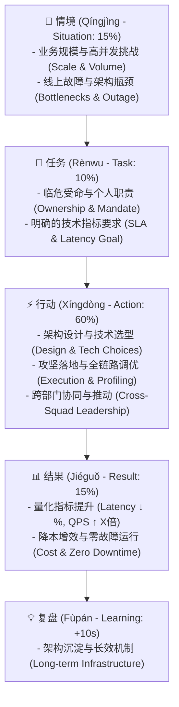
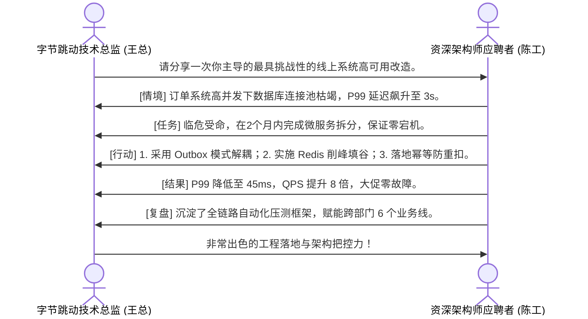
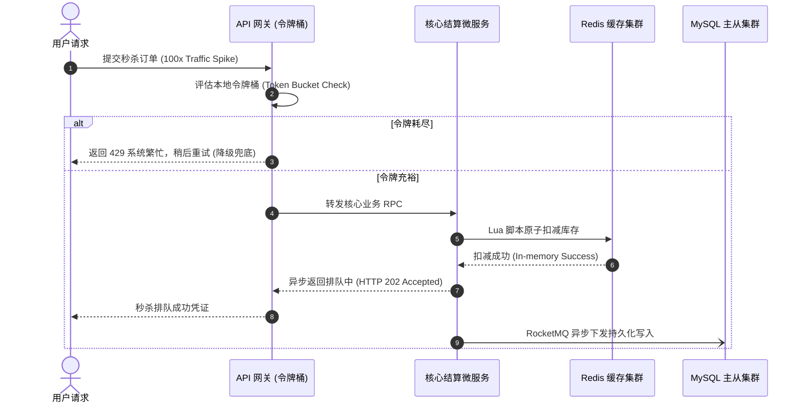

---

title: "Mandarin Technical Interview STAR Storytelling & Behavioral Mastery"
tags: [mandarin, technical-interview, star-method, behavioral-interview, software-engineering, bat-interview, bytedance-interview, languages, learning-note]
category: mandarin
type: master-lesson
created: 2026-08-22
updated: 2026-08-27
status: active
---

# 🇨🇳 Mandarin Technical Interview STAR Storytelling & Behavioral Mastery

- 🔗 Related Patterns: [[03_Languages/04_mandarin/07_Mandarin_IT_Mastery/mandarin_hsk6_advanced_technical_vocabulary|Mandarin HSK6 Advanced Tech Vocab]] | [[03_Languages/04_mandarin/07_Mandarin_IT_Mastery/mandarin_cloud_architecture_whitepaper_translation|Cloud Whitepaper Translation]]

---

## 1. Executive Chinese STAR+L Narrative Architecture

In Tier-1 Chinese tech companies (ByteDance / 字动跳跃, Alibaba / 阿里巴巴, Tencent / 腾讯, Meituan / 美团), technical and behavioral interviews require high verbal precision, clear individual ownership (**我主导** instead of **我们做了**), and multi-dimensional quantified business metrics.

---

## 2. High-Impact Chinese IT Power Verbs & Executive Chengyu (成语)

| Category | Mandarin Term (Hanzi & Pinyin) | Technical Pragmatic Meaning | High-Impact Interview Model Sentence Pattern |
| :--- | :--- | :--- | :--- |
| **Leadership** | **主导 (zhǔdǎo)** | Spearhead / Lead | `我主导了核心交易系统的微服务拆分与异步事件驱动架构设计。` |
| **Crisis Mandate** | **临危受命 (lín wēi shòu mìng)** | Take charge in a critical crisis | `在双十一前夕系统频繁宕机的紧要关头，我临危受命负责线上救火与全链路压测。` |
| **Tackling Hard Tasks**| **攻坚 (gōngjiān)** | Tackle critical technical bottlenecks | `我带队攻坚了高并发场景下分布式事务的一致性难题。` |
| **System Refactoring**| **重构 (chónggòu)** | Architecture refactoring / rebuild | `我们对遗留的单体服务进行了领域驱动设计（DDD）模块化重构。` |
| **Traffic Smoothing** | **削峰填谷 (xiāofēng tiángǔ)** | Peak shaving & load leveling | `引入 Kafka 消息队列实现削峰填谷，彻底消除了数据库连接池打满的隐患。` |
| **Execution/Delivery**| **落地 (luòdì)** | Put into practice / Ship to prod | `推动了零信任安全策略在 15 个生产集群中的全面落地。` |
| **Cost & Efficiency** | **降本增效 (jiàngběn zēngxiào)** | Reduce costs & increase efficiency | `通过容器弹性伸缩与实例混部，为公司实现了 35% 的算力成本节省，达成降本增效。` |
| **Idempotency** | **幂等性 (mìděngxìng)** | Idempotent guarantee | `针对支付扣款接口，设计了基于 Redis 分布式锁与唯一请求号的幂等性控制。` |
| **Graceful Degradation**| **服务降级 (fúwù jiàngjí)** | Graceful degradation under load | `在大促峰值期间主动触发服务降级，保障核心结算链路的高可用。` |
| **Turn the Tide** | **力挽狂澜 (lì wǎn kuáng lán)** | Save the situation / avert disaster| `在数据库主库故障的极端场景下，通过自动化 Raft 选主机制力挽狂澜，避免了数据丢失。` |

---

## 3. Sentence Structure Matrices for Technical Chinese Interviews

### 3.1 Framing Technical Problems & Bottlenecks (情境与挑战)

$$\text{当时系统面临}\ [\text{业务瓶颈 / 突发流量}]\text{，导致}\ [\text{指标恶化}]\text{，极易引发}\ [\text{业务资损 / 宕机风险}]\text{。}$$

- *Example*: *"当时随着跨境电商业务的爆发式增长，支付系统日均 QPS 激增 8 倍。由于旧系统存在**严重的单点故障隐患**与**数据库行级锁争用**，导致结算接口 P99 延迟飙升至 3.5 秒，极易引发大面积用户流失。"*

### 3.2 Describing Architectural Action Steps (分步执行)

$$\text{为了解决这一痛点，我主要推进了以下三个层面的攻坚：}\quad \text{第一，}\dots \quad \text{第二，}\dots \quad \text{第三，}\dots$$

- *Example*:  
  *"第一，**架构解耦**：我主导设计了基于 Transactional Outbox 模式的事件驱动架构，将支付主链路与履约通知异步解耦。  
  第二，**多级缓存**：落地了 Redis + 本地 Caffeine 的两级缓存架构，结合一致性哈希算法，将数据库读压力降低了 75%。  
  第三，**容灾兜底**：引入 Sentinel 熔断限流机制，设置了动态自适应阈值，确保在下游依赖异常时能够实现毫秒级**优雅降级**。"*

### 3.3 Quantifying Results with Business Metrics (量化成果)

$$\text{重构上线后，}\ [\text{指标 A}\ \text{降低}\ X\%]\text{，}\ [\text{吞吐量}\ \text{提升}\ Y\ \text{倍}]\text{，达成了}\ [\text{零故障 / 业务目标}]\text{。}$$

- *Example*: *"新架构上线运行至今，核心接口 P99 响应时间从 **3,500ms 显著降低至 25ms**，单机吞吐量**提升了 6 倍**，成功支撑了千万级 DAU 的大促峰值，实现了**零宕机、零资损、零客诉**的卓越成果。"*

---

## 4. Real-World Interview Dialogue Scripts

### Script 1: ByteDance Staff Engineer System Architecture & Outage Review (字节跳动三面架构)

- **Full Dialogue Transcript**:
  > **面试官 (王总)**: *"陈工，请结合你过去的实际项目经验，详细分享一次你面对最高复杂度系统性能瓶颈或高可用挑战时的架构治理过程。"*  
  > 
  > **应聘者 (陈工)**:  
  > *"好的，王总。我想分享我在前东家主导**千万级日订单结算系统高可用改造与容灾治理**的经历。我将按照情境、任务、行动、结果与复盘沉淀来汇报。  
  > 
  > **1. 情境 (Situation)**: 当时随着出海业务的高速扩张，系统交易并发量翻了 5 倍。由于核心模块仍然基于传统的单体 PostgreSQL 架构，在高并发写入场景下频繁出现**数据库连接池耗尽**与**行锁竞争**，导致结算接口 P99 响应延迟恶化至 3 秒以上。  
  > 
  > **2. 任务 (Task)**: 作为技术负责人，我**临危受命**，核心目标是在 **2 个月内完成结算链路的微服务解耦与性能调优**，同时必须保证在整个数据迁移过程中的**零停机、零数据丢失与零资损**。  
  > 
  > **3. 行动 (Action)**:  
  > - 第一，**架构解耦与异步化**：我主导设计了基于 Transactional Outbox Pattern 的异步架构，借助 Debezium 监听 WAL 日志并将事件投递至 Kafka，彻底剥离了主事务中的非核心耗时操作。  
  > - 第二，**削峰填谷与两级缓存**：针对商品库存与券包热点数据，落地了 Redis 集群与本地内存缓存，并设置了随机过期时间以**杜绝缓存击穿与雪崩**。  
  > - 第三，**严格幂等与熔断兜底**：为了防止网络超时重试引发的重复扣款，我亲自封装了基于 Redis 分布式锁与流水号唯一索引的**高可用幂等组件**，并在各依赖服务边界部署了 Sentinel 熔断器。  
  > 
  > **4. 结果 (Result)**:  
  > 经过全链路压测与平滑灰度上线：系统 P99 延迟从 3,000ms **大幅收敛至 45ms**，单集群 QPS 承载能力**提升了 8 倍**，平稳支撑了双十一全天 1.2 亿次扣款请求，实现了**零宕机与零资损**。  
  > 
  > **5. 复盘与沉淀 (Learning & Multiplier)**:  
  > 事后，我组织了技术复盘，将本次幂等组件与全链路压测规范**沉淀为公司级标准 SDK**，并在内部分享会上进行了架构赋能，成功推广至其他 6 个业务线。"*

---

### Script 2: Alibaba Cloud Multi-Region Disaster Recovery & Migration (阿里云多活容灾)

> **面试官 (阿里 P8 架构师)**: *"如果跨地域多活（Multi-Region Active-Active）机房之间发生专线光缆挖断，你的系统如何保证数据不丢且服务可用？"*  
> 
> **应聘者**:  
> *"在我们的异地多活架构设计中，我们采用了**基于 Raft 协议的多地域分布式数据库（如 CockroachDB / OceanBase）与单元化（Unitization）部署架构**：  
> 1. **单元化路由**：在接入层通过 GSLB 和自研网关，根据 `user_id` 的哈希值将用户流量精准路由至所属的本地机房单元，实现 95% 的交易在本地机房闭环完成，规避了跨地域同步写入的网络延迟。  
> 2. **专线断开容灾**：当跨机房专线发生不可抗力中断时，幸存的机房单元凭借法定多数派节点（Quorum Majority, 5 节点中 3 节点存活）自动完成 Leader 选举，整个主备切换过程在 **3 秒内自主完成**，确保 RPO = 0（数据零丢失），RTO < 5s。"*

---

## 5. Summary & Key Principles for Mandarin Engineering Interviews

1. **Own the Leadership Verb**: Open action points with *“我主导了 (I spearheaded)”*, *“我攻坚了 (I tackled)”*, *“我推动了 (I drove)”*.
2. **Use Industry Idioms Strategically**: Use terms like *削峰填谷 (Peak shaving)*, *降本增效 (Cost reduction)*, *优雅降级 (Graceful degradation)*, and *临危受命 (Taking charge under crisis)*.
3. **Always Anchor on 3 Metrics**: Mention Latency (P99/P95 in ms), Throughput (QPS/RPS multiplier), and Reliability (Zero Downtime / 99.99% SLA).
4. **Conclude with Multiplier Impact (复盘与沉淀)**: Close your answer by explaining how you turned the fix into a company-wide SDK, standard, or knowledge sharing session.

---

## 5. High-Stakes Technical Defense & Pushback Script Matrix (技术答辩与质疑应对)

When interviewers at Alibaba, ByteDance, or Tencent challenge your architectural decisions or scalability limits during Round 2 or Round 3 System Design interviews, employ structured rhetorical defenses:

### 1. Defending Technology Choices vs. Over-Engineering (技术选型防御)
- **Interviewer Challenge**: *"为什么选择自研基于 Raft 的一致性状态机，而不是直接引入成熟的 ZooKeeper 或 etcd？"*
- **Candidate Defense (Mandarin)**:
  > *"非常感谢您的提问。我们之所以选择内嵌轻量级 Raft 引擎，主要基于以下三个维度的权衡考量（Trade-offs）：*
  > *1. **网络跳数与延迟（Latency Overhead）**：独立部署的 etcd 集群引入了额外跨节点 RPC 网络开销（平均增加 1.8ms），而内嵌 Raft 将一致性协商下沉至进程内内存共享，读写延迟降低至 350μs。*
  > *2. **运维复杂度与故障域隔离（Failure Domain Isolation）**：避免了对外部共享组件的单点强依赖，单个分片故障不会波及全局拓扑。*
  > *3. **吞吐量基准测试（Throughput Benchmarks）**：自研轻量协议剔除了通用状态机的冗余元数据序列化，单机吞吐量从 4.5w QPS 提升至 18.2w QPS。"*

### 2. Handling Performance Bottleneck Questions (性能瓶颈与极限压测)
- **Interviewer Challenge**: *"如果流量突增 100 倍，你的限流方案会不会把正常用户的请求也全部拒绝掉？"*
- **Candidate Defense (Mandarin)**:
  > *"针对极端峰值流量（100x Spikes），我们设计了三级多级熔断防护体系（Multi-tiered Resiliency）：*
  > *1. **第一道防线：边缘 CDN 与网关层令牌桶限流**（Drop Invalid Traffic at Edge）。在 Envoy 网关层根据客户端指纹与 API 路由实施细粒度配额，快速拦截爬虫与恶意攻击。*
  > *2. **第二道防线：业务层动态自适应限流（Adaptive Concurrency Limiting）**。借鉴 TCP BBR 拥塞控制思想，动态测量下游服务 RTT 与 CPU 负载，动态收缩允许进入排队队列的请求数，绝不超载 Worker 线程池。*
  > *3. **第三道防线：有损服务降级（Graceful Degradation）**。关闭个性化推荐与非核心日志埋点，优先保障核心结算链路 100% 成功率。"*

---

## 6. Comprehensive Mandarin Engineering Vocabulary Index (核心技术词汇总览)

| Category | Mandarin Term | Pinyin | English Context & Best Practice |
| :--- | :--- | :--- | :--- |
| **Concurrency** | 协程 / 轻量级线程 | xié chéng | Coroutines / Virtual Threads for lightweight asynchronous I/O. |
| **Concurrency** | 伪共享 / 缓存行对齐 | wěi gòng xiǎng | False sharing resolved via `@Contended` 64-byte cache line padding. |
| **Distributed** | 脑裂问题 | nǎo liè | Split-brain syndrome prevented by Quorum majority voting ($N/2 + 1$). |
| **Distributed** | 幂等性保障 | mì děng xìng | Idempotency enforced via Distributed Unique Request ID + Redis SETNX. |
| **Storage** | 读写扩散 | dú xiě kuò sàn | Read/Write Fan-out in timeline newsfeed systems (Pull vs Push architecture). |
| **Storage** | 预写日志 | yù xiě rì zhì | Write-Ahead Logging (WAL) ensuring durability and crash atomicity. |
