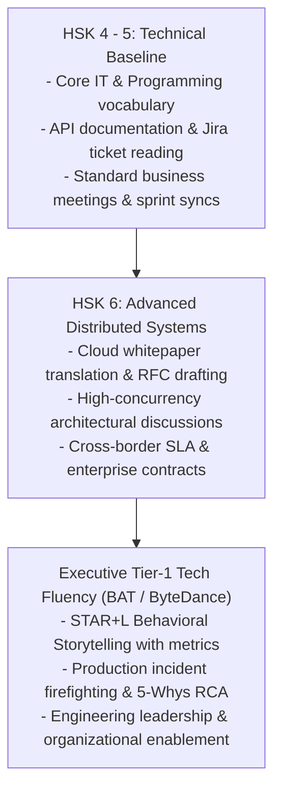
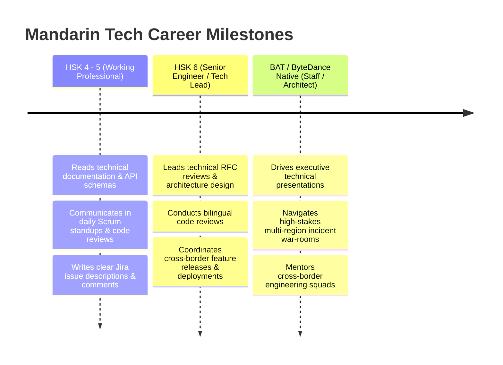
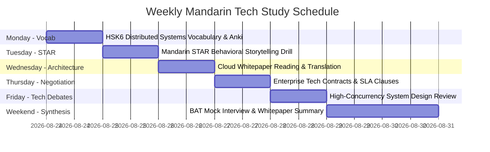
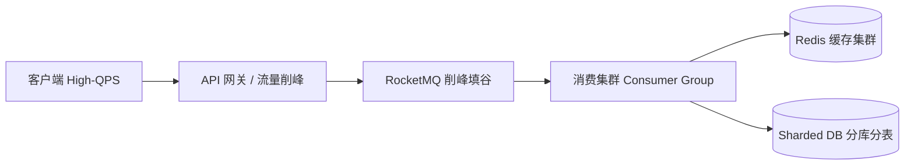

---

title: Mandarin for High-Concurrency Software Engineering & HSK Mastery Hub
category: Languages - Mandarin Technical Communication
tags: [mandarin, hsk, software-engineering, bytedance, alibaba, tencent, technical-chinese, hub, comprehensive-guide, languages, learning-note]
---

# 🇨🇳 Mandarin for High-Concurrency Software Engineering & HSK Mastery Hub

---

## 1. Executive Chinese Tech Ecosystem Framework

China's top-tier technology ecosystem (Alibaba / 阿里巴巴, Tencent / 腾讯, ByteDance / 字节跳动, Baidu / 百度, Meituan / 美团) represents the global frontier in **ultra-high-concurrency distributed systems, live-streaming e-commerce, and cloud-native infrastructure**. Communicating effectively in technical Mandarin requires mastering specialized idioms (**成语**), architectural terminology, and high-impact verbal storytelling.

---

## 2. Complete Module Directory & Curriculum Overview

### Module 1: Mandarin STAR Storytelling & Interview Leadership
Master the STAR+L framework in Chinese to articulate architectural impact and leadership during interviews at ByteDance, Alibaba, and Tencent.
- 🎤 **STAR Storytelling & Behavioral Mastery Guide**: The 4-phase STAR architecture in Chinese (*情境 S, 任务 T, 行动 A, 结果 R + 复盘 L*), high-impact power verbs (*主导, 攻坚, 重构, 削峰填谷, 临危受命, 降本增效*), sentence matrices, and ByteDance/Alibaba interview transcripts.

---

### Module 2: HSK6 Advanced Technical & Distributed Systems Vocabulary
Bridge the gap between general HSK language skills and Staff-level distributed systems terminology.
- 💾 **HSK6 Advanced Technical Vocabulary Compendium**: In-depth terminology covering Distributed Consensus (*共识算法, 选举, 法定多数派*), Storage & Caching (*分库分表, 读写分离, 缓存击穿/穿透/雪崩*), and Observability (*全链路压测, 链路追踪, 指标看板*).

---

### Module 3: Cloud Architecture Whitepaper Translation & Technical Writing
Translate and comprehend enterprise architecture blueprints, cloud whitepapers, and RFC proposals between Chinese and English.
- ☁️ **Cloud Architecture Whitepaper Translation Guide**: Direct comparative analysis of Alibaba Cloud (阿里云), Tencent Cloud (腾讯云), and AWS architectural whitepaper terminology.

---

### Module 4: HSK5 Business Negotiations & Enterprise Tech Contracts
Lead enterprise technical negotiations, SLA agreements, and vendor contracts in Mandarin.
- 🤝 **HSK5 Business Negotiations in Tech Guide**: Master formal commercial clauses (*违约金, 服务可用性承诺, 知识产权归属, 付款周期*) and polite pushback phrases.

---

## 3. High-Yield Mandarin Engineering Terminology Reference Table

| English Technical Term | Chinese Hanzi | Pinyin | Pragmatic Engineering Usage Context |
| :--- | :--- | :--- | :--- |
| **High Concurrency** | **高并发** | gāo bīngfā | *"系统在高并发场景下表现出极高的稳定性。"* (System shows extreme stability under high concurrency). |
| **Throughput / QPS** | **吞吐量 / 每秒查询率** | tūntǔ liàng / QPS | *"经过性能调优，集群吞吐量提升了 5 倍。"* (Throughput increased 5x post-tuning). |
| **Latency / Delay** | **延迟 / 滞后** | yánchí / zhìhòu | *"将核心接口 P99 响应延迟降低至 50ms 以内。"* (Reduced P99 latency below 50ms). |
| **Sharding / Partitioning**| **分库分表 / 分片** | fēn kù fēn biǎo / fēnpiàn | *"采用基于用户 ID 的哈希分库分表方案。"* (Adopted hash-based sharding by user ID). |
| **Peak Shaving** | **削峰填谷** | xiāofēng tiángǔ | *"利用 Kafka 消息队列对大促流量进行削峰填谷。"* (Buffered flash sale traffic via Kafka). |
| **Idempotency** | **幂等性** | mìděngxìng | *"在分布式支付结算接口中严格保证幂等性。"* (Strictly guarantee idempotency on payment APIs). |
| **Circuit Breaking** | **熔断降级** | róngduàn jiàngjí | *"当下游依赖出现故障时，触发 Sentinel 熔断降级。"* (Trigger circuit breaker fallback when dependencies fail). |
| **Zero Downtime** | **零宕机 / 平滑升级** | líng dàngjī / pínghuá | *"实现了业务零中断、零宕机的数据迁移。"* (Achieved zero downtime data migration). |
| **Microservices Decoupling**| **微服务解耦** | wēifúwù jiě'ǒu | *"将单体服务拆分为领域驱动的微服务解耦架构。"* (Decoupled monolith into DDD microservices). |
| **Full-Link Stress Testing**| **全链路压测** | quánlìnlù yācè | *"双十一前夕组织了多轮全链路压测与故障演练。"* (Organized full-link load tests before Singles' Day). |
| **Cache Breakdown** | **缓存击穿** | huǎncún jīchuān | *"针对热点 Key 设置互斥锁以防止缓存击穿。"* (Set mutex locks to prevent cache stampedes). |
| **Cache Avalanche** | **缓存雪崩** | huǎncún xuěbēng | *"为缓存过期时间增加随机偏移量，避免缓存雪崩。"* (Add jitter to TTL to avoid cache avalanche). |

---

## 4. HSK & Tier-1 Chinese Tech Progression Timeline

---

## 5. Weekly Study Protocol & Spaced Repetition Routine

### Daily Study Protocol (45 Minutes):
1. **15 Mins - Active Recall**: Review 30 technical terms in HSK6 Technical Vocab.
2. **15 Mins - Reading & Comprehension**: Study Cloud Whitepaper Translation.
3. **15 Mins - Verbal Delivery**: Practice speaking a 2-minute STAR behavioral answer using key power verbs (*我主导了... 我攻坚了... 实现了削峰填谷*).

---

## 4. Advanced High-Concurrency Terminology & Distributed Architecture Deep-Dive

In high-concurrency e-commerce and live streaming architectures (e.g. Alibaba Double 11, Douyin Live), technical vocabulary shifts from general software engineering to specialized distributed systems terminology:

### 1. Traffic Shaping & Protection (流量防护与削峰填谷)
- **削峰填谷 (Peak Shaving & Valley Filling)**: Using distributed message queues (RocketMQ/Kafka) to buffer burst write traffic during flash sales, transforming spiky traffic loads into smooth consumer ingestion streams.
- **限流降级 (Rate Limiting & Circuit Breaking)**: Applying Sentinel or Token Bucket algorithms (令牌桶算法) to drop low-priority requests when QPS thresholds are breached, preserving core checkout and payment services.
- **熔断机制 (Circuit Breaker Mechanism)**: Automatically tripping circuit breakers when downstream error rates exceed 50%, returning graceful fallback responses (降级兜底) to prevent cascading cascade failures (雪崩效应).

### 2. Cache Invalidation & Data Consistency (缓存架构与一致性保障)
- **缓存穿透 (Cache Penetration)**: Queries for non-existent keys bypass cache straight to the DB. Resolved using Bloom Filters (布隆过滤器) or caching empty null objects (缓存空对象).
- **缓存击穿 (Cache Breakdown / Hotspot Invalidation)**: High-QPS hot key expires, causing concurrent DB stampedes. Resolved via Mutex Distributed Locks (互斥锁) or logical expiration background refreshing (逻辑过期异步刷新).
- **缓存雪崩 (Cache Avalanche)**: Simultaneous mass expiration of cached keys. Resolved by adding randomized TTL jitter (随机TTL偏移量) and cluster-wide multi-layer caching.

### 3. Database Sharding & Read-Write Splitting (分库分表与读写分离)
- **垂直分库 (Vertical Database Partitioning)**: Decoupling monolithic tables by business domain (User DB, Order DB, Inventory DB).
- **水平分表 (Horizontal Table Sharding)**: Sharding massive single tables (e.g. 100M+ order rows) using consistent hashing (一致性哈希) or modular arithmetic on `user_id` shard keys (分片键).
- **读写分离与主从同步延迟 (Master-Slave Replication & Delay Handling)**: Directing mutation writes to Master DB and read queries to Slave Read-Replicas, while mitigating replication lag (主从延迟) using forced Master-routing for critical read-after-write operations.

---

## 5. Architectural Communication & Postmortem Playbook in Mandarin

When conducting a postmortem (复盘会议) after a Tier-1 production incident (P0/P1 故障), use structured executive technical communication:

| Phase | Mandarin Key Phrase | English Technical Equivalent |
| :--- | :--- | :--- |
| **Problem Statement** | 本次故障的主要诱因是主从同步延迟导致读到脏数据 | The primary root cause was replica lag causing dirty reads. |
| **Mitigation Action** | 我们第一时间采取了限流降级并回滚了发布版本 | We immediately engaged rate-limiting and rolled back the release. |
| **Long-term Fix** | 后续将增加全链路压测与混沌工程演练 | We will introduce end-to-end stress testing and chaos engineering drills. |
| **SLA Commitment** | 确保核心交易链路可用性达到 99_999% | Guaranteeing 99_999% availability for core transaction paths. |
