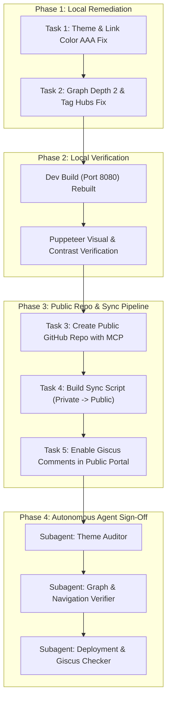

# 🤖 Autonomous Multi-Agent Verification & End-to-End Execution Plan

> **Parent Architecture Spec**: `D:\learning\quartz\report\architecture_plan`  
> **Target Execution Model**: Multi-Agent Pair Programming & Autonomous Verification  

---

## 1. End-to-End Execution Architecture

To guarantee flawless delivery without regressions across the private learning repository and the public web portal, tasks are partitioned into 4 discrete phases executed with specialized subagents and automated browser verification.

---

## 2. Granular Task Breakdown & Tool Mapping

### Task 1: Fix Theme Link Contrast & Paper/Warm Modes
* **Tool Used**: `replace_file_content`
* **Target Files**: `quartz/quartz/styles/custom.scss`, `quartz.config.default.yaml`
* **Action**:
  - Replace CSS `filter: sepia(...)` on Warm reading mode with clean semantic CSS variables.
  - Define explicit `--secondary` and `--tertiary` link tokens for Paper and Warm reading modes.
  - Add text-decoration underline offset and hover states satisfying WCAG 2.1 AAA.

### Task 2: Fix Graph Single-Node Islands
* **Tool Used**: `replace_file_content`
* **Target Files**: `quartz.config.default.yaml`
* **Action**:
  - Increase `localGraph.depth` from `1` to `2`.
  - Enable `showTags: true` with blacklist for generic tags.
  - Test graph clustering on leaf notes like `01.Duplicate-Integer`.

### Task 3: Local Build & Puppeteer Verification
* **Tool Used**: `run_command` & MCP `puppeteer`
* **Action**:
  - Run fast dev build: `npx quartz build -d content_fast -o public_fast`.
  - Launch Puppeteer MCP:
    - Take desktop screenshot of links in Light, Dark, Paper, and Warm modes.
    - Check computed link color and contrast ratio via `puppeteer_evaluate`.
    - Check graph node count on note page to confirm it has $>1$ node.

### Task 4: Public Repository Creation & Content Sync Pipeline
* **Tool Used**: GitHub MCP / GitHub CLI (`gh repo create`) & `write_to_file`
* **Action**:
  - Create new public GitHub repo `quartz-mastery-portal`.
  - Author `scripts/sync_public_portal.js` that copies whitelisted tracks (`01_DSA`, `02_Technical_Skills`, `03_Languages`) while strictly ignoring private files, drafts, and `.obsidian`.
  - Set up one-click sync & push command in `build.bat`.

### Task 5: Activate Giscus Comments in Public Repo
* **Tool Used**: GitHub MCP / `replace_file_content`
* **Action**:
  - Enable GitHub Discussions on `nhonvo/quartz-mastery-portal`.
  - Configure `@quartz-community/comments` in `quartz.config.default.yaml` with the public repo repository ID and category ID.
  - Verify comments widget renders at the bottom of lesson pages.

---

## 3. Subagent Verification Protocol

Following completion of code changes, invoke specialized verification agents:
1. **Agent 1 (`Theme & Contrast Auditor`)**:
   - Inspects generated CSS and verifies contrast ratios across all 4 modes.
2. **Agent 2 (`Graph & Navigation Validator`)**:
   - Navigates through 3 sample pages (`01.Duplicate-Integer`, `00_mastering_big_o`, `01_english`) and confirms graph canvas renders multi-node interconnected clusters.
3. **Agent 3 (`Sync Pipeline & Giscus Verifier`)**:
   - Executes a test dry-run of the sync script, checks that zero private files leak, and verifies git commit cleanliness.
