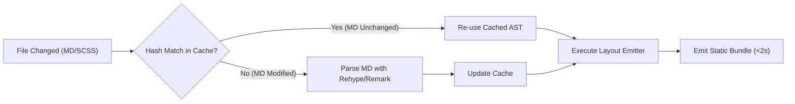

# ⚙️ Technical Architecture, Build Pipeline & Edge CDN Backlog Specification

> **Parent Roadmap**: [`00_master_roadmap_executive_summary.md`](file:///d:/learning/quartz/report/backlog_roadmap/00_master_roadmap_executive_summary.md)  
> **Module**: Build Systems, Performance Engineering, Edge CDN & Automated Testing  
> **Target Scripts**: `D:\learning\build.bat`, `quartz/scripts/stage_content.js`, `quartz/quartz.config.default.yaml`  

---

## 1. Problem Statement & Pipeline Friction

The project operates a dual-build workflow designed to balance fast feedback during editing against full-site production deployments:
- **Fast Build Mode** (`content_fast`): Compiles ~14 key entry files in **~6 seconds** (used on Port 8080).
- **Full Build Mode** (`content`): Compiles all **1,278 markdown files** in **~45-60 seconds** (used for Port 3000 Stage and production releases).
- **Production Deployment to Vercel**: `build.bat` provides 3 deployment options:
  - Option 5: Local build + upload bundle.
  - Option 6: Instant Deploy (Assets Only, skips markdown reparse).
  - Option 7: Push Git branch for remote cloud build.

While highly effective, the current pipeline has technical bottlenecks:
1. **Redundant Reparsing**: When only a CSS stylesheet or single layout component is tweaked, the entire full build re-parses all 1,278 files from scratch.
2. **Asset Payload Size**: Images under `assets/` and screenshots are served uncompressed as raw PNGs, impacting mobile lighthouse scores.
3. **No Automated Visual Regression**: Changes to global CSS (such as custom search bars or drawer layouts) require manual visual spot-checking across multiple viewports.

---

## 2. Comprehensive Pipeline Enhancement Backlog

### 🟢 TECH-01: Incremental Hash Caching & AST Memorization Engine (P0)
* **Goal**: Enable instantaneous sub-2-second rebuilds even when compiling the full 1,278-file workspace.
* **Architecture Design**:
  - Implement content hash checking (`SHA-256` of markdown content + frontmatter).
  - Store parsed ASTs in `.quartz_cache/ast_cache.json`.
  - On rebuild, only files with modified content hashes or modified transclusion dependencies are re-tokenized and emitted.
  - When only `.scss` or Preact component files change, skip AST parsing entirely and only re-execute the layout emitter.

---

### 🟢 TECH-02: Automated Playwright Visual Regression CI Test Suite (P1)
* **Goal**: Prevent inadvertent UI regressions across theme toggles, search modals, and mobile drawers before pushing to production.
* **Test Plan**:
  - Add `scripts/test-visual-regression.mjs` executing headless Chromium tests across standard matrix:
    - **Desktop**: 1440x900 (Verifies desktop search pill, 3-column grid, graph controls).
    - **Tablet**: 768x1024 (Verifies left drawer auto-collapse, TOC behavior).
    - **Mobile**: 375x812 (Verifies header buttons, mobile search modal trigger, TOC FAB).
    - **Themes**: Light, Dark, Paper, and OLED.
  - Integrated directly into `build.bat` before executing Option 5 or Option 7 production deploys.

---

### 🟢 TECH-03: Next-Gen Image & Asset Optimization Pipeline (P1)
* **Goal**: Optimize all cheatsheets, architecture diagrams, and mindmaps for sub-second mobile page loads.
* **Implementation Plan**:
  - Add an automated Sharp/Squoosh asset processor in `scripts/optimize_assets.js`.
  - Convert all screenshots and diagram PNGs in `assets/` into responsive WebP / AVIF formats.
  - Add `loading="lazy"` and explicit `width`/`height` dimensions to prevent layout shifts (CLS).

---

### 🟢 TECH-04: Offline Progressive Web App (PWA) & Service Worker (P2)
* **Goal**: Allow students to read algorithms, review flashcards, and browse documentation completely offline on laptops and mobile devices during commutes.
* **Features**:
  - Lightweight Service Worker caching all core assets (`index.css`, `index.js`, search indexes, and recently visited note HTMLs).
  - Installable PWA manifest with desktop & mobile home-screen icons.
