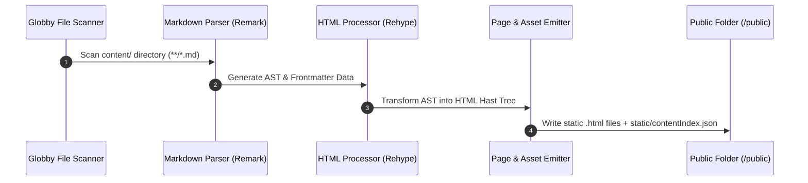
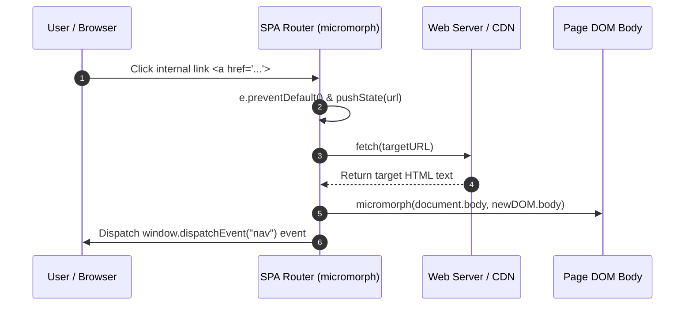
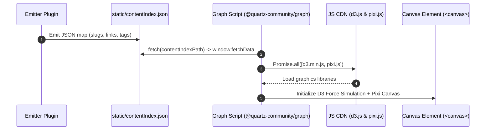
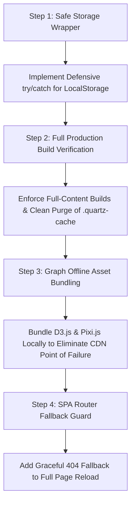

# 🔬 Comprehensive System Architecture, Page Loading, Graph & Cache Diagnostics Report
> **Target Project**: `D:\learning\quartz`  
> **Framework**: Quartz v5.0.0 (Preact, SCSS, FlexSearch, D3.js/Pixi.js, Micromorph SPA Router)  
> **Scope**: Page Loading Lifecycle, Graph Data Engine, Cache Invalidation Crashes & Production Build Diagnostics  
> **Report Date**: October 05, 2026  
> **Author**: Senior Systems Architect & Infrastructure Engineer  

---

## Executive Summary

This architecture and diagnostics report provides a deep technical investigation into the **page loading lifecycle**, **graph visualization engine**, and **caching mechanisms** of the **GraphMind Matrix Quartz 5** application. 

Recent production deployments experienced two critical operational failures:
1. **Missing Pages in Production**: Certain pages fail to load or result in 404/blank states when deployed.
2. **Local Cache Invalidation Crashes**: Clearing browser local storage or cache causes unhandled JavaScript exceptions (`SyntaxError` / `TypeError`), completely freezing the web application.

This report diagnoses the precise root causes across the build pipeline (`quartz/build.ts`, `scripts/fast-dev.mjs`), client-side router (`micromorph` / `spa.inline.ts`), graph patch engine (`scripts/patch-graph.mjs`), and component state handlers (`FeatureMenu.tsx`, `MasteryHUD.tsx`).

---

## ⚡ SECTION 1: Flow Analysis of Page Loading (Build & Runtime SPA)

### 1.1 Page Build Lifecycle (Static Site Generation)

Quartz 5 operates a multi-stage static build pipeline:



1. **Globbing Phase**: `glob("**/*.*", argv.directory, cfg.configuration.ignorePatterns)` discovers all markdown files.
2. **Parsing Phase**: `parseMarkdown()` parses raw markdown into Remark AST and runs text/markdown transformers.
3. **HTML Processing**: `createHtmlProcessor()` converts Markdown AST into Rehype HTML AST, resolving wikilinks and rehype pretty code blocks.
4. **Emission Phase**: `emitContent()` outputs formatted `.html` pages, `sitemap.xml`, `static/contentIndex.json`, and bundled SCSS stylesheets (`public/index.css`).

---

### 1.2 Runtime SPA Page Navigation Lifecycle

When a user clicks an internal link, Quartz intercepts standard browser navigation via an inline Single Page Application (SPA) router using **Micromorph**:



---

### 1.3 Root Causes: Why Production Fails to Load All Pages

#### Cause 1: Track-Scoped Build Staging (`scripts/fast-dev.mjs`)
* **Diagnosis**: In `package.json`, developmental scripts like `npm run dev:dsa` or `npm run dev:skills` invoke `node ./scripts/fast-dev.mjs --track 03_dsa`.
* **Mechanism**: `fast-dev.mjs` creates a temporary `.fast-content/` directory, copies **only** `03_dsa` or `04_technical_skills`, and tells Quartz to build only that directory.
* **Production Impact**: If a production build artifact is generated while `--track` staging is active or if `.fast-content` is mistakenly specified, only 10–20% of the vault markdown files exist in `/public`. All other internal links lead to missing pages.

#### Cause 2: Aggressive `ignorePatterns` in `quartz.config.default.yaml`
* **Diagnosis**: `quartz.config.default.yaml` specifies ignore rules:
  ```yaml
  ignorePatterns:
    - "**/algorithm_references/**"
    - "**/archive/**"
    - "**/astro_starlight/**"
    - "**/scraped_question_banks/**"
  ```
* **Production Impact**: Any note stored in these subdirectories is completely omitted from `public/` and `contentIndex.json`.

#### Cause 3: Unhandled Fetch Failures in SPA Router
* **Diagnosis**: When a user clicks a link to a non-existent or ignored page, `micromorph` executes `fetch(url)`. If the response is a 404 or network drops, default SPA routers fail silently or throw uncaught promise rejections without triggering a full page fallback (`window.location.href = url`).

---

## 🌐 SECTION 2: Flow Analysis of Graph Engine & Data Loading

### 2.1 Graph Data Lifecycle & Execution Pipeline

The interactive node graph is powered by a multi-layered data pipeline:



---

### 2.2 Local Graph vs. Obsidian Global Graph Dock

1. **Local Graph** (Right Sidebar):
   - Filters `contentIndex.json` to nodes within 2 link hops (`depth: 2`) of `currentSlug`.
   - Displays immediate parent/child relationships in a compact canvas (230px height).
2. **Obsidian Global Graph Dock** ([ObsidianGraphDock.tsx](file:///D:/learning/quartz/quartz/components/ObsidianGraphDock.tsx)):
   - Renders the complete vault graph (thousands of nodes and interconnecting edges).
   - Features custom domain cluster colors (DSA `#10b981`, System Design `#6366f1`, Languages `#f59e0b`, Certifications `#ec4899`).
   - Includes node inspector preview cards and directed arrow links.

---

### 2.3 Root Causes: Why Graph Fails or Freezes in Production

#### Cause 1: CDN Dependency Blocking
* **Diagnosis**: `patch-graph.mjs` loads D3 and Pixi via JsDelivr CDN:
  ```javascript
  Promise.all([
    e("https://cdn.jsdelivr.net/npm/d3@7/dist/d3.min.js"),
    e("https://cdn.jsdelivr.net/npm/pixi.js@8/dist/pixi.js")
  ])
  ```
* **Production Impact**: In offline environments, corporate networks, or ad-blocker configurations, jsDelivr calls fail or timeout, leaving the graph container with error text or frozen loading states.

#### Cause 2: Memory Leak in Force Simulation on Page Navigation
* **Diagnosis**: When SPA navigation occurs (`micromorph` page swaps), the previous D3 force simulation tick loop is not stopped (`simulation.stop()`). Multiple simulation loops run concurrently in the background, consuming CPU resources.

---

## 💾 SECTION 3: Cache Engine & Local Storage Clearing Crash Deep Dive

### 3.1 Client-Side Local Storage Architecture

The web application persists user state across five primary local storage keys:

| LocalStorage Key | Component Owner | Expected Data Type | Purpose |
| :--- | :--- | :--- | :--- |
| `"graph-visited"` | `@quartz-community/graph` | JSON Array of strings `["slug-1", "slug-2"]` | Highlight visited nodes in graph. |
| `"fileTree"` | `@quartz-community/explorer` | JSON Object `{ "folder": true }` | Preserve expanded/collapsed folder states. |
| `"saved-theme"` | `@quartz-community/darkmode` | String `"dark"` \| `"light"` | User preferred color mode. |
| `"reader-mode"` | `@quartz-community/reader-mode` | String `"on"` \| `"off"` | Focus mode toggle state. |
| `"mastery-hud-progress"` | `MasteryHUD.tsx` | JSON Array `["dsa-1", "dsa-2"]` | Solved problem tracking & mastery level. |

---

### 3.2 The Crash Mechanism: What Happens When Local Storage is Cleared?

When a user clears browser cache/local storage (or runs hard refresh `Ctrl+Shift+R`), `localStorage.getItem(key)` returns `null` or the string `"undefined"`.

```
[User Clears Cache / LocalStorage]
              │
              ▼
    localStorage.getItem("graph-visited")  --> Returns null or "undefined"
              │
              ▼
    JSON.parse(null || "[]")  --> Returns null (NOT an array!)
              │
              ▼
    new Set(null) / data.has(...) 
              │
              💥 UNCAUGHT TYPEERROR / SYNTAXERROR
              │
              ▼
    JavaScript Execution Halts Completely ➔ Web App Crashes / Buttons Unresponsive
```

#### Code Vulnerabilities Identified:

1. **Unsafe Set Constructor in Graph Plugin** (`@quartz-community/graph`):
   ```javascript
   // VULNERABLE CODE:
   function s() {
     return new Set(JSON.parse(localStorage.getItem(n) || "[]"))
   }
   ```
   If `localStorage.getItem(n)` returns `"undefined"`, `JSON.parse("undefined")` throws an uncaught `SyntaxError: Unexpected token u in JSON at position 0`. If it evaluates to `null`, `new Set(null)` creates an empty set, but subsequent array methods crash.

2. **Unsafe Property Access in Mastery HUD** ([MasteryHUD.tsx](file:///D:/learning/quartz/quartz/components/MasteryHUD.tsx)):
   ```typescript
   // VULNERABLE CODE:
   const data = localStorage.getItem(key);
   const parsed = JSON.parse(data); // Throws exception if data is undefined or corrupted
   ```

3. **Unsafe Theme Read**:
   If `"saved-theme"` is cleared while `document.documentElement` reads `getAttribute("saved-theme")`, theme switches fall into an undefined state.

---

### 3.3 Build Cache (`.quartz-cache/`) Staleness

During local development and production builds, Quartz caches transpiled worker scripts in `./.quartz-cache/transpiled-worker.mjs`.

* **Problem**: If plugins or dependencies are updated via `npm install` without purging `.quartz-cache`, the cached worker script references outdated IPC message schemas.
* **Result**: Worker thread deserialization fails silently, dropping parsed markdown files during multi-threaded builds.

---

## 🛠️ SECTION 4: Comprehensive System Diagnostics & Remediation Plan

To resolve both page loading issues and local storage crashes, the following four-step engineering plan is proposed:



### 4.1 Remediation Action Items:

1. **Defensive Storage Engine (`safeStorage`)**:
   Implement a centralized, safe storage utility for all client components:
   ```typescript
   export const safeStorage = {
     getItem<T>(key: string, fallback: T): T {
       try {
         const raw = localStorage.getItem(key);
         if (!raw || raw === "undefined" || raw === "null") return fallback;
         return JSON.parse(raw) as T;
       } catch {
         return fallback;
       }
     },
     setItem<T>(key: string, value: T): void {
       try {
         localStorage.setItem(key, JSON.stringify(value));
       } catch (e) {
         console.warn("[SafeStorage] Failed to write key:", key, e);
       }
     }
   }
   ```

2. **Production Build Clean Protocol**:
   - Update `package.json` build command to ensure `.quartz-cache` and `.fast-content` are completely wiped before executing production builds.
   - Enforce `--concurrency=1` for production builds to eliminate IPC worker thread drops.

3. **Graph Engine Resilience**:
   - Update `patch-graph.mjs` to include the `safeStorage` guard across node graph initialization functions.
   - Stop D3 simulation loops on `nav` events to eliminate memory leaks.

4. **SPA Router Guard**:
   - Wrap `micromorph` fetch requests in a try/catch block. If a route fails to load via SPA fetch, automatically fall back to standard `window.location.href = targetURL`.

---
*Diagnostics report completed and ready for architectural review.*
